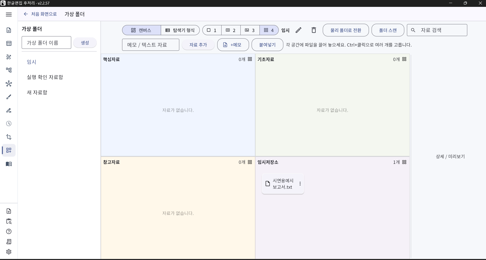
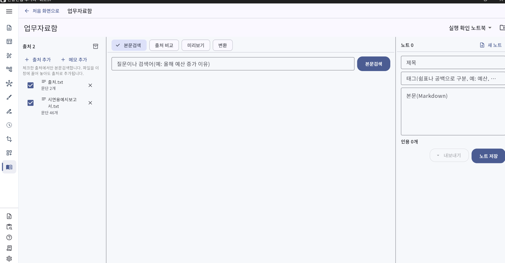
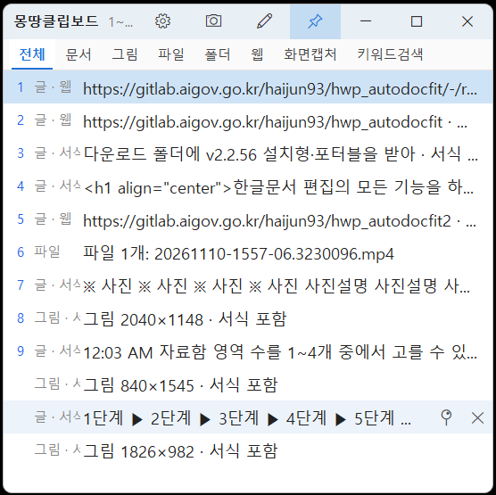

<h1 align="center">한글편집 후처리</h1>

<a href="#korean">한국어</a> · <a href="#english">English</a>

<h2 align="center">⬇️ 지금 내려받기 · 최신 v2.2.64</h2>

| 내려받는 곳 | 설치형 (Setup, 187MB) | 포터블 (Portable, 209MB) |
|:---:|:---:|:---:|
| GitHub | [설치형 내려받기](https://github.com/haijun93/hwp-auto-docfit/releases/download/v2.2.64/HWP_AutoDocFit_v2.2.64_Setup.exe) | [포터블 내려받기](https://github.com/haijun93/hwp-auto-docfit/releases/download/v2.2.64/HWP_AutoDocFit_v2.2.64_Portable.exe) |

실행 파일과 함께 **기능시연용 예시문서** [예시문서 내려받기](https://github.com/haijun93/hwp-auto-docfit/releases/download/v2.2.64/report-example-all-in-one.txt) (`[모의데이터]문서편집_작업방식(한번에적용) 기능시연용문서.txt`)도 받아 두세요. 프로그램의 「한 번에 적용」에 이 문서를 넣으면 시연 영상과 같은 결과를 바로 확인할 수 있습니다.

**설치형**은 설치 후 시작 메뉴에서 실행하고, **포터블**은 설치 없이 파일을 바로 실행합니다. Windows 10·11용이며, 문서 편집 기능에는 한컴오피스 한/글이 필요합니다.

<h1 align="center">한글 보고서 작업의 반복 업무를 줄이는 오프라인 행정업무 지원 도구</h1>

<strong>오프라인 · 폐쇄망 사용 가능 · 원본 보존 · 한/글 연동</strong>

<!-- DEMO:START -->

## 시연 영상

https://github.com/user-attachments/assets/ed8a6b89-70c6-4459-8cff-bebefb8c4d54

<!-- DEMO:END -->

## 개발 배경

행정업무에서는 보고서 작성이 끝난 뒤에도 내어쓰기, 자간 조정, 항목기호 정리, 표 작성, 쪽 맞춤, 파일 변환 등 반복적인 후처리 작업에 많은 시간과 노력이 필요합니다.

이 도구는 이러한 규칙화된 반복 업무를 자동화하여 보고서 작성 시간을 줄이고, 문서의 완성도와 업무 효율을 높이기 위해 개발되었습니다.

문서 편집 기능뿐 아니라 파일 변환, PDF 병합·압축, 파일명 일괄 변경, 표·이미지·다이어그램 편집, 자료 검색, 클립보드 관리 등 행정업무에서 자주 사용하는 기능을 하나의 프로그램에 통합한 것이 특징입니다.

작동 환경

- 외부 AI나 서버를 호출하지 않는 오프라인 방식
- 폐쇄망 환경에서 사용 가능
- 한컴오피스 한/글과 연동
- 원본 문서는 보존하고 처리 결과를 별도 파일로 저장
- 설치형 및 포터블 Windows 실행 파일 지원

## 기능 살펴보기

### 1. 문서 편집 자동화

다음과 같은 한글 문서 후처리 작업을 자동으로 수행합니다.

<table>
<tr>
<td width="50%"></td>
<td width="50%"></td>
</tr>
</table>

세부 기능과 사용 방법

- 자간 정리
- 내어쓰기와 문단 위계 정리
- 항목기호 및 목차 체계 정리
- 서식 통일
- 문서 쪽 맞춤
- 표 서식 정리
- 예시 보고서 기반 서식 분석 및 등록

예시 보고서를 프로그램에 끌어 놓으면 제목표, 개요표, 장·절·소제목, 본문, 표 등 문서 구조와 서식을 분석하여 사용자 서식 프로파일로 등록할 수 있습니다.

처음 사용할 때는 함께 제공되는 예시 보고서 `[모의데이터]문서편집_작업방식(한번에적용) 기능시연용문서.txt`로 「한 번에 적용」을 바로 체험해 볼 수 있습니다. 이 예시는 시연 영상에 쓰인 보고서와 같습니다.

### 2. 표 템플릿 및 표그림판

자주 사용하는 표 서식을 템플릿으로 저장하고 필요할 때 선택해 사용할 수 있습니다.

<table>
<tr>
<td width="50%"></td>
<td width="50%"></td>
</tr>
</table>

새로운 표가 필요한 경우에는 표그림판에서 그림을 그리듯 행과 열을 구성하고, 셀을 병합하거나 분할하며, 선과 배경을 편집할 수 있습니다.

### 3. 다이어그램·마인드맵·붙임사진 편집

보고서 작성에 필요한 다음 요소를 직접 편집할 수 있습니다.

<table>
<tr>
<td width="50%"></td>
<td width="50%"></td>
</tr>
</table>

세부 기능과 사용 방법

- 업무 흐름도
- 다이어그램
- 마인드맵
- 붙임사진
- 사진 설명과 배치
- 도형과 연결선

마인드맵은 하나의 중심 도형을 기준으로 하위 도형을 계속 추가할 수 있으며, 도형과 연결선을 자유롭게 이동·수정·삭제할 수 있습니다.

### 4. 파일 변환

자주 사용하는 문서와 이미지 파일을 다양한 형식으로 변환할 수 있습니다.

세부 기능과 사용 방법

- HWP·HWPX
- PDF
- PNG·JPG 등 이미지
- TXT·Markdown
- DOCX
- XLSX·CSV 등

PDF 병합과 압축 기능을 제공하여 전자결재 첨부파일 용량 제한에도 대응할 수 있습니다.

### 5. 파일명 일괄 변경

여러 파일의 이름을 일정한 규칙에 따라 한 번에 변경할 수 있습니다.

날짜, 문서 종류, 순번, 기관명 등의 규칙을 적용하여 업무자료를 체계적으로 정리할 수 있습니다.

### 6. AI 답변의 공문서 형식 변환

ChatGPT, Gemini, Claude 등 웹서비스에서 작성한 답변을 그대로 복사해 붙여 넣으면 다음 작업을 자동으로 수행합니다.

세부 기능과 사용 방법

- `>`, `**`, `[1]` 등 불필요한 기호 제거
- Markdown과 HTML 잔여 서식 정리
- 제목과 본문 위계 분석
- `□·ㅇ·-·•` 등 공문서 개조식 체계로 변환
- 문장 단위와 항목 단위 재구성

AI 답변을 공문서 보고서에 바로 활용할 수 있도록 정리합니다.

### 7. 몽땅검색

PC에 흩어진 작업 파일을 파일명·본문·위계로 한곳에서 찾고, 시간순 타임라인으로 이전 버전과 변경 이력을 확인할 수 있습니다. (이전 이름: 타임머신)

- **세 가지 검색**: 파일명 검색, 본문검색, 위계검색을 메뉴로 바꿔 가며 쓸 수 있습니다.
- **검색어 공유**: 세 메뉴가 같은 검색어를 함께 쓰므로, 메뉴를 바꾸면 입력한 검색어로 바로 다시 찾습니다.
- **실시간 검색**: 2글자 이상 입력하면 Enter 없이 바로 결과를 보여 줍니다.
- **문서 열기**: 검색 결과나 타임라인에서 문서를 바로 엽니다.
- **연관 문서 찾기**: 타임라인에서 선택한 문서와 관련된 문서를 「위계검색」으로 찾을 수 있습니다.

문서를 언제 수정했는지, 어떤 작업본이 최신인지, 이전 결과물을 다시 찾아야 하는지 확인할 때 활용할 수 있습니다.

### 8. 위계검색

위계검색은 문서의 목차와 구조를 분석하여 검색 결과의 우선순위를 정하는 기능입니다. 몽땅검색과 업무자료함에서 사용할 수 있습니다.

세부 기능과 사용 방법

일반적인 검색은 문서에 포함된 단어나 문장의 유사도만 비교하지만, 위계검색은 다음과 같은 문서 구조를 함께 고려합니다.

- 문서 제목
- 장
- 절
- 중제목
- 소제목
- 본문
- 부연설명
- 표 제목과 표 내용

검색어가 제목이나 장·절과 같은 높은 위계에서 발견될수록 더 높은 정보가치를 부여합니다.

예를 들어 “공공 AI 대전환”을 검색하면 해당 단어가 본문에만 포함된 문서보다 제목이나 장·절에서 발견된 문서를 우선적으로 보여줍니다.

검색 결과는 단순한 파일명뿐 아니라 다음과 같은 문서 경로를 함께 표시할 수 있습니다.

> 2026년 업무보고 > 제2장 주요 추진사업 > 2.1 공공 AI 대전환

#### 독자 개발 검색 엔진 (개발 중)

본문검색·위계검색에 쓸 검색 엔진(kfind)을 외부 검색 엔진을 가져다 쓰지 않고 Rust로 직접 개발하고 있습니다. v2.2.65부터 앱 안 검색(본문검색·위계검색)은 이 엔진을 기본으로 쓰고, 엔진이 응답하지 않으면 기존 방식으로 자동 대체합니다. 엔진 코드는 이 저장소의 `kfind/`·`crates/kfind/`에 공개되어 있습니다.

- 문장 단위 다중 단어 검색: 여러 단어가 같은 문장 안에 함께 나오는 경우를 색인 단계에서 바로 판정합니다.
- 한국어 부분 일치: 2글자 조각 단위로 색인하여 조사·어미가 붙은 단어도 찾습니다.
- 가벼운 색인: 압축 단어 사전(FST)과 압축 비트맵(Roaring)으로 색인 크기와 메모리 사용을 줄입니다.

개발 중인 엔진의 자체 시험(문서 3,000개)에서 색인 8.9초·색인 크기 32MB, 검색 1회 엔진 처리 시간 1.4ms 이하로 측정되었습니다. 실제 사용 환경의 성능은 자료의 양과 PC 사양에 따라 다릅니다.

### 9. 가상 폴더

여러 문서를 참고해 하나의 보고서를 작성할 때 원본 파일을 별도 폴더에 복사하지 않고, 원본에 대한 참조만 가상 폴더에 모아 관리할 수 있습니다.

가상 폴더는 별도의 가벼운 창(`kvf.exe`)으로 열리며, 자료를 핵심자료·기초자료·참고자료·임시저장소 영역별로 나누어 빠르게 찾아볼 수 있습니다.

이 기능을 사용하면 원본과 복사본이 뒤섞이는 문제를 줄일 수 있습니다. 필요한 경우 가상 폴더의 자료를 실제 물리 폴더로 전환할 수도 있습니다.

### 10. 업무자료함 (오프라인 노트북)

Gemini Notebook과 유사한 개념을 오프라인 환경에서 구현한 기능입니다.

업무 관련 법령, 매뉴얼, 과거 보고서, 참고자료 등을 주제별 정보 묶음(출처 목록)으로 관리하고, 해당 자료 안에서만 검색하여 필요한 내용을 빠르게 찾을 수 있습니다. 검색어를 넣으면 체크한 출처마다 근거 문단을 나란히 보여 주고, 찾은 내용은 노트로 정리할 수 있습니다.

외부 서버로 자료를 전송하지 않으므로 폐쇄망에서도 사용할 수 있습니다.

### 11. 몽땅클립보드

복사한 문장과 그림을 기록해 두었다가 필요할 때 다시 불러올 수 있습니다.

- **단축키 빠른 목록**: `Ctrl+Shift+V`(기본값)를 누르면 이전에 복사한 문장과 자료 목록이 떠서 바로 골라 붙여 넣을 수 있습니다.
- **화면캡처 폴더 자동 인식**: Windows 스크린샷 폴더 등 화면캡처가 저장되는 폴더를 자동으로 찾아, 새로 찍은 화면캡처도 목록에 모아 줍니다.
- **그림 미리보기**: 그림 항목에 마우스를 올리거나 키보드로 고르면 큰 미리보기를 보여 줍니다.

반복적인 자료 수집과 문서 작성에 유용합니다.

### 12. 쉬는 시간 색인

몽땅검색 본문 색인과 업무자료함 자료 변경분 색인을 PC를 쓰지 않는 쉬는 시간에 자동으로 처리합니다. 사용자가 작업 중이거나 CPU·디스크 사용이 많을 때는 색인을 멈추고 기다리므로 업무를 방해하지 않습니다. 설정에서 끄거나 대기 시간을 바꿀 수 있습니다.

## 통합 업무 지원 도구

이 프로그램은 문서 편집만을 위한 도구가 아닙니다.

다음과 같이 행정업무에서 자주 사용하는 기능을 한곳에 통합했습니다.

### 한눈에 보기

| 기능 | 한 줄 설명 |
|---|---|
| 한글 문서 편집 자동화 | 자간·내어쓰기·문단 위계·서식·쪽 맞춤 |
| 표 작성과 표 서식 관리 | 표 템플릿 및 표그림판 |
| 다이어그램과 마인드맵 편집 | 업무 흐름도·도형과 연결선 |
| 붙임사진 편집 | 사진 설명과 배치 |
| HWP·HWPX·PDF·이미지·DOCX·TXT·Markdown 변환 | 문서와 이미지 파일의 다양한 형식 변환 |
| PDF 병합과 압축 | 전자결재 첨부파일 용량 제한 대응 |
| 파일명 일괄 변경 | 날짜·문서 종류·순번·기관명 규칙 적용 |
| AI 답변의 공문서 변환 | 기호·잔여 서식 정리와 개조식 체계 변환 |
| 몽땅검색 | 파일명·본문·위계검색, 실시간 검색, 파일 타임라인 |
| 위계검색 | 문서 목차와 구조를 고려한 검색 |
| 가상 폴더 | 원본에 대한 참조를 모아 관리 |
| 업무자료함 | 주제별 정보 묶음 안에서 검색 |
| 몽땅클립보드 | 복사 기록·화면캡처를 단축키로 다시 붙여넣기 |
| 쉬는 시간 색인 | PC를 쓰지 않을 때 검색 색인 자동 갱신 |

여러 프로그램을 번갈아 실행하거나 작업 파일을 별도로 복사하지 않고, 문서 작성부터 편집·변환·정리·검색까지 하나의 프로그램에서 처리할 수 있습니다.

자세한 사용법은 [사용자 안내서](../docs/USER_GUIDE.md), 개발·빌드 방법은 [개발 안내](../docs/DEVELOPMENT.md)를 참고하세요. [사용한 오픈소스](../THIRD_PARTY_NOTICES.md) · [라이선스](../LICENSE)

## 주요 특징

- 원본 문서를 변경하지 않고 결과를 새 파일로 저장
- 외부 AI와 서버를 호출하지 않아 폐쇄망에서 사용 가능
- 한컴오피스 한/글과 연동
- 문서 구조와 위계를 활용한 검색 지원
- 파일 변환과 행정업무용 편의 기능 통합
- 설치형 및 포터블 실행 파일 제공
- 4만 줄 이상의 자동화 시험 코드와 CI를 통한 안정성 관리

## 라이선스

- **앱**: [MIT 라이선스](../LICENSE)로 배포합니다.
- **독자 검색 엔진(kfind)**: `kfind/`(`kfind/core/`·`kfind/names/` 포함)·`crates/kfind/` 폴더는 MIT가 아니라 [PolyForm Strict 1.0.0](https://polyformproject.org/licenses/strict/1.0.0/) + 출처 표시 조건으로 배포합니다(전문: [`kfind/LICENSE`](../kfind/LICENSE)). 비상업적 사용만 허용하며, 수정·재배포는 허용하지 않습니다.
- 함께 쓰는 오픈소스의 라이선스는 [사용한 오픈소스](../THIRD_PARTY_NOTICES.md)를 참고하세요.

## 배포 현황

현재 공개 버전은 **v2.2.64**입니다.

설치형과 포터블 Windows 실행 파일로 제공되며, 한컴오피스 한/글과 연동하여 행정 보고서 작성, 문서 후처리, 파일 변환, 자료 검색 업무를 지원합니다.

---

## English

### Overview

**HWP AutoDocFit** is an offline desktop tool that takes the repetitive work out of preparing reports in Hancom Office Hangul (HWP/HWPX), the word processor used throughout Korean public administration. It was built by a civil servant at Mapo-gu Office, Seoul, for public-sector staff who work on closed (air-gapped) networks.

Once a report draft is written, a lot of time still goes into rule-based finishing work: hanging indents, character spacing, bullet hierarchies, tables, page fitting and file conversion. AutoDocFit automates that work and brings the other everyday office tasks — conversion, renaming, search, clipboard history — into one program.

- Fully offline: no external AI services or servers are called, so it works on closed networks.
- Your originals are never modified; results are saved as new files.
- Works with Hancom Office Hangul through its COM automation interface.

### Key features

- **Document formatting automation** — character spacing, hanging indents and paragraph hierarchy, bullet and outline numbering, style unification, page fitting, table formatting. Drop in a sample report and the tool learns its structure and styles as a reusable profile.
- **Table templates and Table Sketchpad** — save frequently used table styles, or draw a new table, merge/split cells and edit borders and shading.
- **Diagrams, mind maps and photo attachments** — workflow charts, shapes and connectors, mind maps, photo pages with captions and layout.
- **File conversion** — HWP/HWPX, PDF, images (PNG, JPG), TXT/Markdown, DOCX, XLSX/CSV; PDF merging and compression to stay within e-approval attachment size limits.
- **Batch file renaming** — rename many files at once using rules such as date, document type, sequence number and organization name.
- **AI answer to official-document format** — paste an answer from ChatGPT, Gemini, Claude, etc.; leftover Markdown/HTML marks are cleaned up and the text is restructured into the standard Korean official-document bullet hierarchy (□, ㅇ, -, •).
- **Mongttang Search (all-in-one search, formerly "Time Machine")** — search your work files by file name, full text or document hierarchy from one place. The three modes share one search box, results appear as you type (two or more characters, no Enter needed), documents open directly from the results, and a timeline shows earlier versions and change history.
- **Hierarchy search** — ranks results by where the term appears in the document's structure (title, chapter, section, body, tables) and shows the document path of each hit.
- **In-house search engine (kfind, in development)** — a Rust search engine written from scratch for full-text and hierarchy search: multi-word matching within a single sentence, Korean partial matching by indexing two-character fragments, and a compact index built on an FST term dictionary and Roaring compressed bitmaps. In our own test (3,000 documents) indexing took 8.9 s with a 32 MB index, and a single query took at most 1.4 ms of engine time. From v2.2.65 the app's built-in search uses it by default and falls back to the previous search automatically if the engine does not respond.
- **Virtual folders** — collect references to original files (not copies) in a lightweight separate window (`kvf.exe`), sorted into areas such as key materials, background materials, references and scratch space; convert to a real folder when needed.
- **Work Library (offline notebook)** — group laws, manuals, past reports and references by topic and search only within that set; matching passages from each checked source are shown side by side, and you can keep notes.
- **Mongttang Clipboard** — keeps a history of copied text and images. Press `Ctrl+Shift+V` (default) for a quick list to paste from, screenshot folders are detected automatically so new screenshots join the list, and image items show a large preview.
- **Idle-time indexing** — search indexes for Mongttang Search and the Work Library are refreshed while the PC is idle, and paused while you are working or the CPU/disk is busy.

### Installation

Download the installer (**Setup**) or the **Portable** executable from the download links at the top of this page.

- **Setup**: install, then launch from the Start menu.
- **Portable**: run the file directly without installing.
- Also download the sample document (`[모의데이터]문서편집_작업방식(한번에적용) 기능시연용문서.txt`) and drop it into "Apply all at once" (「한 번에 적용」) to reproduce the demo video.

The user interface and documentation are in Korean.

### System requirements

- Windows 10 or 11
- Hancom Office Hangul 2020, which the document editing features drive through its COM automation interface
- No internet connection is required.

### License

- **Application**: [MIT License](../LICENSE).
- **kfind search engine**: the `kfind/` (including `kfind/core/` and `kfind/names/`) and `crates/kfind/` folders are not MIT; they are licensed under [PolyForm Strict 1.0.0](https://polyformproject.org/licenses/strict/1.0.0/) with an attribution requirement (full text: [`kfind/LICENSE`](../kfind/LICENSE)). Noncommercial use only; modification and redistribution are not permitted.
- Third-party components: see [Third-party notices](../THIRD_PARTY_NOTICES.md).

See the [user guide](../docs/USER_GUIDE.md) and [development guide](../docs/DEVELOPMENT.md) (both in Korean) for details.
