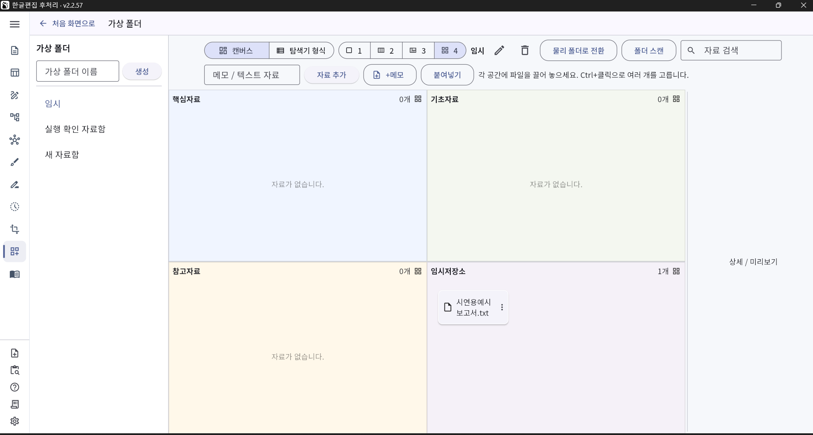
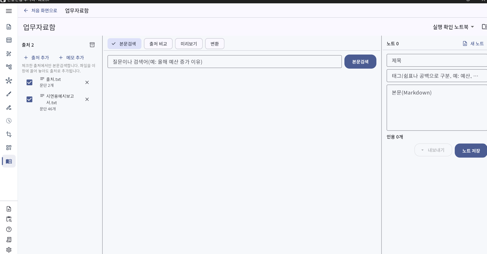
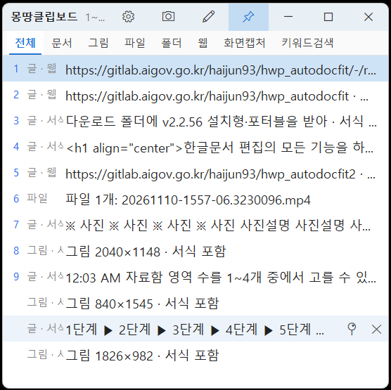

<!-- DOWNLOAD:START -->
<h2 align="center">⬇️ 지금 내려받기 · 최신 v2.2.59</h2>

| 내려받는 곳 | 다운로드 안내 |
|:---:|:---:|
| GitHub | [설치형 내려받기](https://github.com/haijun93/hwp-auto-docfit/releases/download/v2.2.59/HWP_AutoDocFit_v2.2.59_Setup.exe) · [포터블 내려받기](https://github.com/haijun93/hwp-auto-docfit/releases/download/v2.2.59/HWP_AutoDocFit_v2.2.59_Portable.exe) |
| 기능시연용 예시문서 | [예시문서 내려받기](https://github.com/haijun93/hwp-auto-docfit/releases/download/v2.2.59/report-example-all-in-one.txt) (`[모의데이터]문서편집_작업방식(한번에적용) 기능시연용문서.txt`) |

실행 파일과 함께 **기능시연용 예시문서**도 받아 두세요. 프로그램의 「한 번에 적용」에 이 문서를 넣으면 시연 영상과 같은 결과를 바로 확인할 수 있습니다.

**설치형**은 설치 후 시작 메뉴에서 실행하고, **포터블**은 설치 없이 파일을 바로 실행합니다. Windows 10·11용이며, 문서 편집 기능에는 한컴오피스 한/글이 필요합니다.
<!-- DOWNLOAD:END -->

<h1 align="center">한글 보고서 작업의 반복 업무를 줄이는 오프라인 행정업무 지원 도구</h1>

<strong>오프라인 · 폐쇄망 사용 가능 · 원본 보존 · 한/글 연동</strong>

<!-- DEMO:START -->
## 시연 영상

새로 만든 약 3분 영상입니다. 「한 번에 적용」으로 문서를 정리하는 과정부터 표 템플릿·표그림판, 다이어그램·마인드맵, 파일명 일괄 변경, 타임머신·위계검색, 파일 변환, 가상 폴더, 업무자료함, 몽땅클립보드까지 자막과 음성 해설로 차례로 보여 줍니다. 영상 마지막에는 문서 편집 자동화, 표·그림 편집, 파일 변환·정리, 검색·자료 관리, 주요 특징을 슬라이드와 음성 설명으로 정리했습니다.
<!-- DEMO:END -->

## 개발 배경

행정업무에서는 보고서 작성이 끝난 뒤에도 내어쓰기, 자간 조정, 항목기호 정리, 표 작성, 쪽 맞춤, 파일 변환 등 반복적인 후처리 작업에 많은 시간과 노력이 필요합니다.

이 도구는 이러한 규칙화된 반복 업무를 자동화하여 보고서 작성 시간을 줄이고, 문서의 완성도와 업무 효율을 높이기 위해 개발되었습니다.

문서 편집 기능뿐 아니라 파일 변환, PDF 병합·압축, 파일명 일괄 변경, 표·이미지·다이어그램 편집, 자료 검색, 클립보드 관리 등 행정업무에서 자주 사용하는 기능을 하나의 프로그램에 통합한 것이 특징입니다.

작동 환경

- 외부 AI나 서버를 호출하지 않는 오프라인 방식
- 폐쇄망 환경에서 사용 가능
- 한컴오피스 한/글과 연동
- 원본 문서는 보존하고 처리 결과를 별도 파일로 저장
- 설치형 및 포터블 Windows 실행 파일 지원

## 기능 살펴보기

### 1. 문서 편집 자동화

다음과 같은 한글 문서 후처리 작업을 자동으로 수행합니다.

<table>
<tr>
<td width="50%"></td>
<td width="50%"></td>
</tr>
</table>

세부 기능과 사용 방법

- 자간 정리
- 내어쓰기와 문단 위계 정리
- 항목기호 및 목차 체계 정리
- 서식 통일
- 문서 쪽 맞춤
- 표 서식 정리
- 예시 보고서 기반 서식 분석 및 등록

예시 보고서를 프로그램에 끌어 놓으면 제목표, 개요표, 장·절·소제목, 본문, 표 등 문서 구조와 서식을 분석하여 사용자 서식 프로파일로 등록할 수 있습니다.

처음 사용할 때는 함께 제공되는 예시 보고서 `[모의데이터]문서편집_작업방식(한번에적용) 기능시연용문서.txt`로 「한 번에 적용」을 바로 체험해 볼 수 있습니다. v2.2.57부터 이 예시는 시연 영상에 쓰인 보고서와 같습니다.

### 2. 표 템플릿 및 표그림판

자주 사용하는 표 서식을 템플릿으로 저장하고 필요할 때 선택해 사용할 수 있습니다.

<table>
<tr>
<td width="50%"></td>
<td width="50%"></td>
</tr>
</table>

새로운 표가 필요한 경우에는 표그림판에서 그림을 그리듯 행과 열을 구성하고, 셀을 병합하거나 분할하며, 선과 배경을 편집할 수 있습니다.

### 3. 다이어그램·마인드맵·붙임사진 편집

보고서 작성에 필요한 다음 요소를 직접 편집할 수 있습니다.

<table>
<tr>
<td width="50%"></td>
<td width="50%"></td>
</tr>
</table>

세부 기능과 사용 방법

- 업무 흐름도
- 다이어그램
- 마인드맵
- 붙임사진
- 사진 설명과 배치
- 도형과 연결선

마인드맵은 하나의 중심 도형을 기준으로 하위 도형을 계속 추가할 수 있으며, 도형과 연결선을 자유롭게 이동·수정·삭제할 수 있습니다.

### 4. 파일 변환

자주 사용하는 문서와 이미지 파일을 다양한 형식으로 변환할 수 있습니다.

세부 기능과 사용 방법

- HWP·HWPX
- PDF
- PNG·JPG 등 이미지
- TXT·Markdown
- DOCX
- XLSX·CSV 등

PDF 병합과 압축 기능을 제공하여 전자결재 첨부파일 용량 제한에도 대응할 수 있습니다.

### 5. 파일명 일괄 변경

여러 파일의 이름을 일정한 규칙에 따라 한 번에 변경할 수 있습니다.

날짜, 문서 종류, 순번, 기관명 등의 규칙을 적용하여 업무자료를 체계적으로 정리할 수 있습니다.

### 6. AI 답변의 공문서 형식 변환

ChatGPT, Gemini, Claude 등 웹서비스에서 작성한 답변을 그대로 복사해 붙여 넣으면 다음 작업을 자동으로 수행합니다.

세부 기능과 사용 방법

- `>`, `**`, `[1]` 등 불필요한 기호 제거
- Markdown과 HTML 잔여 서식 정리
- 제목과 본문 위계 분석
- `□·ㅇ·-·•` 등 공문서 개조식 체계로 변환
- 문장 단위와 항목 단위 재구성

AI 답변을 공문서 보고서에 바로 활용할 수 있도록 정리합니다.

### 7. 위계검색

위계검색은 문서의 목차와 구조를 분석하여 검색 결과의 우선순위를 정하는 기능입니다.

타임머신의 타임라인에서 선택한 문서와 관련된 문서를 찾는 기능도 같은 이름인 「위계검색」으로 제공합니다.

세부 기능과 사용 방법

일반적인 검색은 문서에 포함된 단어나 문장의 유사도만 비교하지만, 위계검색은 다음과 같은 문서 구조를 함께 고려합니다.

- 문서 제목
- 장
- 절
- 중제목
- 소제목
- 본문
- 부연설명
- 표 제목과 표 내용

검색어가 제목이나 장·절과 같은 높은 위계에서 발견될수록 더 높은 정보가치를 부여합니다.

예를 들어 “공공 AI 대전환”을 검색하면 해당 단어가 본문에만 포함된 문서보다 제목이나 장·절에서 발견된 문서를 우선적으로 보여줍니다.

검색 결과는 단순한 파일명뿐 아니라 다음과 같은 문서 경로를 함께 표시할 수 있습니다.

> 2026년 업무보고 > 제2장 주요 추진사업 > 2.1 공공 AI 대전환

### 8. 타임머신

작업 파일을 시간순으로 검색하여 이전 버전과 변경 이력을 확인할 수 있습니다.

문서를 언제 수정했는지, 어떤 작업본이 최신인지, 이전 결과물을 다시 찾아야 하는지 확인할 때 활용할 수 있습니다.

### 9. 가상 폴더

여러 문서를 참고해 하나의 보고서를 작성할 때 원본 파일을 별도 폴더에 복사하지 않고, 원본에 대한 참조만 가상 폴더에 모아 관리할 수 있습니다.

이 기능을 사용하면 원본과 복사본이 뒤섞이는 문제를 줄일 수 있습니다. 필요한 경우 가상 폴더의 자료를 실제 물리 폴더로 전환할 수도 있습니다.

### 10. 오프라인 노트북

Gemini Notebook과 유사한 개념을 오프라인 환경에서 구현한 기능입니다.

프로그램에서는 「업무자료함」 메뉴로 제공합니다.

업무 관련 법령, 매뉴얼, 과거 보고서, 참고자료 등을 주제별 정보 묶음으로 관리하고, 해당 자료 안에서만 검색하여 필요한 내용을 빠르게 찾을 수 있습니다.

외부 서버로 자료를 전송하지 않으므로 폐쇄망에서도 사용할 수 있습니다.

### 11. 몽땅클립보드

복사한 문장을 기록해 두었다가 필요할 때 다시 불러올 수 있습니다.

`Ctrl+Shift+V`를 사용하면 이전에 복사한 여러 문장과 자료를 다시 선택하여 붙여 넣을 수 있어 반복적인 자료 수집과 문서 작성에 유용합니다.

## 통합 업무 지원 도구

이 프로그램은 문서 편집만을 위한 도구가 아닙니다.

다음과 같이 행정업무에서 자주 사용하는 기능을 한곳에 통합했습니다.

### 한눈에 보기

| 기능 | 한 줄 설명 |
|---|---|
| 한글 문서 편집 자동화 | 자간·내어쓰기·문단 위계·서식·쪽 맞춤 |
| 표 작성과 표 서식 관리 | 표 템플릿 및 표그림판 |
| 다이어그램과 마인드맵 편집 | 업무 흐름도·도형과 연결선 |
| 붙임사진 편집 | 사진 설명과 배치 |
| HWP·HWPX·PDF·이미지·DOCX·TXT·Markdown 변환 | 문서와 이미지 파일의 다양한 형식 변환 |
| PDF 병합과 압축 | 전자결재 첨부파일 용량 제한 대응 |
| 파일명 일괄 변경 | 날짜·문서 종류·순번·기관명 규칙 적용 |
| AI 답변의 공문서 변환 | 기호·잔여 서식 정리와 개조식 체계 변환 |
| 위계검색 | 문서 목차와 구조를 고려한 검색 |
| 타임머신 | 이전 버전과 변경 이력 확인 |
| 가상 폴더 | 원본에 대한 참조를 모아 관리 |
| 오프라인 노트북 | 주제별 정보 묶음 안에서 검색 |
| 클립보드 기록 관리 | 복사 기록을 다시 선택하여 붙여넣기 |

여러 프로그램을 번갈아 실행하거나 작업 파일을 별도로 복사하지 않고, 문서 작성부터 편집·변환·정리·검색까지 하나의 프로그램에서 처리할 수 있습니다.

자세한 사용법은 [사용자 안내서](docs/USER_GUIDE.md), 개발·빌드 방법은 [개발 안내](docs/DEVELOPMENT.md)를 참고하세요. [사용한 오픈소스](THIRD_PARTY_NOTICES.md) · [라이선스](LICENSE)

## 주요 특징

- 원본 문서를 변경하지 않고 결과를 새 파일로 저장
- 외부 AI와 서버를 호출하지 않아 폐쇄망에서 사용 가능
- 한컴오피스 한/글과 연동
- 문서 구조와 위계를 활용한 검색 지원
- 파일 변환과 행정업무용 편의 기능 통합
- 설치형 및 포터블 실행 파일 제공
- MIT 라이선스 기반 배포
- 4만 줄 이상의 자동화 시험 코드와 CI를 통한 안정성 관리

## 배포 현황

현재 공개 버전은 **v2.2.59**입니다.

설치형과 포터블 Windows 실행 파일로 제공되며, 한컴오피스 한/글과 연동하여 행정 보고서 작성, 문서 후처리, 파일 변환, 자료 검색 업무를 지원합니다.
