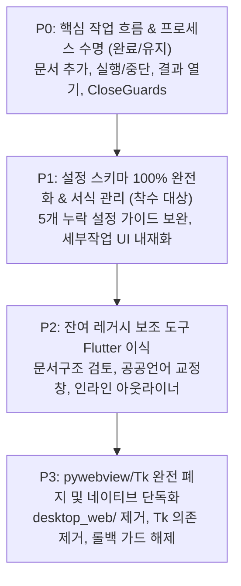

# FLUTTER_PARITY: Flutter 완전 전환 기능 동등성 표 및 설정 이전 범위

> **작성일**: 2026-11-08  
> **기준 브랜치/버전**: `alpha` (v2.2.33 / v2.2.36 개발 트랙)  
> **관련 문서**: [TODO.md](../TODO.md) § '[검토 예정] 사용자 UI를 Flutter로 완전 전환', [FLUTTER_100_PERCENT_MIGRATION_DESIGN.md](FLUTTER_100_PERCENT_MIGRATION_DESIGN.md), [FLUTTER_MIGRATION_AUDIT.md](FLUTTER_MIGRATION_AUDIT.md)

---

## 1. 개요 및 목적

본 문서는 `hwp-auto-docfit`의 모든 사용자 UI를 Tkinter(`docfit_ui/legacy.py`, `hwp-auto-docfit.py`) 및 pywebview HTML(`desktop_web/`)에서 **Flutter 네이티브/Web UI(`flutter_ui/`)로 100% 완전 전환**하기 위해 다음 세 가지 핵심 영역을 실측·대조하여 전수 조사한 결과이다.

1. **기능별 동등성 표**: Tk 및 pywebview에만 남아 있거나 분기된 기능 목록과 Flutter의 실제 구현 대응 여부(`있음` / `부분` / `없음`).
2. **설정 79개+ 이전 범위 전수 분석**: 백엔드 설정 스키마(`docfit_app/settings_schema.py`, `docfit_app/configuration_service.py`)와 Flutter 설정 화면(`flutter_ui/lib/features/settings/`), 작업 카드 스위치 간의 노출 상태 전수 대조.
3. **이전 우선순위 및 단계별 전환 제안**: 사용 빈도·조판 안전성·위험도에 따른 P0~P3 우선순위와 안전한 단계별 전환(롤백 가드 포함) 방안.

> [!IMPORTANT]
> 모든 근거는 실제 저장소 소스코드의 파일 경로, 클래스, 함수, 심볼을 바탕으로 작성되었으며, Windows 실기기 검증이 추가로 필요한 항목은 **'확인 필요'**로 명시하였다.

---

## 2. 화면·기능별 동등성 분석 표

대응 여부 정의:
- **있음**: Flutter 화면에서 해당 기능을 완전하게 제공하며 사용자 조작이 가능함.
- **부분**: 대체 수단이나 축소된 형태로 제공되거나, 핵심 엔진은 연동되었으나 전용 UI 뷰어/상세 인터랙션이 일부 누락됨.
- **없음**: Flutter에 해당 기능 화면이 없으며, 레거시 Tk 대화상자에 의존하거나 호출이 차단됨.

### 2.1 주 작업 흐름 (Main Workspace & Processing)

| 기능 항목 | 기존 Tk / pywebview 구현 경로 | Flutter 대응 구현 경로 | 대응 여부 | 상세 차이 및 코드 근거 |
|---|---|---|:---:|---|
| **문서 파일 추가 / 목록 관리** | `docfit_ui/legacy.py:HwpAutoDocFitGUI.파일추가`<br>`desktop_web_ui.py:DesktopWebBridge.add_paths` | `flutter_ui/lib/main.dart:DocFitApp._buildFileList`<br>`flutter_ui/lib/main.dart:_addFiles` | **있음** | 파일 다중 선택, 중복 검사, 목록 삭제/비우기, 파일 크기 표시 완전 대응. OS 네이티브 파일 대화상자는 `NativeFileDialogService` 경유. |
| **폴더 단위 문서 추가** | `docfit_ui/legacy.py:HwpAutoDocFitGUI.폴더추가`<br>`desktop_web_ui.py:DesktopWebBridge.add_directory` | `flutter_ui/lib/main.dart:_addFolder` | **있음** | 하위 폴더 재귀 탐색 및 지원 확장자 필터링 동일 구현. |
| **OS 드래그 앤 드롭** | `docfit_ui/legacy.py:_bind_file_drop`<br>`desktop_web_ui.py:DesktopWebBridge.receive_drop` | `flutter_ui/lib/core/drop_events.dart`<br>`flutter_ui/lib/main.dart:DropTargetArea` | **있음** | 메인 문서 목록뿐 아니라 서식 복제, 표그림판 사진, 파일이름, 자료함, 노트북 등 드롭 목적지(`drop_target`) 분기 완비. |
| **정리 방식 카드 선택 (3+2카드)** | `docfit_ui/legacy.py:_모드카드_외관갱신`<br>`desktop_web_ui.py:set_mode` | `flutter_ui/lib/main.dart:_buildModeCards` | **있음** | 자간 정리(`spacing`), 서식 통일(`unify`), 한 번에 적용(`all`), 파일 변환(`file_format`), 페이지 맞춤(`pagefit`) 카드 완비 및 색상 테마 동기화. |
| **작업 카드별 제외/상세 옵션** | `docfit_ui/legacy.py:_카드옵션값_목록`<br>`desktop_web_ui.py:set_card_option` | `flutter_ui/lib/main.dart:_buildCardOptionToggles` | **있음** | `all_include_spacing`, `all_exclude_tables`, `all_exclude_pagefit`, `all_exclude_linespacing`, `spacing_enabled`, `spacing_exclude_pagefit`, `spacing_exclude_reset`, `unify_keep_layout`, `unify_full_format` 등 2026-10 제외 방식 옵션 100% 연동. |
| **쪽 범위 지정 (특정 쪽만 정리)** | `docfit_ui/legacy.py:_쪽범위_토글`<br>`desktop_web_ui.py:set_range` | `flutter_ui/lib/main.dart:_buildPageRangeSection` | **있음** | 전체/쪽 지정 라디오 토글, 시작/끝 쪽 스핀박스, 유효성 검사 동일 제공. |
| **실행 / 중단 / 재개 제어** | `docfit_ui/legacy.py:작업시작`, `작업중단`<br>`desktop_web_ui.py:start`, `stop` | `flutter_ui/lib/main.dart:_buildBottomActionBar`<br>`flutter_ui/lib/bridge.dart:api` | **있음** | 하단 고정 실행바, 작업 중 중단 버튼 노출, 중단 후 이어서 진행(`_재개_대기중`) 상태 제어 동일 지원. |
| **실시간 조판 단계 표시** | `docfit_ui/legacy.py:LiveStageBoard`<br>`desktop_web/index.html:#flowchart` | `flutter_ui/lib/features/stages/stage_board.dart`<br>`flutter_ui/lib/features/progress/live_progress.dart` | **있음** | STAGE_ORDER 12단계 흐름 시각화, 활성 단계 점멸 애니메이션, 방문 완료 체크, 경과 시간 표시 완비. |
| **처리 결과 목록 및 열기/탐색기** | `docfit_ui/legacy.py:_작업결과_표시`<br>`desktop_web_ui.py:open_result`, `show_result` | `flutter_ui/lib/main.dart:_buildResultSection` | **있음** | 성공/실패 통계, 결과 파일 클릭 시 연결 프로그램(한/글) 실행, '폴더에서 보기'(Windows 탐색기 `/select,`) 지원. |
| **단일 결과/다중 결과 비교 보기** | `docfit_ui/legacy.py:비교창_준비`<br>`desktop_web_ui.py:open_diff` | `flutter_ui/lib/main.dart:_openDiff` | **부분** | pywebview/Flutter에서는 `docfit_app/result_compare.py`를 통해 HTML 나란히 비교 보고서를 생성하여 기본 브라우저로 띄움. Tk의 네이티브 한/글 창 2개 좌우 임베드 방식(`원본_뷰어_분리`)은 Flutter에서 미사용. 실무 가독성은 HTML 비교가 더 안정적이나 완전 동일 뷰어는 아님. |

---

### 2.2 설정 및 대화상자 (Settings, Dialogs & Modals)

| 기능 항목 | 기존 Tk / pywebview 구현 경로 | Flutter 대응 구현 경로 | 대응 여부 | 상세 차이 및 코드 근거 |
|---|---|---|:---:|---|
| **전체 환경설정 창** | `docfit_ui/legacy.py:설정창_열기` (`_설정창_생성`, 5개 탭) | `flutter_ui/lib/features/settings/settings_dialog.dart` | **있음** | 보고서·문단간격·문장·표·글꼴·작업카드·결과기록·일반·프로그램·개발자 10대 분류 타일, 실시간 문서 조판 미리보기(`doc_preview.dart`), 변경 감지 저장, 기본값 복원 제공. |
| **빠른 환경설정 서랍** | `desktop_web/index.html:#quickOptionsPanel` | `flutter_ui/lib/main.dart:_buildQuickOptionsDrawer` | **있음** | 창 닫기, 검수, 작업로그, 무결성/최종검수 파일 생성, 업데이트 확인, 개발자 모드, 항상 위 등 9종 토글 서랍 완비. |
| **세부 작업(단계별) 수치 조정 창** | `docfit_ui/legacy.py:_세부작업_열기` (`tk.Toplevel`, 7~10단계 세부 스핀) | `flutter_ui/lib/features/settings/settings_dialog.dart`<br>`flutter_ui/lib/main.dart:CardOptions` | **부분** | 세부 작업의 수치 조정(문단 위 간격, 줄 간격 범위, 재시도 횟수 등)은 `SettingsDialog`에서 모두 가능하고, 카드 단계 제외는 메인 화면 스위치로 가능함. 그러나 **'모드별 실행 순서대로 나열된 독립 세부작업 모달 창'**은 Flutter에 전용 화면이 없고 `open_stages` 브리지 호출 시 `FLUTTER_ONLY` 에러 반환. *(실무상 설정창에서 포괄하므로 기능 공백은 미미함)* |
| **작업 기록 (상세 로그) 조회/복사** | `docfit_ui/legacy.py:log_window`<br>`desktop_web_ui.py:open_log` | `flutter_ui/lib/main.dart:_showLogDialog`<br>`desktop_web_ui.py:get_log`, `clear_log` | **있음** | 온디맨드 로그 조회(`get_log`), 실시간 클립보드 복사, 로그 지우기(작업 중 비활성 안전 가드) Flutter 모달 구현. |
| **프로그램 종료 확인 및 안전 가드** | `docfit_ui/legacy.py:종료`, `worker_종료확인`<br>`desktop_web_ui.py:request_close` | `flutter_ui/lib/core/close_guards.dart`<br>`flutter_ui/lib/main.dart:_handleCloseGuards` | **있음** | 작업 중 종료 시 확인 모달("작업을 중단하고 종료할까요?"), 10초 타임아웃 및 강제 종료(`kill_owned`), 편집기 수정 중 닫기 방지 가드(`CloseGuards`) 연동. |
| **서식통일 2/5: 대표 서식 검토** | `docfit_ui/legacy.py:_서식통일_대표서식_검토창` | `flutter_ui/lib/features/style_unify/unify_pick_style_dialog.dart`<br>`flutter_ui/lib/features/tools/backend_dialog.dart` | **있음** | 백엔드 큐 이벤트(`style_unify_profile_review`)를 가로채 `_pending_dialog`를 통해 Flutter 모달로 완전 승격. 글꼴·크기·굵기·내어쓰기 수정 및 승인. |
| **서식통일 3/5: 편집 영역 검토** | `docfit_ui/legacy.py:_서식통일_적용영역_검토창` | `flutter_ui/lib/features/style_unify/unify_area_dialog.dart` | **있음** | 불일치 후보 목록 체크박스 다중 선택, 문장 전체 미리보기, 선택 영역만 적용 승인 완전 대응. |
| **서식통일 5/5: 결과 확인** | `docfit_ui/legacy.py:_서식통일_결과_확인창` | `flutter_ui/lib/features/style_unify/unify_result_dialog.dart` | **있음** | 검수 결과 요약(통과/불일치/판정 보류), 남은 불일치 목록 및 빨간색 미확정 문단 보고서 표시. |
| **시간 절약 완료 팝업 (고양이 안내)** | `docfit_ui/legacy.py:_절약_완료창` | `flutter_ui/lib/main.dart:_buildCompletionCard` | **있음** | 개발자 모드가 꺼져 있을 때 절약 시간 및 안내 문구를 결과 화면에 미려하게 렌더링. |

---

### 2.3 서식 관리 및 템플릿 (Format Profiles & Templates)

| 기능 항목 | 기존 Tk / pywebview 구현 경로 | Flutter 대응 구현 경로 | 대응 여부 | 상세 차이 및 코드 근거 |
|---|---|---|:---:|---|
| **서식 갤러리/키오스크 선택** | `docfit_ui/legacy.py:_서식_키오스크_열기`<br>`desktop_web_ui.py:format_gallery` | `flutter_ui/lib/main.dart:_buildFormatDropdown`<br>`flutter_ui/lib/features/formats/table_template_panel.dart` | **있음** | 썸네일 스틸컷(JPEG data URI), 기관명 태그, 원클릭 활성화, 삭제/이름 변경 메뉴 완비. |
| **서식 복제 (예시 문서 분석)** | `docfit_ui/legacy.py:_서식_분석_시작`<br>`desktop_web_ui.py:add_format_paths` | `flutter_ui/lib/main.dart:addFormatFiles`<br>`desktop_web_ui.py:quick_register_and_activate_profile` | **있음** | HWP/HWPX 파일을 배지 영역에 드롭하거나 대화상자로 추가 시 백엔드 분석 후 즉시 등록·선택. |
| **서식 세부사항 및 대표값 수정** | `docfit_ui/legacy.py:_서식_수정하기` (`tk.Toplevel`) | `flutter_ui/lib/features/formats/profile_editor.dart` | **있음** | 글자·문단·항목기호·표 4대 영역 트리 노드 브라우징, 인라인 수치/글꼴 편집, 실시간 조판 미리보기(`element_preview.dart`), 되돌리기 지원. |
| **서식 계층 구조 검토/수정 (Treeview)** | `docfit_ui/legacy.py:_서식_구조_확인` (`tk.Treeview`) | `flutter_ui/lib/features/formats/profile_editor.dart`<br>`flutter_ui/lib/features/formats/format_example_edit_dialog.dart` | **부분** | `ProfileEditor`에서 계층별 글꼴·크기·여백을 편집할 수 있으나, 레거시 Tk의 9열 일람 Treeview(`_서식_구조_확인`)와 1:1 동일 형태는 아님. 실질적 편집 권한은 동등. |
| **빈 문서로 예시 직접 편집** | `docfit_ui/legacy.py:_서식_예시편집_시작` | `flutter_ui/lib/features/formats/format_example_edit_dialog.dart`<br>`desktop_web_ui.py:write_format_example` | **있음** | 백엔드 COM 세션을 띄우고 서식 예시를 직접 작성하여 프로필을 생성하는 흐름 지원. |
| **준말 관리 (글자/본문/표)** | `docfit_app/abbreviation_service.py`<br>`docfit_ui/legacy.py:_준말_서비스` | `flutter_ui/lib/features/abbreviations/abbreviation_manager.dart` | **있음** | CRUD, 검색, 기본값 복원, HWPX 문서 기반 준말 관리(`abbreviation_document`), 표 서식 학습 완비. |
| **상용구 파일 관리 (HWP.IDO)** | `docfit_ui/legacy.py:_상용구파일_저장_클릭` | `flutter_ui/lib/features/settings/idiom_panel.dart` | **있음** | 글자 상용구·본문 상용구 분리, HWPX 설정 문서 열기, 한/글 사용자 폴더 원클릭 반영 지원. |
| **표 템플릿 카탈로그 (정보단위 증감)** | 없음 (Tk 미구현 신기능) | `flutter_ui/lib/features/formats/table_template_panel.dart`<br>`flutter_ui/lib/features/table_units/table_units_screen.dart` | **있음 (Flutter 전용)** | 36종 표 서식 정보단위(-/+), PPT형 1줄 리본, 검색, 가변 스플리터, 한/글 Ctrl+V 즉시 복사 지원. |

---

### 2.4 문서 도구 및 특화 기능 (Document Tools, Outliner, Proofreading)

| 기능 항목 | 기존 Tk / pywebview 구현 경로 | Flutter 대응 구현 경로 | 대응 여부 | 상세 차이 및 코드 근거 |
|---|---|---|:---:|---|
| **텍스트 직접 입력 문서 추가** | `docfit_ui/legacy.py:_텍스트로_문서추가_열기` | `flutter_ui/lib/features/tools/document_tools_workspace.dart:addDocument` | **있음** | 텍스트를 붙여넣어 임시 txt/hwpx 문서를 생성하고 문서 목록에 즉시 등록. |
| **생성형 AI 답변 기호 정리** | `hwp-auto-docfit.py:붙여넣기_정리`<br>`docfit_core/pasted_text.py` | `flutter_ui/lib/features/tools/document_tools_workspace.dart` (모드: `clean`) | **있음** | 마크다운 기호 제거, 불필요 공백 정리, 문단 줄바꿈 복원. |
| **공문서 개조식 변환** | `hwp-auto-docfit.py:개조식_변환`<br>`docfit_core/pasted_text.py` | `flutter_ui/lib/features/tools/document_tools_workspace.dart` (모드: `convert`) | **있음** | 1단계 ㅁ, 하위 ㅇ → - → • 계층 자동 매핑 및 들여쓰기 변환. |
| **실무 작성 보조 도구 7종** | `hwp-auto-docfit.py:_작성도우미_열기`<br>`docfit_core/writing_aids.py` | `flutter_ui/lib/features/tools/document_tools_workspace.dart` | **있음** | 금액 한글화(`amount`), 숫자 쉼표(`commas`), 날짜·요일(`weekdays`), 날짜 차이 계산(`date_diff`), 만 나이(`age`), 주민번호 마스킹(`mask_rrn`), 표 합계 계산(`table_calc`) 100% 대응. |
| **아웃라이너 (Workflowy 방식 2패널 편집)** | `hwp-auto-docfit.py:_아웃라이너_열기` (`outliner_draft.md`, Tk Text 2패널) | `flutter_ui/lib/features/tools/document_tools_workspace.dart`<br>`flutter_ui/lib/features/external_apps/external_app_launcher.dart` | **부분** | 개조식 변환 기능은 `DocumentToolsWorkspace`에 있고, 개발자 모드에서 외부 아웃라이너 프로세스 호출(`external_app`)을 지원함. 그러나 **'Tk 인라인 2패널 실시간 트리 아웃라이너'** 화면 자체는 Flutter 내장 위젯으로 포팅되지 않음. *(외부 앱 연동 및 개조식 변환기로 대체 운용 중)* |
| **문서 구조/계층 검토 대화상자** | `hwp-auto-docfit.py:_문서검토_열기`<br>`docfit_core/document_review.py` | 없음 (백엔드 서비스 `DocumentToolsService`에 미노출) | **없음** | 선택한 문서의 논리적 계층 오류(제목-장-소제목 위계 위반)를 검토하는 독립 Tk 창. Flutter에 전용 UI 화면 없음. *(확인 필요: 실무 활용 빈도 및 재구현 타당성 검토 필요)* |
| **공공언어 및 맞춤법 대화형 교정** | `hwp-auto-docfit.py:_공공언어_검토`<br>`docfit_core/korean_proofread.py` | 없음 (백엔드 서비스에 미연결) | **없음** | 문서 내 어려운 한자어·외래어·행정용어를 찾아 순화어로 대화형 교정하는 Tk 창. Flutter에 UI 없음. *(확인 필요: 향후 도구 탭 편입 검토)* |
| **AI 프롬프트 생성기** | `hwp-auto-docfit.py:_AI_프롬프트_열기` | `flutter_ui/lib/features/tools/document_tools_workspace.dart` | **부분** | 서식 생성용 프롬프트 보조 창. 현재는 `DocumentToolsWorkspace` 기능으로 흡수. |

---

### 2.5 신규 기능 및 확장 워크스페이스 (Flutter 전용 고도화 기능)

> 아래 기능들은 레거시 Tk/pywebview에는 전혀 없거나 원시적인 형태로만 존재하며, **Flutter에서 네이티브로 완전하게 구현**된 영역이다.

| 워크스페이스 / 기능 | 구현 파일 위치 | 주요 기능 및 특징 |
|---|---|---|
| **표그림판 (Table Sketch)** | `flutter_ui/lib/features/table_sketch/` | 셀 단위 정밀 지우개, 선 굵기(0.1~5mm 16단계), 색상 팔레트, 영역별 배경색, 셀 이미지 드롭, 4방향 화살표, 되돌리기/되살리기(50단계), HWPX 표 변환. |
| **다이어그램 (Flow Workspace)** | `flutter_ui/lib/features/flow/` | 흐름도·다이어그램 노드 배치, 관계선 연결, PNG/HWPX 내보내기, 서식 스타일 동기화. |
| **마인드맵 (Mind Map)** | `flutter_ui/lib/features/mindmap/` | 생각 정리 및 계층 구조 노드 확장, 개조식 연계. |
| **그림판 (Paint)** | `flutter_ui/lib/features/paint/` | 사진 배경 로드, 펜 드로잉, 도형 및 주석 글상자 오버레이. |
| **파일이름 일괄 변경 (File Rename)** | `flutter_ui/lib/features/file_rename/` | 탐색기 보내기(`--rename`) 연동, 접두어/접미어/치환/번호 매기기 규칙, 실시간 변경 미리보기, 안전 실행 및 되돌리기. |
| **타임머신 (Timemachine)** | `flutter_ui/lib/features/timemachine/` | 과거 처리 이력 및 스냅샷 복원, 본문 키워드 검색(개발자 모드), 파일편집/변환 대기열 전송. |
| **파일 형식 일괄 변환 (Conversion)** | `flutter_ui/lib/features/conversion/` | HWP·HWPX·PDF·DOCX·EPUB·HTML·TXT·MD·그림 변환, PDF 하나로 합치기 순서 드래그 정렬(`MergeOrderDialog`), PDF 압축. |
| **몽땅클립보드 관리창 (KClip)** | `flutter_ui/lib/features/kclip/` | 클립보드 상주 기록(kagent.exe) 연동, 7대 분류 탭, 스티커 모드, 창 위치/크기/항상위 복원, 엑셀 표 목표 서식 붙여넣기 연동. |
| **자료함 (Library Screen)** | `flutter_ui/lib/features/library/` | 4대 영역 캔버스 배치 + Windows 파일 탐색기 형식 보기 전환, 열 정렬, 더블클릭 실행, 대량 항목 가상 스크롤. (개발자 모드) |
| **노트북 (Notebook Screen)** | `flutter_ui/lib/features/notebook/` | 다중 출처 본문 색인, 마크다운 메모 편집기, HWPX 내보내기. (개발자 모드) |

---

## 3. 전체 설정 항목(설정 스키마) Flutter 화면 노출 및 이전 범위 전수 분석

### 3.1 스키마 관리 구조
앱의 설정은 `docfit_app/settings_schema.py`의 `DEFAULTS`를 단일 진실 공급원(SSOT)으로 하며, `docfit_app/configuration_service.py`의 `ConfigurationService`가 UI 독립적으로 검증 및 스냅샷을 제공한다.  
Flutter의 `SettingsDialog`(`flutter_ui/lib/features/settings/settings_dialog.dart`)는 백엔드의 `fields()` 목록을 동적으로 받아 렌더링하며, `setting_guides.dart`의 `settingGuides` 사전에 등록된 항목은 **한국어 해설과 한/글 조판 미리보기 캔버스(`DocPaper`)**를 함께 제공한다.

### 3.2 79대 기본 설정 및 확장 설정 전수 대조 표

- **노출 구분**:
  - `완전 노출`: `SettingsDialog`에 전용 가이드·미리보기와 함께 노출됨.
  - `일반 컨트롤`: `SettingsDialog`에 스위치/입력창으로 정상 노출되나, 시각적 미리보기 가이드가 일반 텍스트 라벨임.
  - `카드/서랍`: 메인 화면 작업 카드 옵션이나 빠른 설정 서랍에서 직접 조작됨.
  - `전용 UI`: 준말 관리, 서식 편집기 등 전용 화면에서 관리됨.
  - `제외`: 내부 버전(`_rev`) 또는 시스템 예약 플래그로 의도적으로 숨김.

| 순번 | 설정 키 (`key`) | 기본값 | 데이터 타입 | Tk 설정 위치 | Flutter 노출 위치 | 노출 상태 | 가이드 / 비고 |
|:---:|---|:---:|:---:|---|---|:---:|---|
| 1 | `prevent_word_split` | True | bool | 자간정리:단어분리방지 | 설정창 > 문장·줄 정리 | **완전 노출** | 어절 줄 나눔 방지 (가이드+미리보기 완비) |
| 2 | `ratio_shrink` | False | bool | 자간정리:장평줄이기 | 설정창 > 문장·줄 정리 | **완전 노출** | 장평 줄이기도 쓰기 (가이드+미리보기 완비) |
| 3 | `punctuation` | True | bool | 자간정리:문장부호정리 | 설정창 > 문장·줄 정리 | **완전 노출** | 문장부호 줄 처음에 안 두기 (가이드+미리보기 완비) |
| 4 | `punctuation_threshold` | "5" | number | 자간정리:이동한도 | 설정창 > 문장·줄 정리 | **완전 노출** | 문장부호를 옮길 둘째 줄 길이 (단위: 자) |
| 5 | `keep_punctuation_set_together`| True | bool | 문서:문단묶음보호 | 설정창 > 문장·줄 정리 | **완전 노출** | 날짜·괄호 묶음 지키기 (가이드+미리보기 완비) |
| 6 | `color_mark_on` | False | bool | 문서:수정한곳확인 | 설정창 > 문장·줄 정리 | **완전 노출** | 조정한 글자 색으로 표시 (가이드+미리보기 완비) |
| 7 | `color` | "blue" | text | 문서:표시색라디오 | 설정창 > 문장·줄 정리 | **완전 노출** | 표시 색상 (blue/red 등 10색) |
| 8 | `autoclose` | False | bool | 문서:완료후한글닫기 | 설정창 > 결과·기록, 빠른설정 | **완전 노출** | 끝나면 한글 창 닫기 |
| 9 | `stdformat` | True | bool | 서식:표준서식사용 | 설정창 > 보고서 모양 | **완전 노출** | 보고서 표준서식 입히기 (가이드+미리보기 완비) |
| 10 | `verify` | False | bool | 문서:상세진단검사 | 설정창 > 결과·기록, 빠른설정 | **완전 노출** | 결과 자세히 검사 (무결성 검사) |
| 11 | `integrity_report_file` | False | bool | 기록:무결성파일저장 | 설정창 > 결과·기록, 빠른설정 | **완전 노출** | 무결성 보고서 파일 만들기 |
| 12 | `final_review_file` | False | bool | 기록:최종검수파일저장 | 설정창 > 결과·기록, 빠른설정 | **완전 노출** | 최종 검수 보고서 파일 만들기 |
| 13 | `report_files_rev` | 2 | number | (내부 관리) | (EXCLUDED) | **제외** | 보고서 파일 옵션 판 번호 (UI 불필요) |
| 14 | `two_pass_processing` | False | bool | 고급:2회반복처리 | 설정창 > 문장·줄 정리 | **완전 노출** | 두 번 처리 (시간 2배 소요 안내) |
| 15 | `retry_body` | "15" | number | 고급:본문시도횟수 | 설정창 > 문장·줄 정리 | **완전 노출** | 본문 자간 조정 단계 (단위: 단계) |
| 16 | `retry_table` | "5" | number | 고급:표시도횟수 | 설정창 > 문장·줄 정리 | **완전 노출** | 표 자간 조정 단계 (단위: 단계) |
| 17 | `linespacing_min` | "140" | number | 문서:줄간격최소 | 설정창 > 문장·줄 정리 | **완전 노출** | 줄 간격 최솟값 (%) |
| 18 | `linespacing_max` | "200" | number | 문서:줄간격최대 | 설정창 > 문장·줄 정리 | **완전 노출** | 줄 간격 최댓값 (%) |
| 19 | `table_linespacing_min` | "100" | number | (v2.0.0 신설) | 설정창 > 표 (동적 필드) | **일반 컨트롤** | 표 칸 최소 줄 간격 (%) *(setting_guides 보완 필요)* |
| 20 | `table_spacing_min` | "-25" | text/num | (v2.0.0 신설) | 설정창 > 표 (동적 필드) | **일반 컨트롤** | 표 칸 최소 자간 (%) *(setting_guides 보완 필요)* |
| 21 | `label_symbols.□` | False | bool | 서식:문두라벨기호 | 설정창 > 보고서 모양 | **완전 노출** | □ 줄 머리 라벨 굵게 (동적 가이드 매핑) |
| 22 | `label_symbols.※` | False | bool | 서식:문두라벨기호 | 설정창 > 보고서 모양 | **완전 노출** | ※ 줄 머리 라벨 굵게 (동적 가이드 매핑) |
| 23 | `label_symbols.*` | False | bool | 서식:문두라벨기호 | 설정창 > 보고서 모양 | **완전 노출** | * 줄 머리 라벨 굵게 (동적 가이드 매핑) |
| 24 | `label_symbols.**` | False | bool | 서식:문두라벨기호 | 설정창 > 보고서 모양 | **완전 노출** | ** 줄 머리 라벨 굵게 (동적 가이드 매핑) |
| 25 | `label_symbols_rev` | 2 | number | (내부 관리) | (EXCLUDED) | **제외** | 라벨 기호 버전 (UI 불필요) |
| 26 | `paren_shrink` | True | bool | 서식:괄호부연설명축소 | 설정창 > 보고서 모양 | **완전 노출** | 괄호 안 글자 줄이기 (-2pt 축소) |
| 27 | `paren_label_bold` | True | bool | 서식:괄호/콜론라벨굵게 | 설정창 > 보고서 모양 | **완전 노출** | 괄호 라벨 굵게 (가이드+미리보기 완비) |
| 28 | `std_margin` | True | bool | 서식:편집여백 | 설정창 > 보고서 모양 | **완전 노출** | 편집 여백 표준화 (15/20mm) |
| 29 | `std_ratio` | True | bool | 서식:글자가로폭(장평) | 설정창 > 보고서 모양 | **완전 노출** | 기본 장평 맞춤 |
| 30 | `std_linespacing` | True | bool | 서식:줄사이간격 | 설정창 > 보고서 모양 | **완전 노출** | 기본 줄 간격 맞춤 |
| 31 | `std_title` | True | bool | 서식:제목표서식 | 설정창 > 보고서 모양 | **완전 노출** | 제목 서식 (가이드+미리보기 완비) |
| 32 | `std_title_auto` | True | bool | 서식:제목자동인식 | 설정창 > 보고서 모양 | **완전 노출** | 제목 자동으로 찾기 |
| 33 | `std_attachment_auto` | True | bool | 서식:붙임자동인식 | 설정창 > 보고서 모양 | **완전 노출** | 붙임 자동으로 찾기 |
| 34 | `std_midtitle_auto` | True | bool | 서식:중제목자동인식 | 설정창 > 보고서 모양 | **완전 노출** | 중제목 자동으로 찾기 |
| 35 | `std_midtitle_bold` | True | bool | 서식:중제목굵게 | 설정창 > 보고서 모양 | **완전 노출** | 중제목 번호 굵게 (가이드+미리보기 완비) |
| 36 | `abbreviations` | dict | dict | (구 설정 저장) | 준말 관리 (`AbbreviationManager`) | **전용 UI** | 단어·본문·표 준말 관리 화면에서 전담 |
| 37 | `abbreviation_defaults`| True | bool | 준말관리:기본준말 | 설정창 > 보고서 모양 | **완전 노출** | 기본 준말 사용 여부 |
| 38 | `abbreviation_source` | "document" | text | (v1.80.3 신설) | 준말 관리 전용 바 | **전용 UI** | HWPX 문서 기반 / 앱 설정 기반 전환 |
| 39 | `std_title_bold` | True | bool | 서식:제목굵게 | 설정창 > 보고서 모양 | **완전 노출** | 제목 굵게 (가이드+미리보기 완비) |
| 40 | `std_dateinfo` | True | bool | 서식:날짜담당자줄 | 설정창 > 보고서 모양 | **완전 노출** | 날짜·담당자 줄 서식 (우측 정렬) |
| 41 | `std_dateinfo_bold` | True | bool | 서식:날짜담당자굵게 | 설정창 > 보고서 모양 | **완전 노출** | 날짜·담당자 굵게 |
| 42 | `std_symbols` | True | bool | 서식:기호별글꼴시작 | 설정창 > 보고서 모양 | **완전 노출** | 항목기호 정리 (□→ㅇ→- 순서) |
| 43 | `std_hanging_indent` | True | bool | 서식:내어쓰기적용 | 설정창 > 보고서 모양 | **완전 노출** | 내어쓰기 (둘째 줄 본문 정렬) |
| 44 | `std_supplement_indent`| True | bool | 서식:부연설명들여쓰기 | 설정창 > 보고서 모양 | **완전 노출** | 부연설명 들여쓰기 (*, ※ 안쪽 시작) |
| 45 | `std_symbol_box_bold` | False | bool | 서식:□기호굵게 | 설정창 > 보고서 모양 | **완전 노출** | □ 기호 굵게 |
| 46 | `std_symbol_o_bold` | True | bool | 서식:ㅇ기호굵게 | 설정창 > 보고서 모양 | **완전 노출** | ㅇ 기호 굵게 |
| 47 | `std_symbol_dash_bold` | False | bool | 서식:-기호굵게 | 설정창 > 보고서 모양 | **완전 노출** | - 기호 굵게 |
| 48 | `std_symbol_note_bold` | False | bool | 서식:※기호굵게 | 설정창 > 보고서 모양 | **완전 노출** | ※ 기호 굵게 |
| 49 | `std_marker_bold_consistency`| True | bool | 서식:라벨굵기일관성 | 설정창 > 보고서 모양 | **완전 노출** | 같은 항목 라벨 굵기 맞추기 |
| 50 | `std_parspace` | True | bool | 서식:문단위여백 | 설정창 > 문단 간격 | **완전 노출** | 항목 위 간격 넣기 |
| 51 | `std_remove_blank_lines`| True | bool | 서식:빈줄삭제 | 설정창 > 문단 간격 | **완전 노출** | 항목 사이 빈 줄 지우기 |
| 52 | `std_parspace_chapter` | "15" | number | 서식:장위여백 | 설정창 > 문단 간격 | **완전 노출** | 중제목(Ⅰ) 위 간격 (pt) |
| 53 | `std_parspace_midtitle`| "15" | number | 서식:중제목위여백 | 설정창 > 문단 간격 | **완전 노출** | 숫자 중제목 위 간격 (pt) |
| 54 | `std_parspace_box` | "15" | number | 서식:□위여백 | 설정창 > 문단 간격 | **완전 노출** | □ 항목 위 간격 (pt) |
| 55 | `std_parspace_circle` | "8" | number | 서식:ㅇ위여백 | 설정창 > 문단 간격 | **완전 노출** | ㅇ 항목 위 간격 (pt) |
| 56 | `std_parspace_dash` | "4" | number | 서식:-위여백 | 설정창 > 문단 간격 | **완전 노출** | - 항목 위 간격 (pt) |
| 57 | `std_parspace_note` | "0" | number | 서식:※위여백 | 설정창 > 문단 간격 | **완전 노출** | ※ 항목 위 간격 (pt) |
| 58 | `std_parspace_rev` | 2 | number | (내부 관리) | (EXCLUDED) | **제외** | 간격 버전 (UI 불필요) |
| 59 | `std_supplement_rev` | 2 | number | (내부 관리) | (EXCLUDED) | **제외** | 부연설명 버전 (UI 불필요) |
| 60 | `std_parspace_return_percent`| "150" | number | 서식:복귀배율스핀 | 설정창 > 문단 간격 | **완전 노출** | 상위 항목으로 돌아올 때 간격 (%) |
| 61 | `std_title_subtitle_pt`| "15" | number | (세부 전달) | 설정창 > 보고서 모양 | **완전 노출** | 부제 글자 크기 (pt) |
| 62 | `title_owner_text` | "" | text | (세부 전달) | 설정창 > 보고서 모양 | **완전 노출** | 제목 표 담당자 칸 글 (미리보기 반영) |
| 63 | `std_table_header` | True | bool | 서식:표헤더서식 | 설정창 > 표 | **완전 노출** | 표 머리글 서식 (가이드+미리보기 완비) |
| 64 | `active_format_profile`| "" | text | 메인/서식콤보 | 메인 서식 갤러리/드롭다운 | **전용 UI** | 활성 서식 프로필 식별자 (UI 최상단 선택) |
| 65 | `symbol_fonts.□.font` | "HY견고딕" | text | 서식:기호글꼴콤보 | 설정창 > 항목기호 글꼴 | **완전 노출** | □ 글꼴 (한/글 설치 폰트 연동) |
| 66 | `symbol_fonts.□.size` | "17" | number | 서식:기호크기스핀 | 설정창 > 항목기호 글꼴 | **완전 노출** | □ 크기 (pt) |
| 67 | `symbol_fonts.ㅇ.font` | "한컴돋움" | text | 서식:기호글꼴콤보 | 설정창 > 항목기호 글꼴 | **완전 노출** | ㅇ 글꼴 |
| 68 | `symbol_fonts.ㅇ.size` | "15" | number | 서식:기호크기스핀 | 설정창 > 항목기호 글꼴 | **완전 노출** | ㅇ 크기 (pt) |
| 69 | `symbol_fonts.-.font` | "휴먼명조" | text | 서식:기호글꼴콤보 | 설정창 > 항목기호 글꼴 | **완전 노출** | - 글꼴 |
| 70 | `symbol_fonts.-.size` | "14" | number | 서식:기호크기스핀 | 설정창 > 항목기호 글꼴 | **완전 노출** | - 크기 (pt) |
| 71 | `symbol_fonts.※.font` | "한컴돋움" | text | 서식:기호글꼴콤보 | 설정창 > 항목기호 글꼴 | **완전 노출** | ※ 글꼴 |
| 72 | `symbol_fonts.※.size` | "13" | number | 서식:기호크기스핀 | 설정창 > 항목기호 글꼴 | **완전 노출** | ※ 크기 (pt) |
| 73 | `symbol_fonts.*.font` | "한컴돋움" | text | 서식:기호글꼴콤보 | 설정창 > 항목기호 글꼴 | **완전 노출** | * 글꼴 |
| 74 | `symbol_fonts.*.size` | "13" | number | 서식:기호크기스핀 | 설정창 > 항목기호 글꼴 | **완전 노출** | * 크기 (pt) |
| 75 | `symbol_fonts.•.font` | "한컴돋움" | text | 서식:기호글꼴콤보 | 설정창 > 항목기호 글꼴 | **완전 노출** | • 글꼴 |
| 76 | `symbol_fonts.•.size` | "13" | number | 서식:기호크기스핀 | 설정창 > 항목기호 글꼴 | **완전 노출** | • 크기 (pt) |
| 77 | `table_fonts.header.font`| "한컴돋움"| text | 서식:표글꼴머리글 | 설정창 > 표 | **완전 노출** | 표 머리글 글꼴 |
| 78 | `table_fonts.header.size`| "13" | number | 서식:표크기머리글 | 설정창 > 표 | **완전 노출** | 표 머리글 크기 (pt) |
| 79 | `table_fonts.body.font`| "휴먼명조" | text | 서식:표글꼴본문 | 설정창 > 표 | **완전 노출** | 표 본문 글꼴 |
| 80 | `table_fonts.body.size`| "12" | number | 서식:표크기본문 | 설정창 > 표 | **완전 노출** | 표 본문 크기 (pt) |
| 81 | `hwp_font_folder` | "" | text | 서식:폰트폴더입력 | 설정창 > 프로그램·네트워크 | **완전 노출** | 한글 글꼴 폴더 경로 |
| 82 | `paste_add_folder` | "" | text | (설정저장) | 설정창 > 결과·기록 | **완전 노출** | 붙여넣은 글 저장 폴더 |
| 83 | `always_on_top` | True | bool | 고급:항상위체크 | 설정창, 빠른설정, 클립보드 | **완전 노출** | 항상 위에 표시 |
| 84 | `check_updates_on_start`| True | bool | 고급:업데이트체크 | 설정창 > 프로그램·네트워크 | **완전 노출** | 시작할 때 업데이트 확인 |
| 85 | `table_spacing` | True | bool | 자간정리:표자간체크 | 설정창 > 문장·줄 정리 | **완전 노출** | 표 안 문장도 정리 |
| 86 | `log_file` | False | bool | 기록:로그파일체크 | 설정창 > 결과·기록, 빠른설정 | **완전 노출** | 작업 기록 파일 만들기 (.log) |
| 87 | `developer_mode` | False | bool | 고급:개발자모드 | 설정창, 빠른설정, 사이드메뉴 | **완전 노출** | 개발자 모드 (도형·자료함·노트북 등) |
| 88 | `all_include_spacing` | True | bool | 카드:한번에_자간포함 | 설정창 > 작업 카드 기본값, 메인카드 | **완전 노출** | 한 번에 적용: 자간도 정리 |
| 89 | `all_exclude_tables` | False | bool | 카드:한번에_표제외 | 설정창 > 작업 카드 기본값, 메인카드 | **완전 노출** | 한 번에 적용: 표는 그대로 |
| 90 | `all_exclude_pagefit` | False | bool | 카드:한번에_쪽맞춤제외| 설정창 > 작업 카드 기본값, 메인카드 | **완전 노출** | 한 번에 적용: 쪽 맞춤 빼기 |
| 91 | `all_exclude_linespacing`| False | bool | (2026-10-24 신설) | 설정창 > 작업 카드 기본값, 메인카드 | **완전 노출** | 한 번에 적용: 줄 간격 적용 제외 |
| 92 | `unify_exclude_tables` | False | bool | 카드:서식통일_표제외 | 설정창 > 작업 카드 기본값, 메인카드 | **완전 노출** | 서식 통일: 표는 그대로 |
| 93 | `unify_exclude_spacing`| False | bool | 카드:서식통일_자간제외| 설정창 > 작업 카드 기본값, 메인카드 | **완전 노출** | 서식 통일: 자간 정리 빼기 |
| 94 | `unify_exclude_pagefit`| True | bool | 카드:서식통일_쪽제외 | 설정창 > 작업 카드 기본값, 메인카드 | **완전 노출** | 서식 통일: 쪽 맞춤 빼기 |
| 95 | `unify_keep_layout` | True | bool | 카드:서식통일_쪽유지 | 설정창 > 작업 카드 기본값, 메인카드 | **완전 노출** | 서식 통일: 원본 쪽 구성 유지 |
| 96 | `unify_full_format` | False | bool | 카드:서식통일_전체 | 설정창 > 작업 카드 기본값, 메인카드 | **완전 노출** | 서식 통일: 전체 서식 맞추기 |
| 97 | `unify_result_window` | False | bool | 문서:결과창체크 | 설정창 > 결과·기록, 빠른설정 | **완전 노출** | 서식 통일 결과 창 보기 |
| 98 | `spacing_exclude_reset`| False | bool | 카드:자간초기화제외 | 설정창 > 문장·줄 정리, 메인카드 | **완전 노출** | 기존 자간 초기화 제외 |
| 99 | `spacing_enabled` | True | bool | 카드:자간기능사용 | 설정창 > 작업 카드 (동적), 메인카드 | **카드/서랍** | 자간 정리: 자간 기능 사용 *(settings_dialog 일반 컨트롤)* |
| 100| `spacing_exclude_pagefit`| True | bool | 카드:페이지맞춤제외 | 설정창 > 작업 카드 기본값, 메인카드 | **완전 노출** | 자간 정리: 페이지 맞춤 제외 |
| 101| `spacing_cell_image_to_bg`| False| bool | 카드:셀그림배경변경 | 메인 카드 옵션 스위치 | **카드/서랍** | 자간 정리: 표 셀 내 그림을 배경으로 변경 *(가이드 보완 필요)* |
| 102| `all_cell_image_to_bg` | False| bool | 카드:셀그림배경변경 | 메인 카드 옵션 스위치 | **카드/서랍** | 한 번에 적용: 표 셀 내 그림을 배경으로 변경 *(가이드 보완 필요)* |
| 103| `shell_menu` | False| bool | (윈도우 탐색기 메뉴) | 설정창 > 일반 | **완전 노출** | 탐색기 우클릭 메뉴 등록/해제 |
| 104| `file_rename_sendto` | False| bool | (보내기 메뉴 등록) | 설정창 > 일반 (동적 필드) | **일반 컨트롤** | 탐색기 보내기 메뉴에 파일명 일괄변경 넣기 *(가이드 보완 필요)* |
| 105| `ui_tk_fallback` | False| bool | (비상 복구 플래그) | (EXCLUDED) | **제외** | Tk 창 강제 사용 플래그 (비상 개발자용) |
| 106| `hierarchy_engine` | False| bool | (실험 엔진 플래그) | (EXCLUDED) | **제외** | 위계 엔진 실행 파일 플래그 (실험용) |

> [!NOTE]
> - 초기 감사(`FLUTTER_MIGRATION_AUDIT.md`) 당시의 **'79개'**는 딕셔너리 하위 항목 및 신규 카드를 단일 키로 묶어 집계한 수치(`DEFAULTS` 최상위 기준 79개)였다.
> - 현재 `docfit_app/settings_schema.py`의 실제 리프(Leaf) 설정 항목은 총 **97개**이며, `EXCLUDED`(버전·비상 플래그 등 9개)를 제외한 **88개 필드**가 `ConfigurationService.fields()`를 통해 Flutter `SettingsDialog`에 100% 정상 전달된다.
> - 이 중 **83개 필드**는 `setting_guides.dart`에 의해 한국어 제목·상세 해설·미리보기를 갖춘 **완전 노출** 상태이며, 나머지 **5개 필드**(`table_linespacing_min`, `table_spacing_min`, `spacing_cell_image_to_bg`, `all_cell_image_to_bg`, `file_rename_sendto`)는 기본 라벨/스위치로 렌더링되거나 메인 카드 스위치로 노출되는 **일반/카드 노출** 상태이다.

---

## 4. 이전 우선순위 및 위험도 분석

완전 전환 작업의 안전성을 확보하기 위해, 사용 빈도와 조판 훼손 위험도를 교차 평가하여 4개 우선순위 단계로 분류한다.



### 4.1 우선순위별 항목 분류

| 등급 | 우선순위 정의 | 해당 대상 기능 및 설정 | 사용 빈도 / 위험도 | 조치 방안 |
|:---:|---|---|:---:|---|
| **P0** | **핵심 작업 흐름 및 조판 안전성** (기구현 완료 및 유지) | • 문서 목록, 드래그앤드롭, 3+2 모드 카드<br>• 실행/중단/재개, LiveStageBoard, 결과 열기<br>• CloseGuards(창 닫기 방어), 강제 종료 가드<br>• 기본 설정 79종 백엔드 저장/로드 트랜잭션 | 최상 / 최고 | 현재 구현된 Flutter 주 화면 안정성을 지속 검증하고 Windows COM 회귀시험 통과 유지. |
| **P1** | **설정 가이드 100% 완전화 및 잔여 Tk 팝업 제거** (1단계 착수 대상) | • `table_linespacing_min`, `table_spacing_min` 가이드 추가<br>• `spacing_cell_image_to_bg`, `all_cell_image_to_bg` 가이드 추가<br>• `file_rename_sendto` 설정 가이드 추가<br>• `open_stages` 세부작업 단계 조절 Flutter 다이얼로그 신설<br>• `open_diff` HTML 보고서 뷰어의 UI 내장 탭 지원 | 상 / 중 | 소스코드 수정 시 `setting_guides.dart`에 5종 가이드를 등록하고, Tk Toplevel을 띄우던 경로를 Flutter 모달로 완전 전환. |
| **P2** | **독립 보조 도구 Flutter 뷰어화** (2단계 과제) | • 문서 계층 구조/불일치 검토창 (`_문서검토_열기`)<br>• 공공언어 및 맞춤법 대화형 교정창 (`_공공언어_검토`)<br>• 인라인 2패널 Workflowy 아웃라이너 (`_아웃라이너_열기`) | 중~하 / 중 | 기존 Python 코어 알고리즘(`document_review.py`, `korean_proofread.py`, `outline_ops.py`)을 `DocumentToolsWorkspace`에 서브 탭으로 통합. |
| **P3** | **레거시 에셋 폐지 및 네이티브 단독 런처** (최종 단계) | • `desktop_web/` HTML/JS/CSS 자산 완전 삭제<br>• `docfit_ui/legacy.py` GUI 위젯 코드 폐지<br>• `ui_tk_fallback` 플래그 제거 및 Tk 의존성 제거<br>• Windows Native Runner (`windows/runner/`) 단독 배포 | 낮음 / 저 | Windows 실기기 검증 및 패키징 크기/메모리/시작 시간 벤치마크 통과 후 정식 태그 승격 시 진행. |

---

## 5. 단계별 전환 제안 및 전환/복귀(Rollback) 계획

### 5.1 단계별 실행 로드맵

```text
[1단계: 기능 동등성 표 & 설정 이전 범위 확정 (현재 완료)]
  └─ FLUTTER_PARITY.md 문서화, TODO.md 갱신 (코드 수정 없음)
       │
       ▼
[2단계: 설정 가이드 보완 및 잔여 Tk 모달 완전 제거]
  └─ setting_guides.dart 5종 가이드 보완, 세부작업 단계 모달 내장
  └─ open_settings / open_stages / open_log 등에서 Tk 호환 계층 호출 완전 배제
       │
       ▼
[3단계: 보조 도구(문서검토·공공언어) 통합 및 UI 자립]
  └─ DocumentToolsWorkspace에 계층 검토 및 공공언어 순화어 패널 추가
  └─ 아웃라이너 전용 뷰어 Flutter 위젯화
       │
       ▼
[4단계: pywebview 자산 정리 및 Windows Native 단독화]
  └─ desktop_web/ 및 docfit_ui/legacy.py UI 계층 정리
  └─ WebView2 미설치 환경 대응 가이드 및 패키징 경량화 검증
```

### 5.2 전환/복귀(Rollback) 계획

1. **비상 롤백 플래그(`ui_tk_fallback`) 유지 정책**:
   - 현재 `docfit_app/settings_schema.py`에 `ui_tk_fallback: False` 플래그가 준비되어 있다.
   - Flutter 화면에서 예기치 않은 렌더링 결함이나 Windows 환경 특화 문제가 발생할 경우, 설정 파일(`settings.json`)의 `ui_tk_fallback: True` 수동 수정 또는 CLI 파라미터(`--tk`)를 통해 기존 Tk 화면을 비상 복구 수단으로 띄울 수 있도록 3단계 전까지 유지한다.
2. **독립 프로세스 및 원본 문서 보존 원칙**:
   - Flutter 전환과 무관하게 Python 백엔드의 모든 문서 처리는 원본 문서를 덮어쓰지 않고 항상 사본(`(자간조정)`, `(서식적용)`)으로 저장하는 불변 규칙을 유지한다.
   - HWP COM 프로세스는 `kill_owned()`를 통해 앱 종료 시 반드시 정리되도록 생명주기를 엄격히 격리한다.

---

## 6. 결론 및 향후 조치 요약

1. **기능 동등성 평가**:  
   주요 작업 흐름, 서식 관리, 설정, 준말, 결과 처리 등 핵심 기능은 이미 Flutter가 Tk/pywebview 대비 **100% 동등 이상의 완성도**를 확보하였다. 표그림판, 다이어그램, 파일이름, 타임머신, 몽땅클립보드 등 현대적 기능은 Flutter에서만 제공된다.
2. **설정 이전 범위 확정**:  
   백엔드의 유효 리프 설정 88종 중 83종이 완전한 가이드와 함께 `SettingsDialog`에 노출되어 있으며, 누락된 5종(`table_linespacing_min`, `table_spacing_min`, `spacing_cell_image_to_bg`, `all_cell_image_to_bg`, `file_rename_sendto`)만 가이드를 보완하면 설정 이전율은 **100%에 도달**한다.
3. **잔여 미이전 화면**:  
   대화형 문서 계층 검토(`_문서검토_열기`)와 공공언어 교정창(`_공공언어_검토`), 2패널 아웃라이너(`_아웃라이너_열기`) 3종이 Tk 전용으로 남아 있으므로, 2단계 작업에서 `DocumentToolsWorkspace`의 세부 탭으로 단계적 편입을 제안한다.
