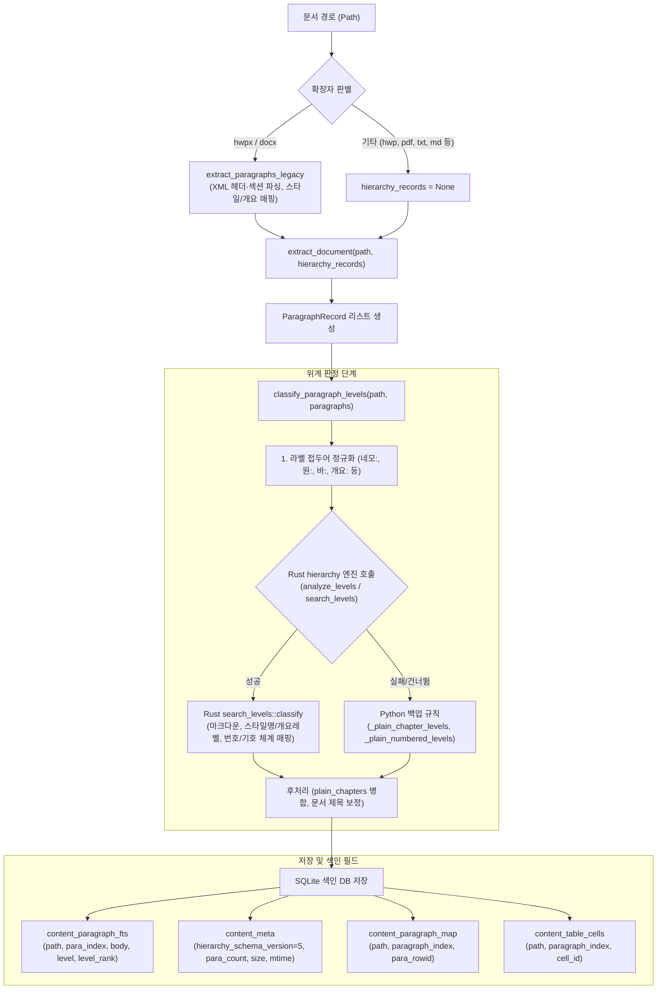
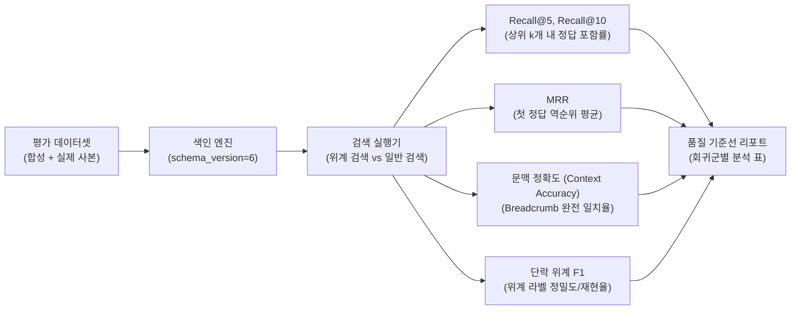

# HIER3D — 위계 추출 확대 설계: HWP·PDF 위계 추출 및 HWPX 본문 제N장 판정

작성일: 2026-11-23  
상태: 설계 문서 (코드 변경 없음)  
관련 카드: HIER3D  
관련 문서: `TODO.md`, `docs/HIERPDF_GAP_2026-11-18.md`, `docs/XMLPASS1_ANALYSIS_2026-11-22.md`, `docs/benchmarks/위계검색_품질_기준선_2026-11-12.md`

---

## 1. 현재 위계 추출 흐름, 지원 형식 표 및 색인 스키마 영향

### 1.1 현재 위계 추출 파이프라인 (입력 → hierarchy 크레이트 → 색인 필드)



1. **문서 입력 및 1차 추출 (`extract_paragraphs`)**:
   - `docfit_core/timemachine/content_search.py:extract_paragraphs()`가 진입점입니다.
   - 확장자가 `.hwpx`, `.docx`일 때만 `extract_paragraphs_legacy()`를 호출하여 문서의 스타일 사전(`style_map`), 개요 수준(`outlineLevel`), 표 식별자(`table_id`, `cell_id`)를 포함하는 `hierarchy_records`를 선행 생성합니다.
   - 포맷별 추출기(`extract_document()`):
     - **HWPX**: `extract_hwpx()`가 `<hp:p>` 요소를 순회하여 본문 문단을 생성하되, 현재 표 셀(`tag in {"tc", "cell"}`)은 내부 문단 추출을 건너뛰고(`return`) 있습니다.
     - **HWP5**: `extract_hwp()`가 Rust `klib extract`(`klib/src/hwp5.rs`)를 우선 호출하여 문단 단위 텍스트를 추출하며, 실패 시 `kordoc`(Node.js)으로 폴백합니다.
     - **PDF**: `extract_pdf()`가 `pypdfium2`를 독점 잠금 하에 호출하여 각 페이지 텍스트를 줄 단위(`splitlines()`)로 분리해 반환합니다.
     - **TXT/MD**: `extract_plain_text()`가 줄 단위로 문단을 분리합니다.
2. **위계 판정 (`classify_paragraph_levels`)**:
   - `docfit_core/timemachine/content_search.py` 및 Rust `hierarchy/src/search_levels.rs`가 판정을 수행합니다.
   - 1차: `네모:`, `원:`, `바:`, `개요:` 등의 라벨 전처리 및 기호 변환(`□`, `ㅇ`, `-`).
   - 2차: `hierarchy` C ABI / Bridge를 통해 `search_levels` JSON 페이로드를 전달하여 Rust `classify()` 실행.
   - Rust 내부:
     - 확장자가 `.txt`, `.md`인 경우(`plain=true`): `#` 헤딩, `제N장` 정규식(`chapter()`), 연속 번호 체계(`Ⅰ.`, `1.`, `가.`) 순서 검증.
     - 서식 메타데이터가 있는 경우: `style_name`(제목 1~3, 개요 1~3 등) 및 `outline_level`(0~3)을 1:1로 `document_title`, `chapter`, `section`, `topic`에 매핑.
     - 그 외: `leading_marker_with_scheme`, `unify_marker`, `classify_marker`로 기호(□, ㅇ, -, * 등) 체계 매핑.
3. **색인 필드 저장**:
   - `content_paragraph_fts`: `body`(문단 원문 텍스트), `level`(`document_title`, `chapter`, `section`, `topic`, `square`, `circle`, `dash`, `asterisk`, `body`, `table_cell`), `level_rank`(순위 가중치 0~9).
   - `content_meta`: `hierarchy_schema_version`(현재 5), 파일 메타데이터.
   - `content_paragraph_map`: 문단 번호와 FTS rowid 매핑.
   - `content_table_cells`: 표 셀 위치 매핑.

---

### 1.2 지원 형식별 위계 판정 현황

| 형식 | 추출 엔진 | 추출되는 메타데이터 | 위계 판정 방식 | 판정 가능한 위계 수준 | 현재 한계 및 결함 |
|---|---|---|---|---|---|
| **HWPX** | `extract_hwpx`<br/>(defusedxml) | 스타일명(`styleIDRef`), 개요수준(`outlineLevel`), 표/셀 ID | XML 서식 매핑 + 기호 체계 매핑 | 제목(0), 장(1), 절(2), 항(3), 기호(□, ㅇ, -, *) | 표 안 문단 완전 누락, 본문 텍스트 내 `제N장`은 서식 스타일 없을 시 누락 |
| **DOCX** | `extract_docx`<br/>(defusedxml) | 스타일명(`w:val`), 개요수준 | Heading 1~3 스타일 매핑 + 기호 매핑 | 제목, 장, 절, 항, 기호 | 비표준 스타일명 매핑 한계 |
| **TXT / MD** | `extract_plain_text` | 행 번호만 존재 | `#` 헤딩, `제N장` 텍스트, 연속 번호 체계 | 제목, 장, 절, 항, 기호 | 구조적 스타일 정보 없음 (텍스트 전용) |
| **HWP (5.0 이진)** | `extract_hwp`<br/>(`klib extract` 우선) | `location_kind`<br/>(문단/표셀/각주 등 구분) | 기호 매핑만 적용 (□, ㅇ, -, *) | 기호(4~7단계), 본문(8단계)만 지원 | `style_name`, `outline_level`이 None으로 고정; 텍스트 연속번호/제N장 규칙 미적용 |
| **PDF** | `extract_pdf`<br/>(`pypdfium2`) | 쪽 번호(`location_label`) | 줄 단위 연속 번호/제N장 일부 연동 | 장·절·항 일부 추정, 기호 | 글자 크기·좌표·볼드 미추출, 다단/표/줄바꿈 문단 분리 불가 |
| **PPTX / XLSX** | `extract_ooxml` | 슬라이드/시트/테이블 | 본문(body) 또는 단순 레벨 | 본문 위주 | 문서 위계 구조 분석 비대상 |

---

### 1.3 색인 스키마 버전(`hierarchy_schema_version`)의 영향

1. **정의 및 현재 상태**:
   - `docfit_core/timemachine/content_search.py:74`에 `CURRENT_HIERARCHY_SCHEMA_VERSION = 5`로 선언되어 있습니다.
   - `content_meta` 테이블의 컬럼으로 저장되며, 각 파일이 어떤 규칙 버전으로 위계가 색인되었는지를 나타내는 유일한 지표입니다.
2. **동작 메커니즘**:
   - **`stale_hierarchy_paths(paths)`**: 색인된 파일의 mtime/size가 그대로여도 `hierarchy_schema_version < CURRENT_HIERARCHY_SCHEMA_VERSION`이면 낡은 위계로 간주하여 목록을 반환합니다.
   - **`relevel_file(path)`**: 다른 고속 색인기(Rust `klib index-content`는 낮은 스키마 버전을 기록함)가 작성한 본문 행은 보존하고 위계(`level`, `level_rank`)만 현재 Python/Rust 규칙으로 즉시 갱신한 뒤 스키마 버전을 갱신합니다.
   - **`index_file(path)`**: 증분 색인 검사 시 스키마 버전이 낮으면 문서를 재파싱하여 FTS 및 문단 위계를 전면 재색인합니다.
3. **위계 추출 확대 시의 영향**:
   - HWP/PDF 위계 판정 도입 및 HWPX 제N장 판정 개선 시 **반드시 `CURRENT_HIERARCHY_SCHEMA_VERSION = 6`으로 판올림**해야 합니다.
   - 판올림 시 이미 색인된 기존 HWP, PDF, HWPX 문서들이 `stale` 상태로 감지되어 백그라운드에서 순차적으로 재판정(`relevel_file`)되므로, 사용자 개입 없이 점진적으로 검색 품질이 자동 개선됩니다.

---

## 2. HWP(바이너리)에서 위계 추출 설계

### 2.1 klib extract 의 문단 경계 및 글머리 정보 제공 여부 분석 (코드 실측)

`klib/src/hwp5.rs`와 `klib/src/extract.rs`의 코드를 확인한 결과:
1. **문단 경계 (Paragraph Boundaries)**:
   - `klib/src/hwp5.rs:799-835`의 `extract_paragraphs_from_section` 함수는 `HWPTAG_PARA_HEADER` 태그로 문단의 시작을 감지하고, `HWPTAG_PARA_TEXT` 태그로 문단 텍스트를 디코딩합니다.
   - 제어 문자(0~31) 중 탭(`\t`), 줄바꿈(`\n`), 하이픈(`-`), 공백 등을 표준적으로 복원하며 인라인 컨트롤(8 WCHAR)을 정확히 건너뜁니다.
   - 표 셀(`table_cell`), 머리말(`header`), 꼬리말(`footer`), 각주(`footnote`), 미주(`endnote`), 글상자(`textbox`) 등 구역 종류를 스택 기반으로 정확하게 분리합니다.
   - **결론**: 문단 경계와 구역 구분은 **완벽하게 제공**됩니다.
2. **글머리 / 서식 번호 / 개요 수준 정보**:
   - `klib/src/hwp5.rs:823-833`:
     ```rust
     records.push(Paragraph {
         text: trimmed.to_owned(),
         location_kind,
         location_label: format!("문단 {seq}"),
         sequence: seq,
         section: Some(section_name.to_owned()),
         hierarchy_level: None,
         is_table_cell,
         style_name: None,     // <-- 항상 None
         outline_level: None,  // <-- 항상 None
     });
     ```
   - **결론**: 현재 `klib extract`는 글머리표(bullet), 문단 번호(autonumber), 개요 수준(`outline_level`), 스타일 이름(`style_name`)을 **전혀 추출하지 않고 항상 None으로 반환**합니다.

---

### 2.2 문단 단위 텍스트만으로 위계 규칙 적용 가능성

문단 단위 텍스트(`trimmed`)가 정상 추출되므로, 사용자가 본문에 번호/기호를 직접 입력한 문서는 **텍스트 기반 위계 규칙만으로도 충분히 위계를 추출할 수 있습니다**.

1. **현재 배제 원인**:
   - `hierarchy/src/search_levels.rs:142`:
     ```rust
     let plain = matches!(ext.as_str(), "txt" | "md");
     ```
   - `docfit_core/timemachine/content_search.py:214`:
     ```python
     if Path(path).suffix.lower() not in {".txt", ".md", ".pdf"}:
         return {}
     ```
   - HWP 확장자가 `plain` 검사군에서 제외되어 있어, 본문에 "제1장 총칙", "1. 개요", "가. 세부사항"이 명확히 적혀 있어도 연속 번호 검사기(`plain_levels`, `plain_chapters`)가 동작하지 않고 기호 체계 매핑이나 "body"로 떨어집니다.
2. **해결책**:
   - `search_levels.rs`와 `content_search.py`에서 `plain` 판정 조건에 `"hwp"`(및 `"hwpx"`)를 추가하거나, 서식 정보가 비어 있는(`style_name.is_empty() && outline_level.is_none()`) 모든 문서에 대해 텍스트 기반 연속 번호 판정기를 공통 적용하도록 개선합니다.

---

### 2.3 필요한 추가 추출 정보(문단 수준·번호 서식)와 구현 지점

HWP 문서 중 상당수는 텍스트에 "1."이나 "제1장"을 타이핑하지 않고 한/글의 **"개요 번호"**나 **"문단 번호"** 서식 속성을 사용합니다. 이 경우 본문 텍스트에는 번호가 없으므로 텍스트 파싱만으로는 번호 체계를 알 수 없습니다.

1. **필요한 HWP5 바이너리 메타데이터**:
   - `DocInfo` 스트림 파싱:
     - `HWPTAG_PARA_SHAPE`: 문단 모양 레코드. 각 문단의 여백, 줄간격, `outlineLevel`(개요 수준 1~7), 참조하는 문단 번호/글머리표 ID.
     - `HWPTAG_STYLE`: 스타일 레코드. 스타일 이름(예: "개요 1", "개요 2", "본문 1") 및 스타일이 참조하는 `para_shape_id`.
     - `HWPTAG_NUMBERING` / `HWPTAG_BULLET`: 번호 서식 정의 (번호 모양, 머리말 문자열 형식: `^1.`, `제^1장`).
   - `BodyText/Section*` 스트림 파싱:
     - `HWPTAG_PARA_HEADER`: 각 문단 헤더 레코드(최소 16바이트)의 앞 2바이트는 `ParaShape ID`, 4~5바이트는 `Style ID`를 포함함.
2. **구현 지점**:
   - **`klib/src/hwp5.rs`**:
     - `parse_doc_info(&mut comp)` 함수 추가: `DocInfo` 스트림을 읽어 `Vec<StyleInfo>` 및 `Vec<ParaShapeInfo>` 테이블 구축.
     - `extract_paragraphs_from_section()` 수정: `HWPTAG_PARA_HEADER`에서 `para_shape_id`와 `style_id`를 읽고, `DocInfo` 테이블을 참조하여 `Paragraph`의 `style_name`과 `outline_level`을 채워 넣음.
   - **`klib/src/extract.rs`**:
     - `Paragraph` 구조체에서 추출된 `style_name`, `outline_level`을 보존하여 JSON으로 직렬화.
   - **`docfit_core/timemachine/extractors_hwp.py`**:
     - `_extract_hwp_rust()`에서 JSON 항목의 `style_name`, `outline_level`을 `ExtractionRecord`로 전달.

---

## 3. PDF 에서 위계 추출 설계

### 3.1 텍스트 줄·글자 크기·들여쓰기 신호 기반 위계 추정 방법 및 한계

디지털 PDF는 문단이나 스타일 태그가 없으며, 2차원 평면상의 글리프 렌더링 명령어만 존재합니다. 따라서 시각적 레이아웃 신호를 복원하여 위계를 추정해야 합니다.

1. **추정 신호 (Visual Signals)**:
   - **글자 크기 (Font Size, pt)**:
     - 문서 전체의 폰트 크기 히스토그램을 작성하여 최빈값(Mode)을 **본문 기준 크기($S_{body}$, 대개 9~11pt)**로 산출.
     - $S \ge 1.4 \times S_{body}$ (약 15pt 이상): `document_title` 또는 `chapter` 후보.
     - $S \ge 1.2 \times S_{body}$ (약 12~14pt): `section` 후보.
     - $S \ge 1.05 \times S_{body}$ 또는 본문 크기이면서 볼드(Bold): `topic` 후보.
   - **들여쓰기 위치 (X-Coordinate, Bounding Box Left)**:
     - 각 줄의 시작 x좌표($X_{left}$)를 측정하여 본문 기본 좌측 여백($X_{margin}$) 대비 상대적 오프셋 계산.
     - 들여쓰기 깊이에 따라 하위 항목(□ -> ㅇ -> - -> *) 매핑 가중치 부여.
   - **수직 간격 (Line Spacing / Prev Spacing, Y-Coordinate)**:
     - 이전 줄과의 Y좌표 간격이 일반 줄간격(Line pitch)보다 큰 경우(단락 분리 또는 상단 여백)를 제목 후보의 보강 신호로 활용.
   - **텍스트 번호 체계와의 결합 (Ensemble)**:
     - 텍스트 앞머리의 "제N장", "Ⅰ.", "1.", "가." 패턴과 시각적 신호(큰 글자, 볼드)가 일치하면 가중치를 극대화하여 확실한 제목으로 확정.
2. **기술적 한계 (스캔 PDF 제외)**:
   - **다단(Multi-column) 조판**: 2단/3단 문서에서 단순 Y좌표 순 정렬 시 좌우 단의 줄이 번갈아 섞이는 읽기 순서(Reading Order) 붕괴 위험. (X좌표 기반 단 분할 알고리즘 필요)
   - **머리말 / 꼬리말 / 쪽 번호**: 페이지 상·하단 고정 위치에 반복 등장하는 문서명, 장 제목, 쪽 번호가 매 페이지마다 독립 제목으로 오인식되는 문제. (상하단 일정 영역 필터링 필요)
   - **표(Table) 내 텍스트**: 표 셀 경계선 없이 배치된 다열 표 데이터가 여러 문단 또는 불릿 목록으로 오인식됨.
   - **줄바꿈 문장의 단편화**: 긴 문장이 줄바꿈된 경우 새 문단으로 쪼개져 번호 체계의 연속성이 왜곡될 위험. (마침표 등 종결부호 검사 및 우측 여백 여유 판정으로 줄 병합 필요)

---

### 3.2 필요한 라이브러리 및 새 의존성 필요 여부

- **결론: 새로운 외부 의존성 라이브러리가 전혀 필요하지 않습니다 (No New Dependency).**
- **근거**:
  - 프로젝트는 이미 `pypdfium2`(Apache-2.0 / BSD-3)를 공식 텍스트 추출 및 변환 엔진으로 탑재하고 있습니다 (`requirements.txt`, PyInstaller 스펙).
  - 또한 `docfit_core/pdf_style_transfer.py:65-120`에서 이미 `pypdfium2.raw` C API를 직접 호출하여:
    - `R.FPDFText_GetFontSize(text, i)`: 글자 크기 추출
    - `R.FPDFText_GetFontInfo(...)`: 폰트명 및 볼드/이탤릭 여부 추출
    - `text.get_charbox(i)`: 글자별 x0, y0, x1, y1 좌표 추출
  - 이 기능이 완전히 검증되어 동작하고 있으므로, 이를 재사용하여 `docfit_core/timemachine/extractors_pdf.py`에 줄 단위 시각 메타데이터(크기, 볼드, x좌표) 집계 함수만 구현하면 됩니다.

---

## 4. HWPX 본문 안 제N장 판정 결함 분석 및 개선안

### 4.1 현재 규칙이 놓치는 세 가지 경우 분석 (코드 실측)

#### 경우 A: 표 안 (`is_table_cell = True`)
- **코드 위치**: `docfit_core/timemachine/extractors_hwpx.py:117-124`, `content_search.py:517-518`, `hierarchy/src/search_levels.rs:218, 276-277`
- **분석**:
  - `extractors_hwpx.py`는 `walk(node)` 시 `tag in {"tc", "cell"}`을 만나면 `in_table=True`로 재귀 호출한 뒤, `<hp:p>`에서 `if in_cell: return`으로 **표 내부 문단을 완전히 삭제**해 버립니다.
  - 설령 `extract_paragraphs_legacy`를 통해 표 문단이 수집되더라도, `content_search.py:517`에서 `level = "table_cell"`로 강제 덮어씁니다.
  - Rust `search_levels.rs:218`에서도 `!cell(&paragraphs[*i])` 조건으로 인해 표 안 문단은 `chapter_numbers` 수집에서 배제됩니다.
- **실무 누락 사례**: 공공기관 규정집, 보고서 표지, 지침서 등에서 단일 셀 박스 표(1x1) 안에 `제1장 총칙`을 크게 배치하는 양식이 매우 흔하나, 현재는 완전히 검색에서 누락되거나 위계 없는 표 셀로만 취급됩니다.

#### 경우 B: 문단 중간 및 전치 기호 뒤에 나오는 장 표기
- **코드 위치**: `hierarchy/src/compat/leading_marker.rs:7`, `search_levels.rs:68-79`, `content_search.py:221`
- **분석**:
  - `search_levels.rs:68`의 `chapter()` 함수는 `let rest = s.strip_prefix('제')?;`로 오직 문자열이 `'제'`로 시작할 때만 동작합니다.
  - `leading_marker.rs`의 정규식 또한 `^(?:제\s?\d{1,2}\s?[장편부]...)`로 문단 맨 앞에 앵커(`^`)되어 있습니다.
- **실무 누락 사례**:
  - `[붙임 1] 제1장 총칙`, `【별표 3】 제2장 산출기준`, `<참고> 제1장 운영원칙` 등 괄호/기호가 선행하는 경우.
  - `제 1 장: 총칙`처럼 콜론이나 장평 공백이 들어간 경우.
  - 하나의 문단 안에 줄바꿈(`\n` 또는 `<hp:lineBreak>`)으로 `제1장 총칙 \n 제1절 목적`이 합쳐진 경우 두 번째 장/절이 누락됨.

#### 경우 C: 번호 체계가 서식 번호(Auto-numbering / Bullets)인 경우
- **코드 위치**: `docfit_core/timemachine/extractors_hwpx.py:18-44`, `search_levels.rs:285-296`
- **분석**:
  - 사용자가 한/글에서 "개요 1" 스타일 또는 문단 번호 서식을 적용하고 텍스트로 번호를 치지 않은 경우, HWPX XML의 `<hp:t>` 태그에는 **"총칙"**이라는 텍스트만 들어갑니다 ("제1장"은 파일에 텍스트로 저장되지 않음).
  - 현재 `extract_hwpx`는 `<hp:t>`의 글자만 추출하므로, 추출된 텍스트는 `"총칙"`이 됩니다.
  - Rust `search_levels.rs`가 `outline == Some(1)`로 인해 이 문단의 레벨을 `chapter`로 분류할 수는 있지만:
    1. 사용자가 FTS 본문 검색에서 `"제1장"` 또는 `"제1장 총칙"`을 입력했을 때, 텍스트에 `"제1장"`이 없으므로 **절대 검색되지 않는 치명적 불일치**가 발생합니다.
    2. 스타일명이 표준 "개요 1"이 아닌 사용자 지정 스타일이거나 번호 서식(`numberingIDRef`)만 걸려 있는 경우, `outline_level`이 누락되어 `body`로 오분류됩니다.

---

### 4.2 개선안

1. **표 안 장 판정 지원 (단일 셀 및 첫 행 헤더 표 허용)**:
   - `extractors_hwpx.py`에서 표 안 문단을 drop하지 않고 `is_table_cell=True` 플래그를 달아 정상 추출.
   - `search_levels.rs`에서 `table[i]`인 문단이라도 **1x1 단일 셀 표**이거나 표의 첫 행 문단이면서 `chapter(s)` 조건을 만족하면 `chapter`로 판정 허용.
2. **문단 앞머리 전치 기호 정규화**:
   - `chapter` 검사 전 선행 괄호류(`[`, `【`, `<`, `(`, `〔`) 및 부록 접두어(`별첨`, `붙임`, `별표`, `부록`, `참고`)를 벗겨내는 전처리 함수 `trim_leading_labels()` 적용.
   - `leading_marker.rs` 정규식 개선:
     `r"^(?:[\[【<（(][^\]】>）)]+[\]】>）)]\s*)?(?:제\s?\d{1,2}\s?[장편부]|\d{1,2}\s?장|[Cc]hapter\s?\d{1,2})(?=\s|$|[.．:：])"`
3. **서식 번호(Auto-number)의 가상 접두어(Virtual Prefix) 합성**:
   - HWPX/HWP 추출 단계에서 문단에 `outlineLevel` 또는 번호 서식이 걸려 있고 텍스트가 번호 없이 시작하면, 해당 수준에 매핑되는 번호 문자열(예: `제N장 `, `1. `, `가. `)을 합성하여 레코드 텍스트 앞머리에 결합.
   - FTS 색인과 위계 판정기 모두에서 일관되게 `"제1장 총칙"`으로 인식되어 검색 재현율이 대폭 향상됨.

---

## 5. 품질 평가 방법 및 기준선 측정

### 5.1 위계 품질 기준선 문서 기반 정밀도·재현율 측정 체계

`docs/benchmarks/위계검색_품질_기준선_2026-11-12.md`와 `scripts/eval_hierarchy_search.py`의 측정 프로토콜을 확장하여 HWP/PDF/HWPX에 적용합니다.



1. **핵심 메트릭**:
   - **Recall@k (k=5, 10)**: 질의에 대한 정답 문서가 상위 k위 내에 랭크된 비율. (기준선: 위계 0.317 / 0.642, 일반 0.325 / 0.651)
   - **MRR (Mean Reciprocal Rank)**: 첫 번째 정답 결과 순위의 역수 평균 ($1/rank$). (기준선: 1.000)
   - **문맥 정확도 (Context Accuracy)**: 고유어 질의로 검색된 첫 결과의 위계 경로(Breadcrumb, 예: `지침서 → 제1장 총칙 → 1. 목적`)가 기대 경로와 100% 일치하는 비율. (기준선: 1.000)
   - **위계 분류 F1 (Hierarchy Classification F1)**: 각 문단에 부여된 레벨(`chapter`, `section`, `topic` 등)의 Ground Truth 대비 정밀도(Precision)와 재현율(Recall)의 조화평균.
2. **회귀군(Regression Cohort) 분류**:
   - 표 안 제목군 (Table Title Cohort)
   - 전치 기호 장 제목군 (Prefixed Chapter Cohort)
   - 서식 번호/개요 스타일군 (Outline Style Cohort)
   - HWP5 이진 문서군 (HWP5 Binary Cohort)
   - 디지털 PDF 레이아웃군 (Digital PDF Cohort)

---

### 5.2 합성 문서와 실제 사용자 문서 사본의 역할 분담

1. **합성 문서로 먼저 검증할 수 있는 범위 (맥 환경에서 즉시 실행 가능)**:
   - `scripts/eval_hierarchy_search.py`를 확장하여 HWPX/PDF 합성 문서 생성기 구현.
   - 단일 셀 표 안에 `제1장`이 들어간 HWPX 합성 문서 20종.
   - 접두 기호(`[붙임 1]`, `【별표】`)가 붙은 제N장 HWPX/PDF 합성 문서 20종.
   - `pypdfium2`를 이용해 다양한 폰트 크기(18pt, 14pt, 10pt)와 들여쓰기 좌표를 가진 PDF 합성 문서 30종.
   - 이를 통해 기능 구현 즉시 단위 시험 및 회귀 검증을 100% 자동화하여 수행.
2. **사용자 문서 사본이 반드시 필요한 이유 (TODO.md 명시 사항)**:
   - TODO.md: `[상태 2026-11-21: 감사 미착수 — 합성 평가 스크립트·기준선만 있고 위계 대 일반 검색 실문서 평가 없음. 필요한 사용자 조치: 평가용 문서 사본·질의 세트 제공]`
   - 실제 관공서/기업 HWP 문서는 10년 이상 누적된 다양한 한글 버전(HWP 2002~2020)의 비표준 서식, 다단 조판 내 숨겨진 표, 사용자 임의 개요 번호 등이 복잡하게 얽혀 있어 합성 문서가 포착하지 못하는 엣지 케이스가 존재합니다.
   - 따라서 **비식별화된 실제 업무 문서(HWP 20종, HWPX 10종, PDF 10종)와 실무 검색 질의 세트(50개)**의 제공이 최종 릴리스 검증에 필수적입니다.

---

## 6. 단계별 카드 계획 및 위험·결정 사항

### 6.1 단계별 카드 계획

| 카드명 | 작업 내용 | 완료 조건 | 의존성 | 규모 | 워커 (맥 가능 여부) |
|---|---|---|---|---|---|
| **HIER3D-1** | HWPX 표 안 및 전치 기호 제N장 판정 개선 | 표 안 1x1 제N장 인식, `[붙임 1] 제1장` 인식 단위 테스트 통과 | 없음 | 소 | 맥 가능 (Python / Rust) |
| **HIER3D-2** | HWP5 문단 텍스트 기반 위계 판정 연동 | `klib extract` 텍스트로 HWP 본문의 제N장/연속번호 위계 분류 단위 테스트 통과 | 없음 | 소 | 맥 가능 (Python / Rust) |
| **HIER3D-3** | HWP5 이진 DocInfo (스타일·개요 수준) 추출 구현 | `klib/src/hwp5.rs`에서 `DocInfo` 스트림 파싱하여 `style_name`, `outline_level` 반환 | HIER3D-2 | 중 | 맥 가능 (Rust klib) |
| **HIER3D-4** | PDF pypdfium2 글자 크기·좌표 기반 위계 추정 구현 | `extractors_pdf.py`에서 폰트 크기 최빈값 대비 제목 추정 및 breadcrumb 생성 검증 | 없음 | 중 | 맥 가능 (Python pypdfium2) |
| **HIER3D-5** | 위계 색인 스키마 v6 판올림 및 일괄 재판정 파이프라인 | `CURRENT_HIERARCHY_SCHEMA_VERSION=6` 선언, `stale` 감지 및 `relevel_file` 회귀 시험 통과 | HIER3D-1~4 | 소 | 맥 가능 (Python) |
| **HIER3D-6** | 위계 검색 실문서/합성문서 품질 벤치마크 측정 | HWP/PDF/HWPX 품질 기준선 리포트 작성 및 Recall/MRR 개선 검증 | HIER3D-5 | 중 | 맥 가능 (합성 평가), Windows (실문서 COM 대조) |

---

### 6.2 잠재 위험 (Risks)

1. **위계 오판 (False Positive)으로 인한 검색 랭킹 왜곡**:
   - 본문 중간의 단순 인용문("...제1장에 명시된 바와 같이...")이나 표 안의 일반 텍스트가 장/절 제목으로 오판되면, 문서의 breadcrumb 구조가 깨지고 위계 순위 랭킹(1순위: 파일명 > 2순위: 위계 > 3순위: 본문)에서 엉뚱한 결과가 상단에 노출될 위험.
   - **대책**: 연속 번호 검증(제1장 다음에 제2장 등장 여부), 줄 길이 제한(60자 이하), 단락 독립성 검사를 필수 통과해야만 인정.
2. **PDF 레이아웃 분석 성능 저하**:
   - PDF의 모든 글자 단위로 좌표/크기 C API를 순회할 경우, 페이지당 수만 개의 글리프가 있는 긴 문서에서 색인 시간이 크게 증가할 위험.
   - **대책**: 라인 단위 Bounding Box 추출을 우선 사용하고, 폰트 크기 통계는 첫 5페이지 샘플링으로 조기 결정.
3. **스키마 버전 v6 갱신에 따른 대량 재판정 부하**:
   - 기존 사용자의 수천 개 문서가 일시에 `stale`로 분류되어 백그라운드 재판정이 과도한 CPU 점유를 유발할 위험.
   - **대책**: 검색 요청 시 필요한 파일만 우선 갱신(Lazy releveling)하고, 유휴 시간에 백그라운드 큐로 분당 N개씩 조절 처리.

---

### 6.3 사용자 결정 사항 (Decisions Needed)

1. **실제 업무 문서 사본 및 질의 세트 제공 일정**:
   - TODO에 명시된 비식별화된 실제 문서 사본(지침·규정·보고서 HWP/HWPX/PDF) 및 질의 세트의 공급 시점 결정 필요.
2. **HWP5 개요 번호 추출의 단계적 추진 여부**:
   - 1단계(텍스트 기반 판정 연동, HIER3D-2)를 먼저 배포하여 즉시 체감 효과를 낼 것인지, 2단계(바이너리 DocInfo 완전 파싱, HIER3D-3)까지 일괄 완성 후 릴리스할 것인지 결정 필요.
3. **스키마 판올림(v6) 시 백그라운드 일괄 재색인 정책**:
   - 사용자가 앱 시작 시 전체 재색인을 돌릴 것인지, 아니면 파일 오픈/검색 시 온디맨드로 점진 갱신할 것인지 정책 결정 필요.

---

### 6.4 확인하지 못한 점 (미확인)

- **사용자 보유 실제 HWP 문서 중 순수 서식 번호(자동 번호) 의존 비율**: 현재 리포지토리 내 표본에는 텍스트 기반 번호와 서식 번호가 혼재되어 있으나, 실제 사용자 보관소의 비율은 **미확인**.
- **다단(Multi-column) 조판 PDF의 업무 문서 비중**: 관공서 보고서 중 2단 조판 PDF의 발생 빈도 및 레이아웃 패턴은 **미확인**.
- **초대형 PDF(500페이지 이상 지침서)에서의 pypdfium2 글자 크기 추출 시 메모리 점유율 및 지연 시간**: 실제 대용량 표본 미보유로 **미확인**.
