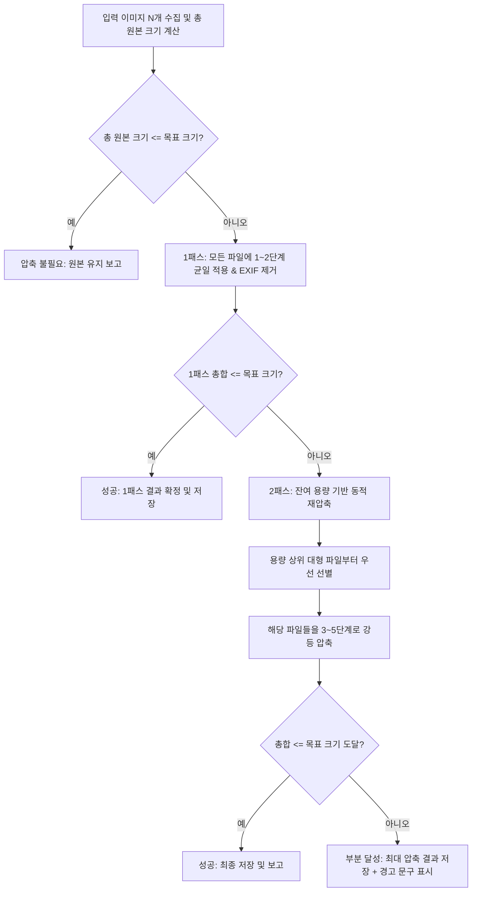

# 이미지 파일(JPG 등) 총 크기 줄이기 설계 문서 (IMGCOMP1)

작성일자: 2026-11-22  
상태: 설계 완료 (구현 대기)  
선행 작업: `docs/PDFIMG_RESULT_2026-11-21.md` (① PDF 압축 이미지 PDF 방식 반영 결과), `TODO.md` 해당 항목 ②

---

## 1. 개요 및 배경

현재 몽땅파일변환 앱은 HWP, HWPX, PDF, 이미지(PNG/JPG) 등의 상호 변환을 지원하며, 최근 `docfit_core/pdf_compress.py`를 통해 단일 PDF의 그림 재인코딩 및 이미지 PDF 전환을 통한 용량 압축(`pdfz`, `pdfi`)을 구현했다.  
그러나 업무 환경(공공기관, 지자체, 교육청, 사내 포털 등)에서는 게시판 첨부 한도나 메일 용량 제한(예: 총합 10MB, 20MB) 때문에 스마트폰 촬영 사진이나 고해상도 스캔 이미지(JPG, PNG 등) 여러 장의 총용량을 한꺼번에 줄여야 하는 요구가 빈번하다.

본 문서는 **"이미지 파일(JPG 등) 총 크기 줄이기"** 기능을 현재의 변환 파이프라인(`docfit_core`, `docfit_app`, `flutter_ui`)에 매끄럽게 통합하기 위한 상세 설계 문서이다.  
설계 시 **Rust 우선 원칙**(필수 사유가 없으면 고성능·안전성의 Rust 엔진 채택)을 준수하며, 원본 불변성, 사실 기반 설계, 단계적 압축 탐색 및 화질 저하 방지를 핵심 목표로 한다.

---

## 2. ① 현재 파일변환 구조에서 이미지 압축이 들어갈 자리

### 2.1 입력 확장자 및 대상
- **지원 입력 확장자 (`IMAGE_INPUT_EXTENSIONS`)**:
  - 기존 `docfit_core/file_conversion.py`에 정의된 8개 확장자:
    `{".png", ".jpg", ".jpeg", ".webp", ".bmp", ".tif", ".tiff", ".gif"}`
- **입력 파일 선택 형태**:
  - 복수 이미지 파일 드래그앤드롭 / 파일 선택 창 다중 선택
  - 폴더 끌어놓기 또는 폴더 선택(내부의 모든 지원 이미지 파일 자동 수집)

### 2.2 결과 형식 식별자 (Target Identifier)
- **타깃 키**: `imgz` (기존 PDF 압축 `pdfz`와 대칭되는 직관적 명칭)
- `docfit_core/file_conversion.py`의 `CONVERSION_OUTPUTS`에 `"imgz"` 추가:
  ```python
  CONVERSION_OUTPUTS = frozenset({
      "hwpx", "pdf", "pdfz", "pdfm", "pdfi", "imgz",
      "docx", "epub", "html", "jpg", "png", "txt", "md"
  })
  ```
- **UI 노출 명칭**:
  - Label: `이미지 압축` (또는 영문 UI 시 `IMG COMPRESS`)
  - Icon: `Icons.photo_size_select_large_outlined` 또는 `Icons.compress`
  - 활성화 조건(`enabled`): 선택된 파일이 1개 이상이며, 선택된 모든 파일의 확장자가 `IMAGE_INPUT_EXTENSIONS`에 포함될 때 활성화.

### 2.3 옵션 구조 (Options)
사용자 및 UI가 전달하는 파라미터 규격 (`kwargs` / JSON 페이로드):
1. `image_target_total_mb`: 전체 결과 총합 목표 크기(MB 단위, 기본값: 10MB). 0 이하일 경우 개별 파일 목표 크기 모드로 전환.
2. `image_target_file_mb`: 파일당 개별 목표 크기(MB 단위, 선택 사항, 예: 2MB).
3. `image_compress_mode`:
   - `auto` (기본값): 포맷을 유지하되(JPG→JPG, PNG→PNG) 품질 및 해상도 단계적 조절. 목표 달성 불가 시 투명도 없는 PNG는 JPG 변환 허용.
   - `keep_format`: 절대 파일 형식을 바꾸지 않고 품질과 해상도만 조절.
   - `aggressive_webp`: 고압축 WebP 형식으로 전면 변환(웹 게시용).
4. `preserve_exif`: EXIF 메타데이터 보존 여부 (기본값: `False` — 위치 정보/개인정보 삭제 및 파일 크기 절약. 단, 회전 정보 `Orientation`은 삭제 전 픽셀 자체에 반드시 회전 반영).

### 2.4 진행 보고 (Progress & Cancellation)
- `docfit_app/conversion_runner.py`의 `run_conversion` 및 `progress` 콜백 연동:
  - 파일 인덱스별 진행률:
    `('progress', {'file': i, 'total': N, 'percent': int((i / N) * 100), 'stage': f'{source.name} {step_desc} 압축 중'})`
  - 단계별 취소 확인:
    `stop_event.is_set()`을 각 파일 압축 시작 전 및 각 단계(Step) 시도 루프 사이에서 확인하여 취소 시 임시 파일 정리 후 즉시 반환.

### 2.5 결과 파일 저장 규칙
- `docfit_core/file_conversion.py`의 `output_path_for` 규칙 확장:
  - 원본 옆 저장 모드:
    - 원본이 `photo.jpg`인 경우: `photo(이미지압축).jpg`
    - 확장자가 바뀌는 경우 (예: PNG→JPG 변환): `graphic(이미지압축).jpg`
    - 중복 회피: 기존 파일 존재 시 `photo(이미지압축) (2).jpg` 순으로 증가
  - 출력 폴더 지정 모드 (`output_dir` 설정 시):
    - 지정된 폴더 내에 위 명명 규칙을 적용하여 생성.
  - **불변 원칙**: 원본 파일은 읽기 전용으로만 열며, 절대 원본 경로를 덮어쓰거나 수정하지 않는다.

---

## 3. ② 방식 비교표 및 구현 위치 (Rust 우선 원칙)

### 3.1 압축 방식별 비교표

| 방식 | 줄어드는 정도 (압축률) | 화질 위험 및 부작용 | 호환성 | 구현 위치 및 추천 의존성 |
|---|---|---|---|---|
| **JPEG 재인코딩 품질 단계** (Quality 85→75→65→50→35) | 30% ~ 75% 절감 | 품질 65 이하에서 블록 아티팩트 및 글자/경계선 번짐 발생 가능 | 최고 (모든 뷰어, 한/글 2020, 웹, 모바일 완벽 지원) | **Rust 엔진 `klib`** (`image` 또는 `zune-jpeg`/`turbojpeg`) |
| **해상도 축소 (Downscaling)** (원본→2560→1920→1280→1024px) | 50% ~ 90% 절감 (픽셀수 4배 감소 시 용량 급감) | 미세 글자 해독력 저하, 고주파 디테일 블러 (Lanczos3 필터로 완화) | 최고 (해상도 변경은 모든 뷰어에서 정상 표시) | **Rust 엔진 `klib`** (`image::imageops::resize` / Lanczos3) |
| **PNG → JPEG 변환** (사진/스캔 이미지의 PNG 포맷) | 60% ~ 85% 절감 | **알파 채널(투명도) 손실**. 투명 영역은 흰색 배경으로 합성 필수 | 최고 (JPEG 표준 지원) | **Rust 엔진 `klib`** (알파 채널 감지 후 흰색 블렌딩 및 RGB 인코딩) |
| **WebP 변환** (손실/무손실 WebP) | 40% ~ 80% 절감 (JPEG 대비 약 25~35% 추가 절감) | 손실 모드 시 특유의 스무딩 현상 발생 | **보통** (웹 브라우저는 완벽 지원하나, **구형 한/글 2020 및 일부 폐쇄망 업무 뷰어에서 미지원 위험**) | **Rust 엔진 `klib`** (`image` 또는 `webp` 크레이트) |
| **EXIF 메타데이터 삭제** (GPS, 카메라 태그 제거) | 수 KiB ~ 수백 KiB 절감 (고해상도 썸네일 포함 시 최대 1MB 절감) | 화질 손상 없음. 단, **Orientation(회전) 태그 제거 전 픽셀 물리 회전 미적용 시 사진이 누워버리는 치명적 위험** | 최고 (표준 메타데이터 제거) | **Rust 엔진 `klib`** (`kamadak-exif` 또는 `image`의 내장 orientation) |

### 3.2 구현 위치 분석: Rust 엔진 `klib` vs Python Pillow

> **[원칙] Rust 우선 원칙 (프로젝트 핵심 규칙)**  
> 사서/엔진 계층에서 필수적인 예외 사유(예: Win32 COM, 외부 GUI 바인딩 필수)가 없는 한 연산 집약적인 파일 처리 및 압축은 Rust 크레이트(`klib`)로 구현한다.

1. **Rust 엔진 구현 타당성 검토**:
   - **속도 및 성능**: 이미지 디코딩/리사이즈/인코딩은 CPU 집약적 작업이다. Python Pillow는 C 라이브러리(libjpeg, zlib)를 바인딩하지만 Python 인터프리터 오버헤드와 GIL로 인해 수십~수백 장 일괄 처리 시 병목이 발생한다. Rust는 `rayon`을 통한 손쉬운 멀티코어 병렬화로 대량 파일 일괄 압축 시 3~5배 이상의 처리 속도를 제공한다.
   - **의존성 순수성 및 패키징**: Rust의 `image` 크레이트(v0.25)는 외부 C 동적 라이브러리(VCRUNTIME 등) 의존 없이 정적 컴파일(`+crt-static`)이 가능하여 설치본 안정성이 높다.
   - **필수 사유 검토**: 순수 Rust로 JPEG, PNG, WebP 디코딩/인코딩, Lanczos3 리사이즈, EXIF 회전 전치가 모두 가능하다. 따라서 Python 강제 사유가 없다.

2. **구현 아키텍처 (Rust 기본 + Python Fallback)**:
   - **기본 경로 (Primary)**: Rust `klib` 내에 `image_compress` 서브커맨드(CLI/IPC)를 구현.
     - 명령 형태: `klib image-compress --inputs <파일목록...> --target-mb <MB> --out-dir <경로> --preserve-exif <true/false>`
     - 구조: `crates/klib/src/image_comp.rs` 모듈 신설.
   - **대체 경로 (Fallback)**: `klib` 바이너리 미빌드 환경이나 개발 환경에서는 `docfit_core/image_compress.py`가 기존 설치된 `Pillow==13.0.0`을 사용하여 동일한 알고리즘을 수행하도록 듀얼 백엔드 구조로 설계.

---

## 4. ③ 목표 크기(MB)까지 단계적으로 내리는 알고리즘

### 4.1 기존 PDF 압축 `COMPRESS_STEPS`와의 비교 및 재사용 규칙
기존 `docfit_core/pdf_compress.py`의 `COMPRESS_STEPS`는 `(DPI, 품질, 라벨)`의 5단계 튜플로 정의되어 있다:
- `(150, 75)`, `(120, 65)`, `(100, 55)`, `(85, 45)`, `(72, 35)`
- 최소 절감률: `MIN_SAVING = 0.05` (5% 미만 절감 시 압축 포기/원본 유지)

**이미지 파일 압축에서의 차이점 및 재사용 설계**:
PDF는 문서 페이지의 물리적 출력 크기(포인트/인치)가 정해져 있어 DPI 기반 래스터화가 자연스럽지만, 단독 이미지 파일(JPG/PNG)은 페이지 크기가 없으므로 **최대 변 길이(Max Long Dimension, px)**와 **인코딩 품질(Quality)**의 2축 매트릭스로 단계를 구성해야 한다.  
기존의 5단계 단계적 강등(Step-down) 철학 및 `MIN_SAVING = 0.05` 규칙은 그대로 계승한다.

#### 이미지 압축 표준 5단계 테이블 (`IMAGE_COMPRESS_STEPS`)
| 단계 (Step) | 최대 변 길이 (Max Side) | JPEG 품질 (Quality) | 단계 설명 |
|---|---|---|---|
| **1단계** | 원본 유지 (No Resize) | 85 | 약한 압축 · 원본 해상도 유지 · 메타데이터 정리 |
| **2단계** | 최대 2560 px | 75 | 표준 고화질 · QHD급 축소 · 가벼운 압축 |
| **3단계** | 최대 1920 px | 65 | 웹/업무 표준 · FHD급 축소 · 균형 압축 |
| **4단계** | 최대 1280 px | 50 | 고압축 · HD급 축소 · 텍스트 약간 흐려짐 |
| **최대 압축 (5단계)** | 최대 1024 px | 35 | 최대 압축 · 문서 보조용 · 화질 저하 발생 |

### 4.2 단일 파일 압축 알고리즘
1. 입력 파일의 해상도, 포맷, 알파 채널 존재 여부, EXIF Orientation 확인.
2. EXIF 회전 적용(물리 픽셀 회전) 및 메타데이터 스트립.
3. 1단계부터 5단계까지 순차적으로 인코딩 시도.
4. 각 단계 시도 후 파일 크기가 목표치(`target_bytes`) 이하로 내려가면 즉시 탐색 종료.
5. 5단계까지 진행했음에도 목표를 초과하면, 가장 작게 생성된 5단계 결과를 반환하되 `reached_target=False`로 마킹.
6. 만약 최종 결과가 원본 대비 5% 이상 줄어들지 않으면(`saving < 0.05`), 압축 파일을 생성하지 않고 원본 유지(`NothingToCompress`).

### 4.3 폴더 일괄 처리 및 총 크기 목표 배분 알고리즘 (Total Target Size)
예시: 사용자가 40장의 사진(총 120MB)을 넣고 **"총합 20MB 이하로 줄여달라"**고 요청한 경우.

#### [2패스 적응형 배분 알고리즘 (2-Pass Adaptive Allocation)]


1. **사전 평가**:
   - 전체 파일의 총합 크기 `S_orig` 계산. `S_orig <= Total_Target`이면 처리 없이 조기 완료.
2. **1패스 (가벼운 일괄 정돈)**:
   - 모든 파일에 대해 EXIF 제거 + 2단계(최대 2560px, 품질 75)를 일괄 적용하여 임시 생성.
   - 1패스 후 총합 `S_pass1` 계산.
   - 만약 `S_pass1 <= Total_Target`이면 바로 확정 후 완료 (화질 손상 최소화).
3. **2패스 (적응형 가중 강등)**:
   - 여전히 `S_pass1 > Total_Target`인 경우:
   - 줄여야 할 부족분 `Deficit = S_pass1 - Total_Target`.
   - 파일들을 **1패스 결과 크기가 큰 순서(내림차순)**로 정렬.
   - 용량이 큰 파일부터 차례대로 3단계(1920px/65), 필요 시 4단계(1280px/50), 5단계(1024px/35)로 추가 압축.
   - 각 파일이 줄어든 만큼 `Deficit`을 차감하며, `Deficit <= 0`이 되는 즉시 나머지 작은 파일들의 고화질은 보존하고 루프 탈출.
4. **결과 확정**:
   - 각 파일의 최종 채택본을 `output_path_for` 경로로 원자적(atomic) 이동.

---

## 5. ④ 결과 보고 및 화질 저하 경고 문구

### 5.1 결과 데이터 구조 (`ImageCompressResult`)
`docfit_core/pdf_compress.py`의 `CompressResult` 패턴을 확장:
```python
@dataclass(frozen=True)
class ImageCompressResult:
    source: Path
    target: Path
    before_bytes: int
    after_bytes: int
    step_applied: str          # 예: "3단계 (1920px · 품질 65)"
    dimension_before: tuple[int, int]  # (width, height)
    dimension_after: tuple[int, int]
    format_before: str         # "PNG"
    format_after: str          # "JPEG"
    exif_stripped: bool        # True
    reached_target: bool       # True / False
    warning: str = ""          # 화질 저하 경고 또는 안내
```

### 5.2 결과 전·후 크기 보고 표 (UI 및 CLI 요약)
변환 완료 시 요약 모달 및 CLI 출력에 다음 형식의 표를 제공한다:

| 파일명 | 변환 전 | 변환 후 | 절감률 | 적용 단계 | 해상도 변화 | 비고/경고 |
|---|---:|---:|---:|---|:---:|---|
| `IMG_001.JPG` | 8.4 MB | 1.8 MB | −78% | 2단계 (2560px · Q75) | 4032×3024 → 2560×1920 | 정상 (EXIF 위치정보 삭제) |
| `IMG_002.PNG` | 14.2 MB | 1.2 MB | −91% | 3단계 (1920px · Q65) | 3840×2160 → 1920×1080 | **[안내] PNG→JPEG 변환 (투명배경 흰색 합성)** |
| `DOC_SCAN.JPG`| 5.1 MB | 0.8 MB | −84% | 4단계 (1280px · Q50) | 2480×3508 → 1280×1810 | **[경고] 해상도·품질 대폭 감소 (작은 글씨 주의)** |
| **총합 (3건)**| **27.7 MB** | **3.8 MB** | **−86%** | **목표 달성 (목표: 10.0 MB 이하)** | - | **성공 (3/3건 완료)** |

### 5.3 사용자 안내 및 화질 저하 경고 문구 규칙
1. **고압축 저품질 경고 (품질 <= 50 또는 축소율 >= 50%)**:
   - 문구: `"화질이 크게 저하되어 작은 글씨나 세부 선이 흐릿해질 수 있습니다. 중요한 문서는 확대하여 확인하세요."`
2. **알파 채널 손실 경고 (투명 PNG → JPEG)**:
   - 문구: `"투명 배경이 흰색 배경으로 합성되어 저장되었습니다."`
3. **목표 크기 미달 안내 (`reached_target=False`)**:
   - 문구: `"최대 압축 단계를 적용했으나 지정한 목표 크기({target_mb}MB)를 초과했습니다. 원본 파일 수가 너무 많거나 해상도가 매우 큽니다."`
4. **미세 절감 스킵 안내 (`saving < 0.05`)**:
   - 문구: `"이미 최적화되어 있어 5% 이상 줄어들지 않아 원본을 유지했습니다."`

---

## 6. ⑤ 시험 계획 (합성 이미지 및 품질 지표)

### 6.1 합성 테스트 이미지 생성 (보안·개인정보 배제 및 완전 재현성)
실제 사용자 개인 사진 대신 단위 시험 내에서 프로그래밍 방식으로 합성 이미지를 자동 생성하여 검증한다:
1. **합성 패턴 A (문서/텍스트형 고대비 이미지)**: 흰색 바탕에 격자선과 다양한 크기의 검정색 한글/영문 텍스트 패턴 렌더링 (해상도: 3000×4000, 크기 약 6~8MB).
2. **합성 패턴 B (사진형 고주파 그라디언트 이미지)**: 다채로운 색상의 코사인 그라디언트 + 노이즈 + 원형 도형 (해상도: 4032×3024, 크기 약 10~15MB).
3. **합성 패턴 C (투명 알파 채널 PNG)**: 투명 바탕에 로고 및 반투명 원형 도형이 배치된 RGBA 이미지 (해상도: 2048×2048).
4. **합성 패턴 D (EXIF Orientation 1~8 테스트 세트)**: 1번(정상), 3번(180도 회전), 6번(90도 시계방향 회전), 8번(270도 회전) 메타데이터가 주입된 테스트 이미지.

### 6.2 크기 및 품질 평가 지표 (허용치 기준)
| 시험 항목 | 평가 지표 | 허용치 및 통과 기준 | 검증 방법 |
|---|---|---|---|
| **목표 크기 준수** | 생성 파일 크기 (`after_bytes`) | `after_bytes <= target_bytes` (단, 5단계 도달 예외 플래그 확인) | `os.path.getsize(target)` 측정 |
| **최소 절감 보호** | 절감률 (`saving`) | 압축률 < 5% 시 결과 파일을 생성하지 않고 예외(`NothingToCompress`) 발생 확인 | 기압축된 50KB 이미지 입력 시험 |
| **시각적 화질 (1단계)** | PSNR (최대 신호 대 잡음비) | **PSNR ≥ 38.0 dB** (육안 구별 불가능 수준) | 합성 이미지 원본 vs 복원본 픽셀 오차 |
| **시각적 화질 (2~3단계)** | SSIM (구조적 유사도) | **SSIM ≥ 0.88** (구조적 왜곡 최소화) | 윈도우 기반 구조적 유사도 측정 |
| **평균 오차 (MAE)** | MAE (Mean Absolute Error) | **MAE ≤ 8.5** (8비트 RGB 채널 기준 256 중 8.5 이하) | `mean(abs(img1 - img2))` |
| **EXIF 방향 보정** | 상단/좌측 기준점 픽셀 일치율 | **100% 일치** (회전 태그 제거 후에도 시각적 방향 불변) | 특정 사분면의 기준 픽셀 RGB 값 대조 |
| **알파 채널 합성** | 배경색 무결성 | 투명 픽셀이 완벽한 흰색(`RGB 255, 255, 255`)으로 치환 | 알파 채널 0 영역의 RGB 값 검사 |

---

## 7. ⑥ 단계 계획, 카드 수 추정 및 위험 3가지

### 7.1 단계 계획 및 카드 수 추정 (총 3개 카드)

- **[카드 1] `IMGCOMP-ENGINE`: Rust `klib` 이미지 압축 엔진 구현 (또는 Python 코어 동시 개발)**
  - 작업 내용:
    - Rust `klib/Cargo.toml`에 `image` 크레이트 추가 및 `crates/klib/src/image_comp.rs` 구현.
    - 5단계 압축 알고리즘, EXIF Orientation 자동 전치 및 메타데이터 스트립, Lanczos3 리사이즈, 알파 배경 합성 구현.
    - Python `docfit_core/image_compress.py` 및 단위 시험(`tests/test_image_compress.py`) 작성.
  - 추정 소요: 카드 1개.

- **[카드 2] `IMGCOMP-RUNNER`: 변환 러너 연동 및 폴더 일괄/총 크기 배분 파이프라인**
  - 작업 내용:
    - `docfit_core/file_conversion.py`에 `imgz` 등록 및 `output_path_for` 규칙 확장.
    - `docfit_app/conversion_runner.py`에 `imgz` 분기 및 2패스 적응형 총 크기 배분 알고리즘 연동.
    - 취소(`stop_event`) 및 진행률(`progress`) 이벤트 송출.
    - `tests/test_conversion_runner_imgz.py` 단위 시험.
  - 추정 소요: 카드 1개.

- **[카드 3] `IMGCOMP-UI`: Flutter 변환 작업공간 UI 및 결과 안내 모달 반영**
  - 작업 내용:
    - `flutter_ui/lib/features/conversion/conversion_workspace.dart`에 `imgz` 카드 및 아이콘 추가.
    - 이미지 압축 설정 패널 (총 목표 크기 MB 입력창, EXIF 보존 토글, 포맷 변환 허용 체크박스).
    - 변환 완료 후 전·후 크기 비교표 및 화질 저하 경고 모달 표시.
  - 추정 소요: 카드 1개.

### 7.2 위험 3가지 및 완화 대책

1. **위험 1: 한/글 2020 및 공공 폐쇄망 시스템의 WebP 형식 미지원 위험**
   - **위험 내용**: WebP는 압축 효율이 뛰어나지만, 공공기관이나 지자체에서 널리 사용하는 한/글 2020 구버전 문서에 그림으로 삽입 시 "지원하지 않는 파일 형식" 오류가 발생할 수 있다.
   - **완화 대책**: 기본 압축 모드(`auto`)에서는 WebP로 자동 변환하지 않고 **JPEG 및 PNG 표준 형식을 엄격히 유지**한다. WebP 변환은 사용자가 "웹 업로드 전용(WebP)"을 명시적으로 체크했을 때만 동작하도록 제한한다.

2. **위험 2: 스마트폰 세로 사진의 EXIF Orientation 소실에 따른 회전 왜곡 위험**
   - **위험 내용**: 스마트폰(아이폰, 갤럭시) 카메라로 촬영한 사진은 실제 픽셀이 눕혀져 있고 EXIF Orientation 태그(예: 6번)로 회전 상태를 저장한다. 용량을 줄이기 위해 단순히 메타데이터를 삭제(Strip)해 버리면 사진이 90도 또는 180도 뒤집혀 저장되는 치명적 사용자 불편이 발생한다.
   - **완화 대책**: 메타데이터를 삭제하거나 재인코딩하기 **직전에 반드시 EXIF 태그를 읽어 물리적 픽셀 회전(Transpose/Rotate)을 먼저 수행**한 다음, 회전 태그를 지우거나 표준(1번)으로 저장한다.

3. **위험 3: 수십 장의 고해상도 이미지(4K~8K) 동시 처리 시 메모리 고갈(OOM) 및 Decompression Bomb 위험**
   - **위험 내용**: 4800만~1억 화소의 고용량 사진 수십 장을 동시에 메모리에 올리거나, 압축 해제 시 수 GB의 메모리를 소비하여 앱이 강제 종료되거나 Decompression Bomb 공격에 노출될 수 있다.
   - **완화 대책**:
     - Pillow의 `Image.MAX_IMAGE_PIXELS` 및 Rust `image`의 한도 설정을 엄격히 적용(초대형 이미지 사전 거부).
     - 모든 파일을 한 번에 메모리에 로드하지 않고 **단일 파일 단위 스트리밍 파이프라인**으로 순차 처리.
     - Rust 엔진 채택을 통해 가비지 컬렉션 대기 시간 없이 즉각적인 래스터 메모리 해제 보장.

---

## 8. 미확인 항목 (추후 실기 확인 필요)

1. **한/글 2020의 WebP 그림 파일 삽입 지원 여부**: 현재 macOS 환경으로 한/글 2020 COM 실기가 없어, 한/글 2020의 최신 업데이트 빌드에서 WebP 이미지가 문서 본문에 정상 삽입되는지 여부는 미확인 상태이다(Windows 실기 확인 필요).
2. **`klib`에 `image` 크레이트 추가 시 릴리스 바이너리 용량 증가폭**: `image` 크레이트 의존성 추가 시 `klib.exe` 단독 실행 파일 크기가 얼마나 증가하는지(예상치: 약 1.5~3MB 증가)는 실제 Cargo 빌드 후 바이너리 크기 실측이 필요하다.
