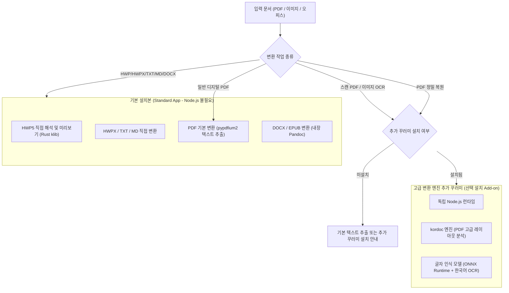

# KORDOC 3단계 설계 메모: 기본 설치본 경량화 및 고급 변환 엔진 분리

작성일: 2026-11-15  
단계: kordoc 의존 줄이기 3단계(설계)  
상태: 설계 완료 (구현 대기)

---

## 1. 배경 및 목적

### 1.1 kordoc 의존 줄이기 진행 경과
- **1단계 (2026-11-15 완료)**: 타임머신·몽땅검색 HWP5 본문 색인을 Rust 순수 해석기(`klib extract`) 우선으로 전환, kordoc은 파싱 실패(암호·배포용 문서) 시 대체(fallback)로 설정. 미사용 고급 기능 9개 패키지 공개 목록 제외.
- **2단계 (2026-11-15 완료)**: HWP5 미리보기(`klib preview` / `render_preview`) 및 HWP5 본문 파싱(`parse_document`)을 Rust 우선·kordoc 실패 시 대체로 전환. 합성 HWP 결과 동일성 및 대체 경로 시험 통과.
- **3단계 (본 문서)**: PDF 고급 레이아웃 변환과 이미지/스캔 PDF 글자 인식(OCR)만 kordoc에 남기고, 이 둘을 기본 설치본에서 분리하여 **'고급 변환 엔진 추가 꾸러미(Advanced Add-on)'**로 독립 구성한다.

### 1.2 해결 과제
1. **설치본 비대화 해소**: 내장 Node.js, npm 패키지 229개, onnxruntime 바이너리, LGPL libvips 의존성을 기본 설치본에서 제거하여 100MB+에 달하던 패키징 용량을 대폭 경량화.
2. **보안 감사 및 라이선스 부담 경감**: 공공기관 및 폐쇄망 환경의 정적 보안 분석(GitLab CI/Semgrep)에서 npm 의존성 취약점 및 LGPL 전파 위험을 원천 차단.
3. **독립 실행성 확보**: 기본 기능(HWP/HWPX 편집, 서식 맞춤, 표그림판, 파일 변환 기본)은 Node.js 없이도 100% 동작 보장.

---

## 2. 아키텍처 구조



---

## 3. PDF 기본 변환 파이프라인 (`pypdfium2` 기반)

추가 꾸러미가 없는 기본 설치 상태에서도 디지털 PDF(텍스트 레이어가 있는 일반 PDF)의 텍스트를 추출하여 HWPX/마크다운으로 변환할 수 있도록 경량 엔진을 제공한다.

### 3.1 텍스트 추출 및 구조화 알고리즘
1. **페이지 순회**: `pypdfium2.PdfDocument(source)`로 페이지를 순회.
2. **텍스트 페이지 해석**: `page.get_textpage()`를 통해 글자 및 바운딩 박스(좌표), 폰트 크기 정보 수집.
3. **줄/문단 경계 판정**:
   - Y 좌표의 차이가 줄 간격 임계치(기본 줄높이의 1.4배)를 넘으면 새 문단(`\n\n`)으로 분리.
   - 폰트 크기가 본문 평균 대비 1.2배 이상이면 제목(Heading `#`, `##`) 후보로 추정.
4. **결과 생성**: 중간 Markdown 생성 후 `generate_hwpx` 또는 Pandoc 연계.

### 3.2 스캔 PDF 및 미인식 문서 대응
- 추출된 총 텍스트 길이가 50자 미만이거나 페이지당 유효 글자 수가 극히 적은 경우:
  - 사용자에게 오류 대신 안내 모달 표출:
    > "이 문서는 글자가 그림으로 된 스캔 PDF입니다. 글자를 인식(OCR)하려면 '고급 변환 엔진 추가 꾸러미' 설치가 필요합니다."
  - 기본 변환 진행 여부 선택권 제공 (빈 껍데기 또는 추출 가능한 부분만 변환).

---

## 4. 고급 변환 엔진 분리 및 연동 방식

### 4.1 추가 꾸러미 구성 (`HWP_AutoDocFit_advanced_addon.zip`)
```
advanced-engine/
├── runtime.json               # 버전 매니페스트 (kordoc 4.24.9, onnxruntime 등)
├── node/                      # 플랫폼별 Node.js 실행 바이너리
├── models/                    # 한국어 OCR 및 레이아웃 모델 (ONNX)
└── app/
    └── node_modules/          # kordoc 및 실행 의존성 (229개 npm)
```

### 4.2 탐색 우선순위 (`docfit_core/kordoc_runtime.py`)
1. 실행 파일과 같은 폴더의 `advanced-engine/` (포터블 USB 배포용)
2. `%LOCALAPPDATA%\HwpAutoDocFit\advanced-engine\` (설치본 사용자 데이터 폴더)
3. 레거시 호환: 기존 `kordoc-runtime/` 폴더

### 4.3 설치 지원 메커니즘
- **온라인 환경**: 앱 설정 창에서 [고급 변환 엔진 다운로드] 단추 1클릭으로 백그라운드 다운로드 및 자동 압축 해제.
- **폐쇄망 환경**: 배포 사이트에서 별도 제공하는 `HWP_AutoDocFit_advanced_addon.zip`을 앱 창에 드래그앤드롭하거나 지정 폴더에 복사하면 즉시 인식.

---

## 5. 화면 변환 준비 상태 판단 변경 설계 (`desktop_web_ui.py`)

기존 718~744행 부근의 `_conversion_prerequisites` 메서드를 3단계 분리 구조에 맞게 개편한다.

### 5.1 사전 요구사항 상태 구조 개선
```python
def _conversion_prerequisites(self):
    # 캐시 확인 (30초 만료)
    ...
    from docfit_core.kordoc_bridge import ocr_available, advanced_engine_status
    from docfit_core.kordoc_runtime import pandoc_available
    pandoc_path = shutil.which("pandoc.exe") or shutil.which("pandoc")

    advanced_status = advanced_engine_status() # {"available": bool, "version": str, "path": str}

    self._conversion_prerequisites_cache = {
        # 기본 엔진 상태: Rust klib + pypdfium2로 상시 준비 완료
        "basic_engine": {
            "hwp_rust": True,
            "pdf_pypdfium": True,
            "status": "ready",
        },
        # 고급 엔진 상태: 추가 꾸러미 설치 여부
        "advanced_engine": advanced_status,
        "ocr": ocr_available(), # 추가 꾸러미 내 모델 확인
        "pandoc": bool(pandoc_path) or pandoc_available(),
        "hwp_com": self._hwp_com_available(),
    }
    return self._conversion_prerequisites_cache
```

### 5.2 변환 가능 대상 카드 UI 동작
- **HWP, HWPX, TXT, MD, HTML 변환**: 추가 꾸러미 없이도 언제나 활성화 (`enabled: True`).
- **디지털 PDF → HWPX/DOCX 변환**: 기본 활성화.
- **스캔 PDF / 이미지 OCR → HWPX 변환**:
  - 추가 꾸러미 미설치 시: 비활성화가 아닌 `설치 필요` 배지 표시.
  - 클릭 시 바로 다운로드/설치 안내 다이얼로그 팝업.

---

## 6. 단계별 이행 체크리스트

1. [ ] **PDF 기본 텍스트 추출기 구현**: `docfit_core/pdf_extract.py` (`pypdfium2` 기반 경량 텍스트/마크다운 변환기).
2. [ ] **고급 엔진 브리지 분리**: `docfit_core/kordoc_bridge.py`에서 기본 파싱 경로와 고급 파싱 경로 명확히 분리.
3. [ ] **런타임 패키징 분리**: 빌드 스크립트(`build_release.py` / CI)에서 kordoc ZIP을 메인 EXE에서 제외하고 별도 ZIP 산출물로 분리.
4. [ ] **UI 연동 및 설정 화면 개선**: `desktop_web_ui.py`의 `_conversion_prerequisites` 개편 및 Flutter 프런트엔드 안내 배지 적용.
5. [ ] **단위 시험 및 회귀 검증**:
   - 추가 꾸러미가 없는 클린 환경에서 HWP, HWPX, 디지털 PDF 변환 시험 통과 검증.
   - 추가 꾸러미 설치 시 OCR 및 고급 레이아웃 변환 정상 동작 검증.
