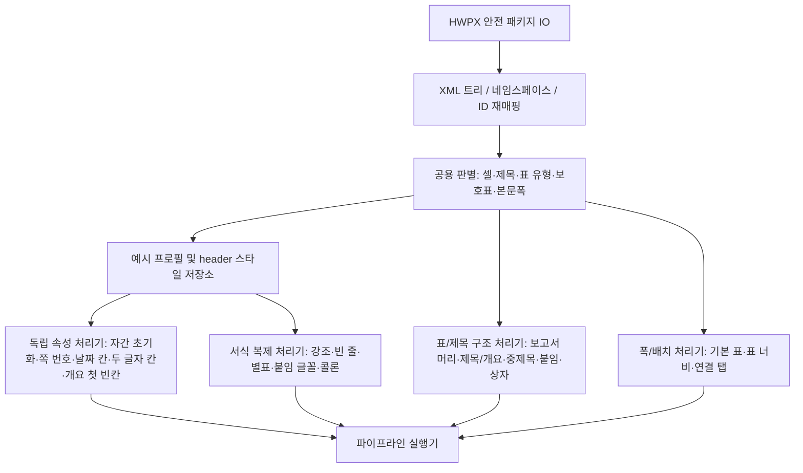

# RSXML0 — 한번에 적용 HWPX 직접 처리기 Rust 이식 설계

작성일: 2026-11-22 · 설계 전용 · 코드 변경·시험·한/글 실행 없음

## 범위와 기준

`docfit_engine/pipeline.py:311-389`의 `선행목록`에 등록되는 처리기 19종을 대상으로 한다. 파이프라인 조건과 사용자 설정에 따라 실행 수는 달라진다. 각 처리기는 `source`를 조사해 선택 인덱스를 반환하고, 선택값과 함께 실행하면 다음 HWPX를 만든다. `제목붙임_선행적용`은 선택 조사→순차 파일 생성→마지막 결과 열기를 맡는 드라이버이며 처리기 자체와 구분한다.

작업 트리에서 확인한 브랜치는 `feature/RSXML0`이다. 요청한 github/main 체크아웃 여부·기준 커밋은 이 로컬 자료만으로 검증하지 못했다. 문서의 줄 번호는 현재 작업 트리 기준이다. 별도 설계 근거는 `docs/XMLPASS1_ANALYSIS_2026-11-22.md`이다.

공통 인터페이스는 `processor(source)`가 섹션별 선택 목록을 반환하고, `processor(source, target, selections)`가 실제 적용 건수를 반환하는 형태다. 패키지 입력은 HWPX ZIP. 주요 입력은 `Contents/sectionN.xml`, 참조/스타일 변경 시 `Contents/header.xml`; 보고서 머리 분석은 첫 section을, 쪽 번호는 section의 `hp:pageNum`을 사용한다. ZIP의 나머지 항목은 보존되어야 한다. `content.hpf`(표준 HWPX 명칭은 `Contents/content.hpf`)는 처리기 본문이 직접 편집하지 않으며 패키지 재작성 시 원본 보존 대상이다.

## 처리기별 조사

코드 크기는 동적 심벌 분기 내부의 대략적 구현량(보조함수·공유 헬퍼 제외, 줄 범위로 센 추정)이다. Rust 예상 난이도는 이식 난이도다. 한/글 호출은 처리기 내부 기준이며 전부 0이다. 호출부 `제목붙임_선행적용`은 현재 열린 문서의 HWPX 스냅샷 변환 및 결과 재열기에 한/글 COM을 사용한다.

| 순번·처리기 (파일:시작 줄) | 입력 → 출력 | 의존 도우미·설정 | COM | 크기·난이도·이유 | 위험 |
|---|---|---|---:|---|---|
| 1 자간 초기화 (`spacing.py:143`) | 모든 section+header → run 자간 0, 보호 구간 보존 | `marker_spacing.reset_spacing`, 보호 문자 수, `자간초기화_XML_예정` | 0 | 약 42줄 · 중: run 분할/서식 ID 갱신 | 기호·라벨 보호 오프셋과 run 경계 변경 |
| 2 별표 위첨자 (`formatter_apply.py:691`) | section+header → `*`, `**` 해당 run 글자모양 참조 변경 | `_문단_별표_대상`, `위첨자_글자모양`, 기호 체계 | 0 | 약 145줄 · 중: 글자 범위와 charPr 생성 | 별표가 문장부호/일반 강조인 사례 오탐 |
| 3 붙임 글꼴 (`formatter_apply.py:836`) | section+header → 붙임 묶음 글자모양 | 붙임 표/문단 판정, 설정된 글꼴·크기 | 0 | 약 94줄 · 중: 경계와 참조 ID 매핑 | 붙임 범위 경계·개별 강조 소실 |
| 4 보고서 머리 서식 (`formatter_analysis.py:444`) | 첫 section+header+프로필 → 제목·보고 주체·개요 구성/표기와 header 서식 참조 | `report_header.report_starts/analyze/apply_header`, 제목 판별, 활성 머리 프로필, 본문 폭 | 0 | 약 80줄 · 상: 값 추출·구성 복제·서식 ID 통합 | 다중 보고서 경계·동일한 기관/날짜 재배치 |
| 5 제목·개요 (`formatter_titles.py:846`) | section+header+예시 HWPX → 제목/개요 표 서식·header 참조 | `제목_대상찾기`, `제목_셀들`, `개요_표인가`, `서식표_종류판별`, 예시 프로필 또는 내장 자료, 제목 설정 | 0 | 약 110줄 · 상: 유형별 예시 선택과 후속 개요 연쇄 처리 | 기준표/참조 ID 병합, 텍스트 보존, 빈 문단 삭제 |
| 6 개요 표 첫 빈칸 (`formatter_apply.py:282`) | section → 개요 A1 첫 글자 앞 공백 | 제목 표 유형 연속 판정, `제목_셀들`, `제목_문자열` | 0 | 약 65줄 · 하: 단순 텍스트 삽입이나 복잡 run은 건너뜀 | UTF-8 문자와 run 첫 글자 기준 불일치 |
| 7 중제목 (`formatter_titles.py:1110`) | section+header+예시 → 표 서식 또는 일반 로마자 제목의 중제목 표 변환 | `중제목_대상찾기/유형판별`, `제목_셀들`, 예시/내장 표, 로마자 판별, 활성 기호 체계, 본문 폭 | 0 | 약 100줄 · 상: 텍스트 문단을 표로 변환하고 ID 재부여 | 문단/표 구조, 표 번호, 목록 체계 규칙 변경 |
| 8 붙임 (`formatter_titles.py:1060`) | section+header+예시 → 붙임 표 서식 | `붙임_대상찾기/유형판별`, `제목_표서식_복사`, 예시 프로필 또는 내장 자료 | 0 | 약 50줄 · 중: 제목 이식 구조와 유사 | 대상 종류 변화·사용자 글 보존 |
| 9 한 칸 상자 (`formatter_titles.py:1619`) | section+header+예시 → 상자 표·칸·문단·글자 서식 | `서식표_종류판별`, `제목_셀들/문단들`, 예시 box 프로필 | 0 | 약 60줄 · 중: 예시 부재·연속 제목 제외 조건 | 개요 상자/4문단 이상 보호 기준 |
| 10 쪽 번호 모양 (`formatter_titles.py:1677`) | section `hp:pageNum` → `pos`, `formatType`, `sideChar` 속성 | `표준서식_설정["쪽번호"]` | 0 | 약 35줄 · 하: 선택된 속성 대입 | 속성 누락/빈 설정, 모든 section의 인덱스 일치 |
| 11 기본 표 서식 (`formatter_tables.py:392`) | section+header+표 스타일 예시 → 표/셀/글자/테두리 서식 및 header 참조 | `보호표_목록`, 머리 표, `_기본표서식_대상인가`, `표서식_저장소/적용`, `기본표서식()` 설정·프로필 | 0 | 약 55줄 · 중상: 다층 표 서식과 보호 검사 | 사용자 꾸민 표 변경, 대상 열거 순서/참조 ID |
| 12 표 칸 너비 (`formatter_tables.py:446`) | section+header의 쪽 크기/여백·셀 텍스트 → 표/열 폭 변경 | `서식표_종류판별`, `표너비_대상인가/맞춤/앞자리`, 본문폭·header index | 0 | 약 52줄 · 중상: HWPUNIT·셀 병합·본문 폭 계산 | 여백 단위, 병합 셀 합계, 캐시/한 줄 배치 차이 |
| 13 기본 표 서식 정렬 재확인 (`formatter_tables.py:392`, 2차 호출) | 11과 동일, 너비 변경 뒤 동일 표 인덱스 재평가 | 표 스타일 프로필, 넓어진 칸의 한 줄/정렬 조건 | 0 | 약 55줄 · 중상: 같은 기능을 순서상 재호출 | 1차 선택 목록 재사용으로 대상 인덱스가 어긋날 수 있음; 매 단계 새 HWPX에서 재조사 |
| 14 연결 부호 탭 정렬 (`formatter_apply.py:535`) | section+header, 본문/셀 폭 → 문단 탭/글자 구조 | `connector_tab.groups_in/align_connectors`, 최종 본문폭·셀 여백, 기능 옵션 | 0 | 약 85줄 · 상: 연속 문단·탭 위치 및 채움점 처리 | 한/글 조판 폭 차이, 탭 채움 표시 재현 |
| 15 콜론 라벨 정렬 (`formatter_apply.py:592`) | section+header → 콜론 라벨 문단 모양/정렬 | `colon_label` 공용 처리, 라벨 설정·기호 체계 | 0 | 약 80줄 · 중상: 문단 판정·스타일 표 참조 변경 | 라벨 문자/숨은 컨트롤 및 표 셀 범위 |
| 16 표 날짜 칸 한 줄 (`formatter_tables.py:68`) | section 표 → 날짜 칸 `lineWrap=SQUEEZE` | `보호표_목록`, `표_날짜칸_한줄`, 날짜 문자열 판별 | 0 | 약 40줄 · 하: 속성 설정 중심 | 날짜 정규식 오판·사용자 표 보호 |
| 17 표 두 글자 칸 (`formatter_tables.py:106`) | section 표 셀 → 한글 2자 사이 공백 삽입 | `보호표_목록`, `서식표_종류판별`, `제목_셀들/문자열`; 설정 없음 | 0 | 약 45줄 · 중: 단일 text run 제약 | 여러 run/혼합 서식은 의도적으로 미적용, 원문 변경 위험 |
| 18 빈 줄 서식 (`formatter_apply.py:250`) | section+header → 문맥이 맞는 빈 문단의 learned style | `docfit_core.blank_lines.slots/apply`, 표 유형 판정, `표준서식_설정["빈줄_서식"]` | 0 | 약 38줄 · 중: 이웃 문맥·스타일 ID 할당 | 빈 줄 분류와 표/제목 보호 경계 |
| 19 강조 낱말 (`formatter_apply.py:340`) | section+header → 같은 계층 문장 낱말의 강조 서식 | `docfit_core.emphasis.apply`, `표준서식_설정["강조_낱말"]` | 0 | 약 37줄 · 중: 계층·문자 범위 서식 | 반복 낱말/문자 run 분할 및 계층 오판 |

이 표의 줄 수는 조사용 근삿값이며 정확한 함수 LOC 측정치가 아니다. 모듈들은 `_install` 동적 심벌 바인딩 구조라 단순 함수 AST 길이와 일반 모듈의 함수 크기가 직접 비교되지 않는다. Rust 계획 규모는 아래 카드의 LOC 추정으로 잡는다.

## 공용 라이브러리와 의존 그래프

핵심 공용 도우미는 `보호표_목록`(사용자 지정/보호 표 제외), `서식표_종류판별`, `제목_셀들`, `제목_문자열`, `제목_참조병합`, 예시 서식 프로필 조회, header ID 저장소/재매핑, 본문 폭·HWPUNIT 변환, ZIP 안전 읽기·원본 멤버 보존·원자 저장이다. `style_inventory.py`·`format_elements.py`는 서식 값의 종류·추출과 설정 의미 참고에 유용하나 처리기 실행 의존성으로 전부 포함할 필요는 없다. `report_header.py`는 머리 서식 전용 로직, `xml_hanging_indent.py`는 내어쓰기/문자 폭 모델 참고, `table_catalog.py`·`table_units.py`는 별도 표 기능이므로 본 19종의 직접 의존으로 간주하지 않는다. `marker_*`는 실제 사용되는 기호·접두·자간 도우미만 선택 이식한다. `cell_image_bg.py`는 이 처리기 집합에서 직접 호출 근거를 찾지 못했다.

권장 이식 순서: (1) 패키지/보안 IO 및 XML 모델 (2) HWPX 경로/네임스페이스/header 참조 공용 함수 (3) `제목_셀들`, 표 종류, 보호표 및 텍스트 보존 도우미 (4) 개요 첫 빈칸·쪽 번호·날짜 칸·두 글자 칸 (5) 자간 초기화·붙임 글꼴·별표·강조 낱말·빈 줄 (6) 표 기본 서식과 너비 (7) 제목/개요·붙임·상자 (8) 중제목·보고서 머리 (9) 연결 부호 탭과 콜론 정렬 (10) 실행기. 독립 짧은 처리기를 먼저 두되 입력 선택 목록이 각 순차 출력에 대해 다시 계산되는 계약을 초기에 구현한다.

## Rust 구조 제안

크레이트 이름 제안은 `docfit-hwpx`(패키지와 트리 조작), `docfit-format`(공용 서식/판별), `docfit-preformat`(19 처리기와 실행기), `docfit-preformat-cli`(프로세스 경계)다. 초기에는 배포/버전 관리 복잡성을 줄이기 위해 workspace 안의 모듈로 시작하고, 독립 재사용이 확인된 뒤 크레이트 분리를 검토한다.

모듈 제안:

- `package`: ZIP 인벤토리, 안전 검사, 압축 해제 없이 읽기, 원본 멤버/압축 메타데이터 보존, 임시 파일+원자적 교체. 경로 탈출, 중복 항목, 크기·압축률 제한, CRC 검사.
- `xml`: 네임스페이스 인식 XML 노드/속성, 안전 파싱, XML 직렬화, 문자 단위 삽입, 참조 ID 그래프와 ID 할당기.
- `model`: section/header/content.hpf 관계, 문단·run·표·셀 순회 API, 인덱스 안정성.
- `common`: 보호표, 서식표 유형, 제목 셀/텍스트, 본문 폭, 날짜/기호/라벨 인식, 설정·프로필 데이터 모델.
- `styles`: charPr/paraPr/borderFill 복사, 공유 참조의 copy-on-write, ID 재매핑, 서식 예시 가져오기.
- `processors::*`: 19개별 순수 변환 함수. 처리기는 HWPX 입력 구조와 설정을 받아 변경 결과 및 진단을 반환하고 COM/파일 선택 UI에는 접근하지 않는다.
- `runner`: 선행목록 호환 순서·조건, 단계별 재조사, 취소/진행 로그, 대상 0건 복사 또는 변경없음 결과, 임시 산출물 수명 관리.
- `cli`: 입력·출력·JSON 설정/프로필 경로·단계 목록·진단 JSON 인자. 종료 코드와 부분 산출 실패 규약.

의존 크레이트 후보(새 의존 목록): `zip` — ZIP 읽기/쓰기(기존 저장소에 사용 중이나 Rust 신규 의존), `quick-xml` — 스트리밍 이벤트/직렬화 또는 `roxmltree` — 읽기 전용 트리 중 비교 조사. 변경 처리에는 `quick-xml` 이벤트만으로 노드 이동/참조 재매핑이 번거로우므로 소유 가능한 트리 API를 가진 대안도 조사해야 한다. 후보: `xmltree` 또는 `sxd-document`(변경 가능한 트리), `deflate`는 `zip` 기능 선택으로 해결 가능한지 확인. `quick-xml`과 `roxmltree`는 역할이 겹치므로 둘 다 자동 채택하지 않는다. 경로 안전성/중복 ZIP 멤버 검증은 라이브러리 기본 동작에 맡기지 말고 명시 구현한다. 정확한 최신 버전·라이선스·MSRV는 이 설계에서 확인하지 않았으므로 전부 미확인이다.

**추천 호출 방식: CLI exe 한 번 호출해 전체 목록을 처리.** 순서와 옵션, 로그를 한 프로세스에서 관리하고 Python은 실행 전후 한 번씩만 경계를 넘는다. Rust 라이브러리 FFI는 Python 런타임/메모리/패키징/오류 수명 관리 비용이 추가되며 선택된 단계의 내부 호출이 많을 때만 이점이 있다. 현재 한 번에 여러 HWPX 패키지를 순차 편집하는 일괄 흐름과 맞는 CLI가 단순하다. Python이 COM 문서를 스냅샷해 HWPX를 넘기고 CLI 완료 후 결과 HWPX를 한 번만 여는 연결부는 유지한다. 이는 파이프라인 전체 COM 호출을 0으로 만드는 설계가 아니며, 처리기 내부 COM 0을 보장한다.

## 결과 동일성 비교 방법

1. 고정 입력/설정/프로필/처리기 순서를 기록하고 ALLQA 문서 세트(`E:/docfit-tmp/allqa`)의 HWPX 사본과 결정적 합성 HWPX를 사용한다. 원본은 수정하지 않는다. 같은 HWPX를 Python 기준 구현과 Rust 구현에 각각 넣는다.
2. 단계별 중간 산출물을 저장한다. 각 ZIP에서 동일 경로 XML만 추출하고 안전한 XML 파서로 읽는다. 비교 전 네임스페이스 URI 기준으로 요소명을 정규화하고 접두사 표기를 제거한다. 속성은 (URI, local-name) 정렬, 텍스트는 XML 의미를 보존하며 줄바꿈/공백을 무조건 trim하지 않는다. 공백 정규화가 가능한 구간만 정책을 명시해 처리한다.
3. 정규화 노드 트리의 요소 이름, 자식 순서, 속성 값, 텍스트/꼬리 텍스트를 경로별로 비교한다. 공백 문자를 보존하는 동등 비교를 기본값으로 하고, 포맷팅 전용 공백 차이만 별도 분류한다. ZIP 멤버 집합, 비 XML 바이너리 SHA-256, 이미지/글 데이터, 필수 패키지 항목도 비교한다.
4. 우선 단계별 트리 차이 0을 합격 기준으로 삼는다. 한/글 재저장본은 별도 비교군으로 취급하고, 한/글이 만든 의미 있는 구조 변화가 기준에 포함될 때만 그 차이를 승인 목록에 넣는다. 단순 최종 파일 해시 일치는 압축 순서·시각 정보가 달라 유효한 기준이 아니다.
5. 합성 자료에는 복수 section, 네임스페이스 접두 변형, 다중 run, 중첩·병합 셀, 보호표/일반표/서식표, 없는·중복 스타일 ID, 다중 보고서, 빈 문단/탭/특수 공백, 무변경 사례를 포함한다. ALLQA 전수는 실제 문서 대표성을, 합성은 구조 경계조건을 검증한다.

비교 오탐 후보: (a) ElementTree/quick-xml의 네임스페이스 접두 자동 재할당 (b) 속성 순서와 XML 선언/인코딩·빈 요소 표기 (`/>` 대 시작/끝 쌍) (c) 들여쓰기/개행 및 CRLF (d) XML 엔티티 표기와 동등 문자 (e) 숫자/공백을 포함한 text 노드의 임의 공백 정리 (f) ZIP 멤버 순서·압축 레벨·타임스탬프 (g) 한/글 재저장 때 ID 재할당, 캐시/`linesegarray` 제거·재생성, 기본값 생략/명시, XML 요소 정렬. 이런 경우를 이유로 의미 있는 자식 순서·텍스트·서식 참조 차이를 무시하면 안 된다. 별도 canonicalizer를 고정하고 기준 구현 출력도 같은 canonicalizer로 비교한다.

## 단계별 카드 계획

총 **8장**, 추정 합계 **약 2,600–3,800 Rust LOC**(테스트 픽스처/비교 도구 별도; 추정치):

| 카드 | 내용 | 예상 규모 | 게이트 |
|---|---|---:|---|
| 1 | ZIP 안전 패키지 IO, 원본 멤버 보존, XML 정규 비교기 | 350–500 LOC | 안전 검사·무변경 왕복 및 의미 트리 비교 |
| 2 | XML 모델, section/header 순회, ID 저장소·스타일 참조 copy-on-write | 400–600 LOC | 참조 유효성·원본 글/멤버 보존 |
| 3 | 공용 표/셀/보호·제목/본문폭·프로필 입력 모델 | 300–450 LOC | 후보/선택 목록 Python 대조 |
| 4 | 독립 처리기 5종: 개요 첫 빈칸, 쪽 번호, 날짜, 두 글자 칸, 자간 초기화 | 350–500 LOC | 각 처리기 단계별 출력 비교 |
| 5 | 서식 텍스트 처리기: 별표, 붙임 글꼴, 빈 줄, 강조, 콜론 | 350–550 LOC | 서식 참조/문자 범위 비교 |
| 6 | 표 처리기: 기본 표 스타일, 너비, 정렬 재확인, 연결 탭 | 400–600 LOC | 보호표·병합·폭·탭 경계 사례 |
| 7 | 구조 처리기: 제목/개요, 중제목, 붙임, 한 칸 상자, 보고서 머리 | 500–750 LOC | 구조·ID·텍스트 보존 및 다중 보고서 |
| 8 | 전체 실행기·Python CLI 연결·ALLQA/합성 회귀 비교 | 300–450 LOC | 19종 순서·선택 재조사·최종 차이 0 |

진행 중 결과 동일성 0이 깨지면 다음 카드로 확장하지 않는다. 기존 Python 처리기는 기준 구현으로 유지하고 Rust가 완전히 동등할 때 연결 전환한다. 카드별 예상 규모는 모듈 구현 전 미확인 추정이다.

## 주요 위험과 대응

1. **서식 ID 참조의 공유·재사용 때문에 한 요소 변경이 다른 문단까지 번짐.** copy-on-write와 참조 그래프를 공용 카드에서 먼저 구현하고 header 정의·대상 참조의 유효성을 단계별 검사한다.
2. **텍스트/run/표 순회 순서 또는 선택 인덱스가 단계별 변경 뒤 달라짐.** 선택은 매 처리 단계의 최신 산출물에서 다시 조사한다. 하나의 순번을 뒤 단계에 재사용하지 않고, Python/Rust에서 동일 후보 인덱스와 이유를 기록한다.
3. **XML 트리 의미는 같아도 한/글 재저장 후 조판 결과가 달라짐.** XML 비교와 별도로 Windows 한/글 결과 검증을 후속 게이트에 둔다. 이 맥 작업에서 COM을 실행하지 않으며, HWPX의 속성 차이만으로 시각적 동일성을 주장하지 않는다.

## 미확인

- github/main의 기준 커밋과 이번 작업 브랜치 간 차이.
- 지정 모듈 전체에서 19처리기의 호출 관계를 완전히 추적했는지, 그리고 도움 함수의 간접 의존성/설정 키 전체 목록. 이 문서 표는 조사 중 직접 확인한 핵심 의존성이다.
- ALLQA 문서 수·구성·민감 자료 처리 방식과 합성 HWPX 생성기의 존재/경로.
- Rust XML crate의 최신 버전·라이선스·한/글 HWPX 전체 문법 지원, 압축 보존 기능.
- 19종 각각의 실제 정확 LOC, 성능 기준 수치와 운영상 필요한 처리율.
- XML 비교에서 허용할 한/글 직렬화 차이의 구체적인 승인 목록. 실제 비교 결과를 본 뒤 분류해야 한다.
- 한/글 없이 XML 동등성이 사용자에게 보이는 조판/페이지 결과까지 보장하는지 여부. 보장한다고 가정하지 않는다.
