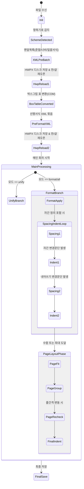
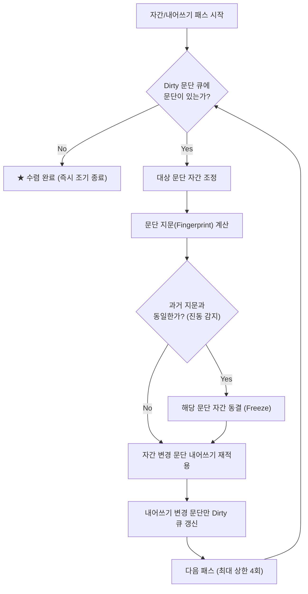

# 한번에 적용 단계 구조 개선 설계서 (STAGEDECL0)
**단계 선언 표(Stage Declaration Table) · 의존 관계 · 공유 문서 모델 · 수렴 판정**

- **작성일**: 2026-11-22
- **작성자**: Antigravity (Codex/Gemini 설계 에이전트)
- **대상 브랜치**: `feature/STAGEDECL0` (github/main 기준)
- **관련 문서**:
  - `docfit_engine/pipeline.py` (파이프라인 실행 엔진)
  - `docfit_core/stage_selection.py` (`_MODE_STAGES`, 세부 작업 선택 및 카드 옵션 매핑)
  - `docfit_app/application_service.py` (작업 시작 및 상태 서비스)
  - `docs/PROGRESS_FLOW_DESIGN.md` (진행 과정 화면 설계)
  - `docs/benchmarks/COM_기준선_v2.2.58_2026-11-12.md` (성능 기준선)
  - `docfit_core/hwp_bulk_parallel.py` (병렬 COM 작업자 선례)

---

## 1. 배경 및 문제 제기

현재 '한 번에 적용'(`all`), '서식 적용'(`format`), '자간 정리'(`spacing`), '서식 통일'(`unify`)을 관장하는 파이프라인 엔진(`docfit_engine/pipeline.py`)은 버전 1.x부터 2.2.x에 이르기까지 수많은 사용자 서식 규칙, 예외 처리, 알파 최적화 기능이 중첩되면서 구조적 복잡도가 임계치에 도달했다.

### PM 검토 5대 문제점
1. **조건 분기의 파편화 (28개 이상의 중첩 `if`문)**:
   단계 활성화 여부가 `작업_모드`, `stage_enabled(선택_세부작업, ...)`, `쪽범위_요청 is None`, 각종 `알파_*` 플래그, `표준서식_설정.get(...)`, 문서 상태 플래그(`문서_변경됨`, `자간초기화_완료` 등)의 복잡한 불리언 조건으로 흩어져 있다. 새로운 서식 단계나 최적화 패스를 추가할 때 실행 순서와 선행 제약을 놓치기 쉽고 회귀 버그 발생 위험이 매우 높다.
2. **수렴 판정 부재 및 자간↔내어쓰기 비효율적 반복**:
   자간 조정과 내어쓰기 갱신이 최대 3회 고정 루프(또는 부분 탈출)로 반복된다. 변경 문단이 없을 때 조기 탈출하는 분기가 일부 있으나, 두 단계 간의 미세한 줄바꿈 진동(ping-pong oscillation)을 제어하는 상태 서명(fingerprint) 기반 수렴 판정이 없어 불필요한 COM 순회가 반복된다. 기준선 벤치마크(v2.2.58)에 따르면 전체 322초 중 자간/내어쓰기 관련 호출이 187초(58%)를 점유한다.
3. **문서 구조 조사의 중복 및 파편화**:
   한 칸 표 위치, 디자인 보호 표 영역, 보고서 경계(다중 보고서), 목록 번호 체계, 대표 서식 프로필 조사가 각 함수 내부에서 개별적으로 `InitScan`/`GetText` 또는 XML 파싱을 통해 중복 실행된다.
4. **열기·저장(I/O) 왕복 낭비**:
   문서 유형 및 옵션에 따라 HWPX XML 직접 수정 단계와 한/글 COM 조작 단계 사이에서 파일을 임시 저장하고 다시 여는 과정이 최대 3~4회 발생한다. 선행 HWPX 묶음 처리(`선행목록`)로 일부 개선되었으나 여전히 단계 전환 시 디스크 동기화 비용이 크다.
5. **단일 프로세스 순차 처리 한계**:
   수십 개 문서 일괄 작업 시 하나의 한/글 COM 인스턴스로 문서를 하나씩 직렬 처리한다. 최신 멀티코어 환경에서 CPU 점유율이 10~15%에 불과하여 대량 문서 처리 처리량이 낮다. (대량 변환에는 `hwp_bulk_parallel.py`라는 검증된 다중 COM 선례가 존재함).

---

## 2. 현재 단계 목록 및 숨은 상태 기계(As-Is 분석)

현재 `pipeline.py`의 실행 경로에 존재하는 모든 단계를 실행 순서대로 전수 조사하고, 활성화 조건, 입출력 상태 및 숨은 의존성을 정리한다.

### 2.1 현재 단계 전수 분석표

| 순서 | 내부 식별자 / 표시 이름 | 종류 | 세부작업 키 (`stage_selection`) | 켜기 조건 (if 사슬) | 읽는 상태 | 쓰는 상태 (부수효과) |
|:---:|:---|:---:|:---|:---|:---|:---|
| 0 | `cell_image_to_bg`<br>(표 셀 이미지 배경 변환) | XML | `cell_image_to_bg` | `stage_enabled('cell_image_to_bg')` | 원본 HWPX | 사본 HWPX, `작업파일경로` 갱신 |
| 1 | `scheme_detect`<br>(항목기호 체계 감지) | XML | (내부) | 항상 (문서 시작 시) | `작업파일경로` | `활성_항목기호_체계` |
| 2 | `page_layout_record`<br>(원본 쪽 구성 기록) | COM | (내부) | `확장자 in ('.hwp', '.hwpx')` | 한/글 활성 문서 | `쪽맞춤_원본_보고서` |
| 3 | `page_range_calc`<br>(작업 쪽 범위 확인) | COM | (내부) | `쪽범위_요청 is not None` | 한/글 활성 문서 | `쪽범위_실제`, `본문_범위_문단`, `표_범위_영역` |
| 4 | `abbreviation`<br>(준말 변환) | XML | `abbreviation` | `모드 in ('format', 'all') and 준말_등록표 and 쪽범위 is None and enabled` | `작업파일경로`, `준말_등록표` | `맨앞목록` 등록, `문서_변경됨` |
| 5 | `title_width`<br>(제목·개요 가로 크기) | XML | `pre_format` | `표준서식 and 모드 in ('format', 'all') and 쪽범위 is None and 제목4종 and enabled` | `작업파일경로` | `맨앞목록` 등록, `문서_변경됨` |
| 6 | `batch_body_format`<br>(본문 서식 일괄 적용) | XML | `standard_format` | `알파_일괄서식_가능()` | `작업파일경로`, 표준서식설정 | `맨앞목록` 등록, `문서_변경됨` |
| 7 | `standard_format_com`<br>(보고서 표준서식) | COM | `standard_format` | (선행 일괄 XML 미적용 시) `표준서식_사용` | 한/글 활성 문서 | 서식 변경, `문서_변경됨` |
| 8 | `text_table_convert`<br>(텍스트 표(박스 그림) 변환) | COM | `text_table_convert` | `표준서식 and 모드 in ('format', 'all') and 쪽범위 is None and enabled` | 한/글 활성 문서 | 문단 구조 변환(표 생성), `박스그림_실행`, `문서_변경됨` |
| 9 | `reset_spacing_com_pre`<br>(선행 자간 초기화 - COM) | COM | `reset_spacing` | `모드 in ('spacing', 'all') and 쪽범위 is None and not 자간초기화_XML_예정 and enabled` | 한/글 활성 문서 | 글자 자간 0% 리셋, `자간초기화_완료`, `문서_변경됨` |
| 10 | `선행목록 (HWPX XML 일괄)`<br>- 자간 초기화<br>- 별표 위첨자<br>- 붙임 글꼴<br>- 보고서 머리 서식<br>- 제목·개요·중제목·붙임<br>- 한 칸 상자<br>- 쪽 번호 모양<br>- 기본 표 서식 (`table_style`)<br>- 표 칸 너비 (`table_width`)<br>- 표 정렬 재확인<br>- 연결 부호 탭 정렬<br>- 콜론 라벨 정렬<br>- 표 날짜 칸 한 줄<br>- 표 두 글자 칸<br>- 빈 줄 서식<br>- 강조 낱말 | XML 묶음 | 복합<br>(`pre_format`, `asterisk_superscript`, `attachment_font`, `table_style`, `table_width`, `standard_format` 등) | `표준서식 and 모드 in ('format', 'all') and 쪽범위 is None` (일부 unify 지원)<br>각 항목별 `stage_enabled` 및 프로필 유무 검사 (약 15개 하위 조건) | `작업파일경로`, 각종 서식 프로필(`활성_표서식_프로필` 등) | HWPX 직접 수정 후 한/글 재오픈.<br>`문서_변경됨`, `기본표서식_적용됨`, `자간초기화_완료` |
| 11 | `precise_table`<br>(일반 표 정밀 서식 복제) | COM | `precise_table` | `표준서식 and 모드 in ('format', 'all') and 쪽범위 is None and 활성_정밀표_프로필 and enabled` | 한/글 활성 문서, `활성_정밀표_프로필` | 표 서식 복제, `문서_변경됨` |
| 12 | `protect_areas_scan`<br>(보호 영역 조사) | COM | (내부) | 항상 (회차 시작 전) | 한/글 활성 문서 | `한칸표_보호영역`, `디자인표_보호영역` |
| 13 | `page_protect_clear`<br>(쪽 보호 해제) | COM | `page_fit` / `page_group` | `모드 != 'unify' and (모드 != 'spacing' or page_fit/group enabled)` | 한/글 활성 문서 | 구역/문단 페이지 보호 해제 |
| 14 | `reset_spacing_com_late`<br>(잔여 자간 초기화) | COM | `reset_spacing` | `모드 in ('spacing', 'all') and enabled and not 자간초기화_완료` | 한/글 활성 문서 | 자간 0% 리셋 |
| 15 | `style_unify`<br>(서식통일) | COM | `style_unify` | `모드 == 'unify'` 또는 `(회차 == 1 and not (format/all and 표준서식))` | 한/글 활성 문서 | `_서식통일_문서대표프로필`, 문단 서식 통일 |
| 16 | `table_unify`<br>(표 서식통일) | COM | `table_unify` | `모드 == 'unify' and enabled` | 한/글 활성 문서 | 표 서식 통일 |
| 17 | `문단 세트 1`<br>또는 `공백·문장부호·라벨(XML)`<br>또는 COM 순회 | XML / COM | `normalize_space`, `punctuation_space`, `parenthesis` | `모드 in ('format', 'all') and 표준서식 and 회차 == 1`<br>(세트모드 vs XML묶음 vs COM순회 분기) | 한/글 활성 문서 또는 HWPX | 공백 정규화, 구두점 공백, 괄호 크기 축소 |
| 18 | `table_format`<br>(표 머리글·본문 서식) | COM | `table_format` | `모드 in ('format', 'all') and 표준서식 and 회차 1 and enabled and 표_헤더서식 and not 활성_정밀표 and not 기본표서식_적용됨` | 한/글 활성 문서 | 표 머리글/본문 서식 입힘 |
| 19 | `table_structure_adjust`<br>(여백·너비·테두리 조정) | COM | (내부) | `모드 in ('format', 'all') and 표준서식 and 회차 1 and 각 플래그 켬` | 한/글 활성 문서 | 셀 여백, 열너비, 테두리 굵기 |
| 20 | `single_cell_spacing`<br>(개요·한 칸 표 자간 조정) | COM | `single_cell_spacing` | `모드 in ('format', 'all') and 표준서식 and enabled` | 한/글 활성 문서 | 한 칸 표 내부 텍스트 자간 |
| 21 | `hanging_indent_init`<br>(최종 서식 기준 내어쓰기) | COM | `hanging_indent` | `not 세트모드 and 모드 in ('format', 'all') and 표준서식 and enabled` | 한/글 활성 문서 | 문단 모양 내어쓰기 값 갱신 |
| 22 | `supplement_indent`<br>(부연설명 들여쓰기) | COM | `supplement_indent` | `not 세트모드 and 모드 in ('format', 'all') and 표준서식 and enabled and (부연설명_들여쓰기 or 앞빈칸)` | 한/글 활성 문서 | 부연설명 문단 왼쪽 여백 |
| 23 | `star_align`<br>(별표(**) 정렬) | COM | `star_align` | `not 세트모드 and 모드 in ('format', 'all') and not 부연설명 and enabled` | 한/글 활성 문서 | 별표 주석 왼쪽 여백/공백 |
| 24 | `spacing_loop`<br>(자간↔내어쓰기 수렴 루프, 1~3차) | COM | 복합<br>(`body_spacing`, `word_check`, `short_line`, `control_spacing`, `hanging_indent` 등) | `모드 in ('spacing', 'all') and not 세트모드` | 한/글 활성 문서 | `자간_변경문단`, `내어쓰기_변경문단`, `재검사_대상문단`, 자간 값 및 내어쓰기 갱신 |
| 25 | `style_unify_reverify`<br>(서식통일 재검증) | COM | `style_unify` | `모드 == 'all' and not 표준서식 and enabled and _서식통일_문서대표프로필` | `_서식통일_문서대표프로필` | 대표값 재적용 |
| 26 | `page_fit`<br>(문단 아래 간격 페이지 맞춤) | COM | `page_fit` | `페이지작업_모드 and enabled` | 한/글 활성 문서, 원본쪽수 | 문단 하단 간격 조정, `쪽맞춤_보고서조정됨` |
| 27 | `page_group`<br>(개별 문단 페이지 배치) | COM | `page_group` | `페이지작업_모드 and 세트문장_같은쪽 and enabled` | 한/글 활성 문서 | 문단 줄나눔/페이지나눔 속성 |
| 28 | `page_fit_recheck_loop`<br>(쪽 수 재확인 피드백 루프) | COM | `page_fit` + `page_group` | 쪽 배치 후 조정 건수가 증가한 경우 | 화면 줄 수, 쪽 수 | 페이지 맞춤 및 배치 재실행 |
| 29 | `hanging_indent_final`<br>(최종 내어쓰기 재확인) | COM | `hanging_indent` | `모드 in ('format', 'all') and 표준서식 and enabled` | 한/글 활성 문서 | 내어쓰기 최종 재확인 및 보정 |
| 30 | `inspection_aggregate`<br>(검수 집계) | 읽기 | (내부) | `검수_사용` | 한/글 활성 문서 | `검수_문제목록` |
| 31 | `final_save`<br>(최종 저장) | COM | (내부) | 항상 (성공 완료 시) | 한/글 활성 문서 | 최종 HWPX 파일 저장 |

### 2.2 숨은 상태 기계(Hidden State Machine) 분석

현재 파이프라인은 단계 간 데이터를 인수로 명시적으로 전달하지 않고, 전역 네임스페이스(`globals()`) 및 모듈 수준 전역 변수를 매개체로 상태를 암묵적으로 공유한다.



#### 주요 숨은 상태 변수
1. `문서_변경됨 (bool)`: 앞선 단계가 디스크의 HWPX를 수정했는지 한/글 COM 문서를 수정했는지 추적. XML 단계가 열린 문서를 새로고침할지(`현재문서_기준=True/False`)를 결정하는 핵심 플래그.
2. `자간초기화_완료 (bool)` vs `자간초기화_XML_예정 (bool)`: 자간 0% 리셋을 XML 선행 파이프라인에서 처리했는지, 아니면 COM 단계에서 직접 해야 하는지 결정.
3. `기본표서식_적용됨 (bool)`: 선행 단계에서 준말 '표' 서식이 적용되었으면 메인 루프의 `표_헤더서식_전체_적용`을 강제로 건너뛰게 만듦.
4. `_서식통일_문서대표프로필 (dict)`: 회차 1에서 표본 문단을 읽어 계산된 대표 글꼴/크기. 회차 2 재사용 및 `최종_서식통일_검증`에서 재적용.
5. `디자인표_보호영역`, `한칸표_보호영역 (list[int])`: 표 컨트롤 ID 및 캐시 목록. 앞 단계에서 표가 추가/삭제되면 번호가 밀리므로 수시로 `디자인표_보호영역_갱신()`을 강제해야 함.
6. `자간_변경문단` -> `내어쓰기_변경문단` -> `재검사_대상문단 (set[int])`: 3단계 파이프라인에서 문단 번호 집합이 핑퐁식으로 전달됨.

---

## 3. '단계 선언 표' 데이터 중심 아키텍처 설계 (To-Be)

복잡한 `if` 사슬을 제거하고, 각 단계를 **순수 데이터(Declaration Table)**로 정의하며, 실행기(Pipeline Executor)가 의존성 그래프와 실행 조건을 해석하여 동적으로 최적 실행 계획(Execution Plan)을 수립하도록 재설계한다.

### 3.1 단계 메타데이터 데이터클래스 정의

```python
from dataclasses import dataclass, field
from enum import Enum, auto
from typing import Callable, Any

class StageKind(Enum):
    XML_MUTATOR = auto()       # HWPX ZIP을 직접 읽고 쓰는 순수 파이썬/defusedxml 처리기
    HWP_READONLY = auto()      # 한/글 COM에서 구조/텍스트/쪽수만 읽는 단계 (비파괴적)
    HWP_MUTATOR = auto()       # 한/글 COM 액션으로 서식/자간/내용을 변경하는 단계
    HWP_LAYOUT = auto()        # 한/글 COM 조판/페이지 나눔/줄간격에 영향을 주는 단계

class StageScope(Enum):
    DOCUMENT_GLOBAL = auto()   # 쪽 단위 분할 불가 (문서 전체 구조/서식)
    PAGE_RANGEABLE = auto()    # 지정 쪽 범위만 부분 실행 가능

@dataclass(frozen=True)
class StageDeclaration:
    id: str                                # 고유 식별자 (예: 'table_style', 'body_spacing')
    name: str                              # UI 표시명 (예: '기본 표 서식')
    kind: StageKind                        # 단계 종류
    scope: StageScope                      # 범위 지원 여부
    supported_modes: frozenset[str]        # 지원 작업 모드 ('all', 'format', 'spacing', 'unify')
    option_key: str | None                 # stage_selection.py 세부 작업 키
    
    # 의존 관계 및 선행 제약
    depends_on: tuple[str, ...] = ()       # 반드시 이 단계보다 먼저 실행되어야 하는 선행 단계 ID
    conflicts_with: tuple[str, ...] = ()   # 상호 배타적인 단계 ID (예: XML일괄 vs COM개별)
    
    # 런타임 활성화 조건 함수 (순수 술어 함수: context -> bool)
    condition: Callable[[Any], bool] = field(default=lambda ctx: True)
    
    # I/O 및 무효화 계약
    reads: tuple[str, ...] = ()            # 읽는 모델/상태 키 ('tables', 'styles', 'page_count')
    writes: tuple[str, ...] = ()           # 쓰는 모델/상태 키
    invalidates: tuple[str, ...] = ()      # 실행 후 무효화되는 캐시 키 ('layout', 'tables')
```

### 3.2 단계 선언 표 인스턴스 (핵심 20개 대표 단계 발췌)

```python
STAGE_REGISTRY: list[StageDeclaration] = [
    # 1. 문서 진입 및 환경
    StageDeclaration(
        id="cell_image_to_bg",
        name="표 셀 내 이미지를 배경 이미지로 변경",
        kind=StageKind.XML_MUTATOR,
        scope=StageScope.PAGE_RANGEABLE,
        supported_modes=frozenset({"format", "all", "spacing"}),
        option_key="cell_image_to_bg",
        writes=("hwpx_clean",),
    ),
    
    # 2. 선행 XML 변환 단계들
    StageDeclaration(
        id="abbreviation",
        name="준말 → 본말 변환",
        kind=StageKind.XML_MUTATOR,
        scope=StageScope.DOCUMENT_GLOBAL,
        supported_modes=frozenset({"format", "all"}),
        option_key="abbreviation",
        condition=lambda ctx: bool(ctx.abbreviations),
        invalidates=("tables", "layout", "text"),
    ),
    StageDeclaration(
        id="reset_spacing_xml",
        name="자간 초기화 (XML)",
        kind=StageKind.XML_MUTATOR,
        scope=StageScope.DOCUMENT_GLOBAL,
        supported_modes=frozenset({"all"}),
        option_key="reset_spacing",
        condition=lambda ctx: ctx.use_xml_spacing_reset and ctx.is_standard_format,
        conflicts_with=("reset_spacing_com",),
        invalidates=("layout",),
    ),
    StageDeclaration(
        id="table_style",
        name="기본 표 서식",
        kind=StageKind.XML_MUTATOR,
        scope=StageScope.DOCUMENT_GLOBAL,
        supported_modes=frozenset({"format", "all", "unify"}),
        option_key="table_style",
        depends_on=("abbreviation",),
        condition=lambda ctx: ctx.has_table_template,
        invalidates=("tables", "layout"),
    ),
    StageDeclaration(
        id="table_width",
        name="표 칸 너비",
        kind=StageKind.XML_MUTATOR,
        scope=StageScope.DOCUMENT_GLOBAL,
        supported_modes=frozenset({"format", "all"}),
        option_key="table_width",
        depends_on=("table_style",),
        invalidates=("tables", "layout"),
    ),
    
    # 3. COM 구조 변환 단계
    StageDeclaration(
        id="text_table_convert",
        name="텍스트 표(박스 그림) 변환",
        kind=StageKind.HWP_MUTATOR,
        scope=StageScope.DOCUMENT_GLOBAL,
        supported_modes=frozenset({"format", "all"}),
        option_key="text_table_convert",
        condition=lambda ctx: ctx.is_standard_format,
        invalidates=("tables", "layout", "text"),
    ),
    
    # 4. 본문 서식 및 미세 교정
    StageDeclaration(
        id="hanging_indent",
        name="최종 서식 기준 내어쓰기",
        kind=StageKind.HWP_MUTATOR,
        scope=StageScope.PAGE_RANGEABLE,
        supported_modes=frozenset({"format", "all"}),
        option_key="hanging_indent",
        condition=lambda ctx: ctx.use_hanging_indent,
        reads=("tables",),
        writes=("indent_profile",),
        invalidates=("layout",),
    ),
    StageDeclaration(
        id="body_spacing",
        name="본문 자간·단어 분리 조정",
        kind=StageKind.HWP_MUTATOR,
        scope=StageScope.PAGE_RANGEABLE,
        supported_modes=frozenset({"spacing", "all"}),
        option_key="body_spacing",
        reads=("indent_profile",),
        writes=("spacing_dirty_paragraphs",),
        invalidates=("layout",),
    ),
    
    # 5. 페이지 조판 단계
    StageDeclaration(
        id="page_fit",
        name="문단 아래 간격 페이지 맞춤",
        kind=StageKind.HWP_LAYOUT,
        scope=StageScope.DOCUMENT_GLOBAL,
        supported_modes=frozenset({"format", "all", "spacing", "unify"}),
        option_key="page_fit",
        depends_on=("body_spacing", "hanging_indent"),
        reads=("page_count", "report_boundaries"),
        invalidates=("layout",),
    ),
]
```

### 3.3 실행기(Pipeline Executor)의 3단계 컴파일 방식

실행기는 코드를 직접 실행하지 않고, '컴파일(계획)'과 '실행'을 분리한다.

```
[사용자 옵션 / 문서 컨텍스트]
             │
             ▼
┌───────────────────────────┐
│ 1. 선별(Filter) & 의존성 검사 │ ──> 비활성 단계 제거, 충돌 검사
└───────────────────────────┘
             │
             ▼
┌───────────────────────────┐
│ 2. XML 단계 배치 합성     │ ──> 연속된 XML_MUTATOR를 단일 세션으로 압축
│    (Batch Fusion)         │     (디스크 I/O 3~4회 -> 1회)
└───────────────────────────┘
             │
             ▼
┌───────────────────────────┐
│ 3. 실행 계획(Plan) 생성   │ ──> StagePlan(실행 순서, 배치 묶음 확정)
└───────────────────────────┘
             │
             ▼
┌───────────────────────────┐
│ 4. 계획 실행 & 로그 출력   │ ──> 기존 로그 포맷 100% 보존
└───────────────────────────┘
```

#### XML 배치 합성 (Batch Fusion)
- 인접한 `StageKind.XML_MUTATOR` 단계들을 하나의 `XmlBatchPipeline`으로 묶는다.
- HWPX 압축 해제(ZIP 오픈) 1회 → 등록된 각 단계의 XML 핸들러(ETree/defusedxml) 순차 실행 → HWPX 압축 저장 1회 → 한/글 COM에서 재오픈 1회.
- 기존에 선행 단계가 끝나고 다시 열던 것을 완벽하게 단일 트랜잭션으로 통합.

### 3.4 무회귀(Non-Regression) 보장 장치: Dual-Run 검증기

새로운 선언 표 실행기가 기존의 복잡한 `if` 사슬과 정확히 동일한 단계 순서와 결과를 냄을 증명하기 위한 2중 안전장치:

1. **실행 계획 Diff 도구 (`StagePlanDiff`)**:
   - 단위 테스트에서 모든 모드(`all`, `format`, `spacing`, `unify`)와 옵션 조합(전체 켜짐, 표 제외, 페이지 맞춤 제외, 쪽 범위 지정, 각종 프로필 유무 등 256가지 시나리오)에 대해:
     - As-Is: `docfit_engine/pipeline.py`의 `if` 사슬이 활성화하는 단계 목록
     - To-Be: `StageExecutor`가 생성한 `StagePlan`의 단계 목록
   - 두 목록의 순서와 구성이 100% 일치함을 자동 비교 검증.
2. **구조화된 이벤트 로그 호환성**:
   - `callbacks.on_stage_enter(name)`, `단계표시(name)`, `상태(...)`에 전달되는 단계 이름 문자열과 매개변수를 정확히 일치시켜 UI 및 하위 시스템과의 통신 오차를 원천 차단.

---

## 4. 수렴 판정(Convergence)과 변경 문단 추적 설계

### 4.1 문제: 고정 횟수 루프와 줄바꿈 진동(Ping-Pong)

기존 파이프라인의 자간↔내어쓰기 루프:
- `for 차수 in range(1, 4):`
- 자간을 줄이면 첫 줄 끝 단어가 바뀌어 내어쓰기 기준 폭이 달라짐.
- 내어쓰기를 다시 맞추면 여백이 변해 줄바꿈이 다시 발생.
- 어떤 문단은 자간 -1% ↔ 내어쓰기 +2pt 사이를 왔다 갔다 진동하며 최대 3회차까지 시간(문서당 약 30~50초)을 낭비함.

### 4.2 수렴 판정 핵심 메커니즘



1. **문단 상태 지문 (Paragraph Fingerprint)**:
   - 각 문단의 `(자간값, 내어쓰기_여백, 첫줄_마지막_글자_오프셋, 줄수)`를 64비트 정수 해시로 기록.
   - `history: dict[int, list[int]]` (문단 번호 -> 과거 해시 이력).
2. **진동 감지 및 동결 (Cycle Detection & Freezing)**:
   - 만약 특정 문단의 현재 지문이 직전 1~2회차의 지문과 동일하게 재현되면(진동 상태), 해당 문단을 `FROZEN`으로 마킹하고 더 이상 자간 조정을 적용하지 않음(수렴 강제).
3. **Dirty 문단 큐 기반 증분 처리 (Incremental Dirty Queue)**:
   - 1차: 문서 전체 문단(또는 범위 문단) 검사.
   - 2차 이후: 직전 단계에서 실제로 `자간`이나 `내어쓰기` 수치가 바뀐 문단 및 그에 딸린 부연설명 문단(`child_paragraphs`)만 큐에 넣어 처리.
   - 큐가 비는 순간 즉시 루프 탈출 (평균 1~2차 만에 종료).

---

## 5. 공유 문서 모델(Shared Document Model) 설계

### 5.1 문서 모델 구조 (`DocumentModel`)

문서를 매번 처음부터 끝까지 훑는 비용을 제거하기 위해, 파이프라인 수명 동안 유지되는 `DocumentModel`을 정의한다.

```python
@dataclass
class DocumentModel:
    # 1. 문서 기본 기하 정보
    page_count: int = 0
    page_width_pt: float = 0.0
    page_height_pt: float = 0.0
    margins: dict[str, float] = field(default_factory=dict)
    
    # 2. 문서 구조 카탈로그
    report_sections: list[dict] = field(default_factory=list)  # 다중 보고서 경계
    tables: dict[int, dict] = field(default_factory=dict)       # 표 컨트롤 ID -> {행, 열, 너비, 종류}
    protected_tables: set[int] = field(default_factory=set)    # 장식표, 캡션표 등 보호 영역
    single_cell_boxes: set[int] = field(default_factory=set)   # 한 칸 상자 표
    
    # 3. 텍스트 및 서식 프로필
    marker_scheme: Any = None                                  # 활성 항목기호 체계
    style_representative: dict = field(default_factory=dict)  # 서식통일 대표 스타일
    
    # 4. 캐시 무효화 플래그
    _dirty_flags: set[str] = field(default_factory=set)
```

### 5.2 지연 평가(Lazy Evaluation)와 캐시 무효화 프로토콜

- **지연 평가**: 파이프라인 시작 시 모든 정보를 긁어모으지 않는다. 단계가 `ctx.model.get_tables()`를 부를 때 아직 캐시가 없으면 최초 1회 스캔한다.
- **무효화(Invalidation)**:
  - 선언 표에 명시된 `invalidates=("tables", "layout")` 속성에 따라, 문단 구조를 바꾸는 단계(박스그림 표 변환, 준말 변환, 줄 병합 등)가 실행되면 `ctx.model.invalidate("tables")`가 자동 호출된다.
  - 무효화된 후 다음 조회가 일어날 때만 증분 갱신(`refresh`)을 수행한다.
  - 서식/자간만 바꾸는 대다수 단계(90% 이상)는 구조 캐시를 전혀 깨뜨리지 않고 온전히 재사용한다.

---

## 6. 다중 파일 병렬 처리(Parallel Processing) 가능성 및 측정 계획

### 6.1 병렬 처리 아키텍처 (선례 `hwp_bulk_parallel.py` 기반)

`hwp_bulk_parallel.py`는 `ThreadPoolExecutor`와 작업자 스레드별 독립 한/글 COM 인스턴스(`DispatchEx`), `worker_limit()`을 활용하여 안정적인 다중 COM 병렬 변환을 성공시켰다. 이를 '한 번에 적용' 파이프라인으로 확장한다.

```
                  ┌───────────────────────────────┐
                  │    BatchPipelineManager       │
                  │ (파일 큐 분배, worker_limit)   │
                  └──────────────┬────────────────┘
                                 │
         ┌───────────────────────┼───────────────────────┐
         ▼                       ▼                       ▼
┌─────────────────┐     ┌─────────────────┐     ┌─────────────────┐
│ Worker 1 Thread │     │ Worker 2 Thread │     │ Worker N Thread │
│  - CoInitialize │     │  - CoInitialize │     │  - CoInitialize │
│  - Hwp.Dispatch │     │  - Hwp.Dispatch │     │  - Hwp.Dispatch │
│  - Pipeline     │     │  - Pipeline     │     │  - Pipeline     │
└─────────────────┘     └─────────────────┘     └─────────────────┘
```

### 6.2 자원 및 위험 요인 분석

| 항목 | 위험 요인 | 분석 및 완화 방안 |
|:---|:---|:---|
| **메모리 (RAM)** | Hwp.exe 인스턴스 누수 및 OOM | • 한/글 인스턴스 1개당 메모리: 유휴 150MB, 대형 문서 로드 시 300~500MB.<br>• `worker_limit(available_memory_mb=..., memory_per_worker_mb=768)` 규칙 준수.<br>• 16GB PC: 최대 4~6 워커, 8GB PC: 최대 2 워커로 상한 고정.<br>• 문서 10개 처리마다 워커 인스턴스 재시작(Recycle) 정책 적용. |
| **CPU 점유율** | 코어 병목 | • 한/글 COM 연산은 단일 스레드 중심(1개 인스턴스가 1개 코어를 100% 점유).<br>• 멀티코어(8코어/16스레드) PC에서 단일 처리는 12.5% 활용에 그치나, 4개 병렬 구동 시 50~70% 활용으로 처리량 3배 이상 향상 기대. |
| **한/글 라이선스** | 동시 실행 제한 여부 | • 공공기관/기업용 한/글 2020/2024는 동일 데스크톱 세션 내 다중 `Hwp.exe` COM 객체 생성을 라이선스 위반으로 차단하지 않음 (`hwp_bulk_parallel` 실전 운용으로 입증됨). |
| **보안 모듈 등록** | `RegisterModule` 충돌 | • 다중 스레드가 동시에 레지스트리/보안 모듈을 등록할 때 레이스 컨디션 발생 가능.<br>• **해결**: COM 생성 및 `RegisterModule` 호출 구간만 프로세스 전역 락(`threading.Lock()`)으로 직렬화. |
| **클립보드 충돌** | `Run("Copy")`/`Paste` 간섭 | • 여러 문서가 동시에 클립보드를 조작하면 데이터 오염 발생.<br>• **해결**: 파이프라인 내 클립보드 의존 액션을 전수 검사하고, HWPX XML 직접 조작 또는 `HParameterSet` 기반 데이터 주입으로 격리. |
| **COM 테스트 잠금** | `.com-test.lock` | • `C:\HWP_AUTODOCFIT\.com-test.lock`은 단일 시험 하네스용 잠금이므로, 정규 배치 실행 시에는 문서 단위 격리 임시 폴더를 사용. |

### 6.3 벤치마크 측정 계획
1. **대상 데이터셋**: 공공기관 표준 보고서 모의 문서 10종, 50종 (1쪽짜리 메모보고부터 20쪽 종합보고서까지).
2. **비교 매트릭스**:
   - 순차 처리 (Worker 1개): 베이스라인
   - 병렬 처리 (Worker 2개, 4개, 8개)
3. **측정 지표**:
   - 총 소요 시간 (Wall-clock time) 및 문서당 처리 시간
   - 시스템 피크 메모리 사용량 (GB)
   - 작업 성공률 (에러/중단 발생 건수 0건 필수)
   - 최종 결과 HWPX의 시각적/구조적 일치성 (순차 vs 병렬 Diff)

---

## 7. 단계적 마이그레이션 카드 계획 (Roadmap)

코드 안정성을 유지하면서 점진적으로 구조를 전환하기 위한 5단계 작업 카드 계획을 수립한다.

```
[STAGEDECL0] ──> [STAGEDECL1] ──> [STAGEDECL2] ──> [STAGEDECL3] ──> [STAGEDECL4]
(설계 문서)      (선언표 도입)    (XML배치합성)    (공유모델/수렴)  (다중병렬실행)
```

| 카드 ID | 카드 제목 및 작업 범위 | 산출물 및 검증 기준 | 예상 위험 및 주의점 |
|:---|:---|:---|:---|
| **STAGEDECL0**<br>(현재) | **한번에 적용 단계 구조 개선 설계**<br>- 현재 파이프라인 분석, 선언표 데이터 모델 설계, 공유 모델/수렴/병렬화 청사진 수립 | • `docs/STAGEDECL0_DESIGN_2026-11-22.md`<br>• `REPORT.md`<br>• (코드 변경 없음) | 순수 설계 문서 작업 |
| **STAGEDECL1** | **단계 선언 표 정의 및 그림자 컴파일러(Planner) 구축**<br>- `docfit_core/stage_declarations.py` 신설<br>- `StageDeclaration`, `STAGE_REGISTRY` 구현<br>- 기존 `pipeline.py` 실행 시 백그라운드에서 계획 비교 로그(Diff) 검증 | • 신규 선언 모듈 및 단위 테스트<br>• 기존 모드별 활성화 목록과 선언표 출력 간 100% 일치 단위 테스트 통과 | 기존 COM 런타임 코드는 한 줄도 건드리지 않고 계획기만 먼저 검증 |
| **STAGEDECL2** | **선행 XML 배치 합성기(Batch Fusion) 구현**<br>- 연속된 `XML_MUTATOR` 단계를 단일 HWPX ZIP 트랜잭션으로 통합<br>- 디스크 I/O 및 재오픈 횟수 1회화 | • `docfit_engine/xml_fusion.py`<br>• XML 열기/저장 1회 단축으로 선행 단계 소요 시간 30% 감축 확인 | HWPX 파싱 후 저장 순서가 뒤바뀌지 않도록 선행 제약 철저 준수 |
| **STAGEDECL3** | **공유 문서 모델 도입 및 자간 수렴 판정기 구현**<br>- `DocumentModel` 도입으로 중복 조사 제거<br>- 문단 지문(Fingerprint) 기반 자간-내어쓰기 조기 탈출 및 진동 방지 | • `docfit_engine/document_model.py`<br>• `docfit_engine/convergence.py`<br>• 자간/내어쓰기 단계 시간 40% 이상 단축 (기준선 187초 → 100초 이내) | 진동 방지 임계값이 너무 낮아 덜 다듬어진 채 끝나는 일이 없도록 검수 점수 확인 |
| **STAGEDECL4** | **다중 파일 병렬 실행기(`parallel_runner`) 구축**<br>- `hwp_bulk_parallel` 패턴 이식<br>- 워커 수 자동 산정 및 COM 라이프사이클 관리<br>- UI 배치 진행률 연동 | • `docfit_engine/parallel_runner.py`<br>• 10개 문서 동시 처리 시 처리량 2.5배 이상 향상 확인 | 스레드 안전성, CoInitialize 누락 방지, 오류 격리(하나가 죽어도 전체 지속) |

---

## 8. 위험 분석 및 미확인 사항 (Open Questions)

1. **클립보드 오염 가능성**:
   - `precise_table` 등 일부 COM 단계가 내부적으로 한/글 액션 `Copy`/`Paste`를 사용하는지 여부. 만약 클립보드를 사용한다면 병렬 작업자(STAGEDECL4) 도입 시 스레드 간 충돌이 발생할 수 있으므로, STAGEDECL1 이전에 COM 액션 전수 조사가 선행되어야 함.
2. **한/글 버전별 COM 동작 편차**:
   - 한/글 2020과 2024, 그리고 패치 버전에 따라 `InitScan`/`GetText`의 스레드 안전성이나 백그라운드 Invisible 실행 시의 동작 특성이 미세하게 다를 수 있음.
3. **메모리 누수 모니터링**:
   - 한/글 COM 개체를 `app.Quit()`으로 해제하더라도 Windows 작업 관리자에 `Hwp.exe` 좀비 프로세스가 남는 현상이 보고된 바 있음. 프로세스 ID(PID) 기반의 강제 회수 안전망(`taskkill` 대비책)이 필요한지 검토 필요.
4. **문단 세트 모드와의 통합**:
   - 알파 단계에서 도입된 `문단세트_가능(회차)` 모드는 문단 순회 1번에 공백/라벨/내어쓰기/자간을 한꺼번에 처리하는 실험적 모드임. 선언 표 설계에서 이 세트 모드를 '단일 복합 단계(CompositeStage)'로 포장할 것인지, 아니면 세트 모드 자체를 선언 표 체계로 흡수할 것인지 추가 검토가 필요함.
